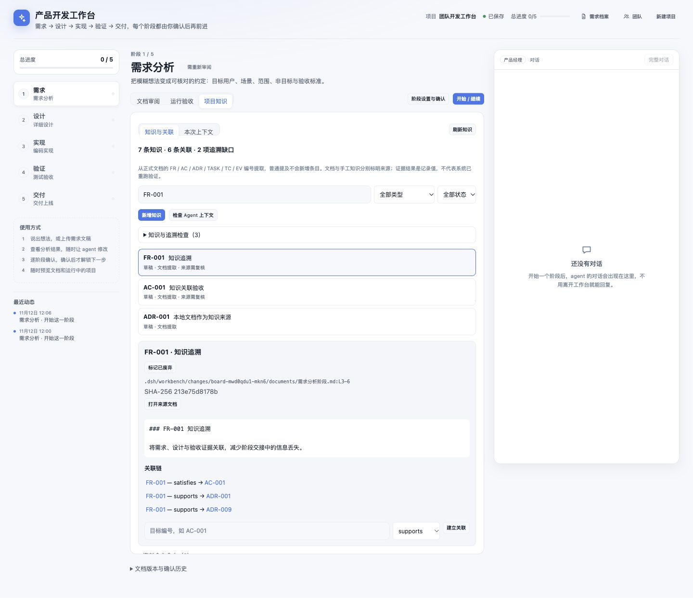

# DSH Workbench · 产品开发工作台

面向 DeepSeek Harness（DSH）的产品开发插件，将需求分析、详细设计、编码实现、测试验收和交付组织在同一个工作台中。

当前开发分支：**personal_manager / v1.18.0**。默认通过项目管家沟通，保留完整文档、版本确认和交付记录；需要时可进入五阶段详细工作区。

第一次使用请看 **[项目管家图文使用手册](dsh-workbench/docs/manager-user-guide.md)**，也可下载并在浏览器打开 **[离线图文版 HTML](dsh-workbench/docs/manager-user-guide.html)**。后续简洁模式见 [实现方案](dsh-workbench/docs/manager-simple-mode-plan.md)（三个批次已完成；真人试用待安排）。技术维护见 [管家实现说明](dsh-workbench/docs/personal-manager.md)。后续修改管家模式必须同步更新主使用手册，规则见 [AGENTS.md](AGENTS.md)。



## 仓库结构

- `dsh-workbench/`：工作台前端、Host 接口、知识与文档管理、测试。
- `spec-analyst-preset/`：需求分析师角色配置。
- `stage-presets/`：设计、开发、测试和交付角色配置。

## 安装

需要可正常运行的 DSH 环境和模型配置。当前本地使用的 DSH 版本为 `0.2.1-rc.2`；DSH 仍在迭代，升级前请验证插件兼容性。

克隆仓库后，使用每个插件目录的绝对路径安装：

```sh
dsh plugin --profile web add link:/absolute/path/to/dsh-workbench/dsh-workbench
dsh plugin --profile web add link:/absolute/path/to/dsh-workbench/spec-analyst-preset
dsh plugin --profile web add link:/absolute/path/to/dsh-workbench/stage-presets
```

检查 Web profile 已启用三个 bundle；保留现有 DSH bundle 配置。重启 `dsh web` 并刷新浏览器。

完整功能与安装说明见 [工作台 README](dsh-workbench/README.md)，知识管理说明见 [使用文档](dsh-workbench/docs/knowledge.md)。

## 阿里云服务器部署

当前提供“一个个人实例 → 每位受邀可信用户一个独立实例”的 Docker 部署方式，完整步骤见 **[ECS 部署指南](deploy/README.md)**。推荐使用专用子域名和 HTTPS，Nginx 转发到服务器本机端口，保留原生 DSH 认证。它不是共享实例的多租户服务，也尚未提供自助注册或计费。

本次准备对应 2 核 2GB、Ubuntu 22.04 的上海 ECS，先部署一个实例。大陆服务器需核对 ICP 备案；域名实名认证、备案、DNS、证书和公网验收分别完成，不能仅因购买域名就认为已经上线。完整准备流程：

1. 只读检查服务器架构、内存、磁盘、端口和已有网站，确认 Docker / Compose。
2. 本机构建匹配架构的镜像和源码归档，上传后导入服务器。
3. 启动只监听本机端口的独立实例，验证认证、管家、模型小任务、审阅、下载和重启恢复。
4. 核对备案与证书，配置专属 DNS / Nginx；确认所需安全组规则后验收 HTTPS 和 WebSocket，再邀请用户。

本地仓库根目录准备示例：

```sh
python3 deploy/release.py --output /tmp/dsh-workbench-1.18.0-source.tar.gz
tar -tzf /tmp/dsh-workbench-1.18.0-source.tar.gz
docker build --platform linux/amd64 -f deploy/Dockerfile -t dsh-workbench:1.18.0-ad9c578 .
docker save dsh-workbench:1.18.0-ad9c578 | gzip > /tmp/dsh-workbench-1.18.0-image.tar.gz
```

上传与运行命令、证书路径、单用户开通、备份、升级回滚和故障处理见部署指南。服务器若为 ARM，应改用 `linux/arm64`。归档不包含模型密钥、个人会话或业务数据；不要复制本地整个 `.dsh` 上云。镜像自带中文字体，复杂 Word 转 PDF 仍需按需配置 LibreOffice。

部署文件检查：

```sh
python3 -B -m unittest discover -s deploy -p 'test_*.py'
sh -n deploy/entrypoint.sh
node --check deploy/healthcheck.mjs
```

已在真实 ECS 完成一个 `owner` 实例的私有部署验证：认证、管家接口、中文 PDF、可编辑 PPTX 和重启持久化通过。当前通过本机 SSH 隧道访问，尚未开放公网；模型配置及真实模型任务待验证。实际状态与验收边界见 [部署验证记录](deploy/preparation-status.md)。

## 验证

修改使用手册后，在 `dsh-workbench` 中运行 `npm run docs:guide`，重新生成离线图文版。

```sh
cd dsh-workbench
npm run check
npm test
```

当前包含 166 项自动化测试。界面截图来自开发验证；测试不等于所有模型、部署方式及多人场景均已验证。

## 数据与使用范围

项目文档、确认记录和上下文清单存储在项目的 `.dsh/workbench/` 中；DSH 自身配置、会话和凭据由 DSH 管理。运行数据、密钥及本地备份不应提交到仓库。

当前面向个人或可信环境使用，尚未实现面向公共服务的多租户权限与强执行隔离。部署脚本提供每人独立容器及持久卷，不能替代陌生用户任意代码的强沙箱。Agent 可以读写工作文件并执行命令，请使用合适的权限和独立工作环境。

若开始任务时提示后端接口未就绪，需重启 DSH Host；仅刷新前端不能加载新增的 Host 路由。

阶段进度、下一步入口、任务队列与插件保护原则见 [阶段引导说明](dsh-workbench/docs/stage-guidance.md)。
