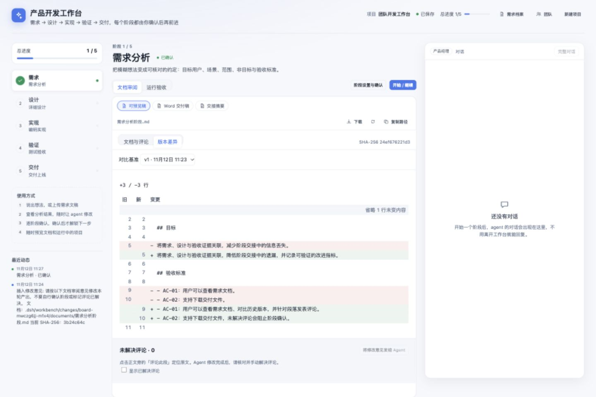
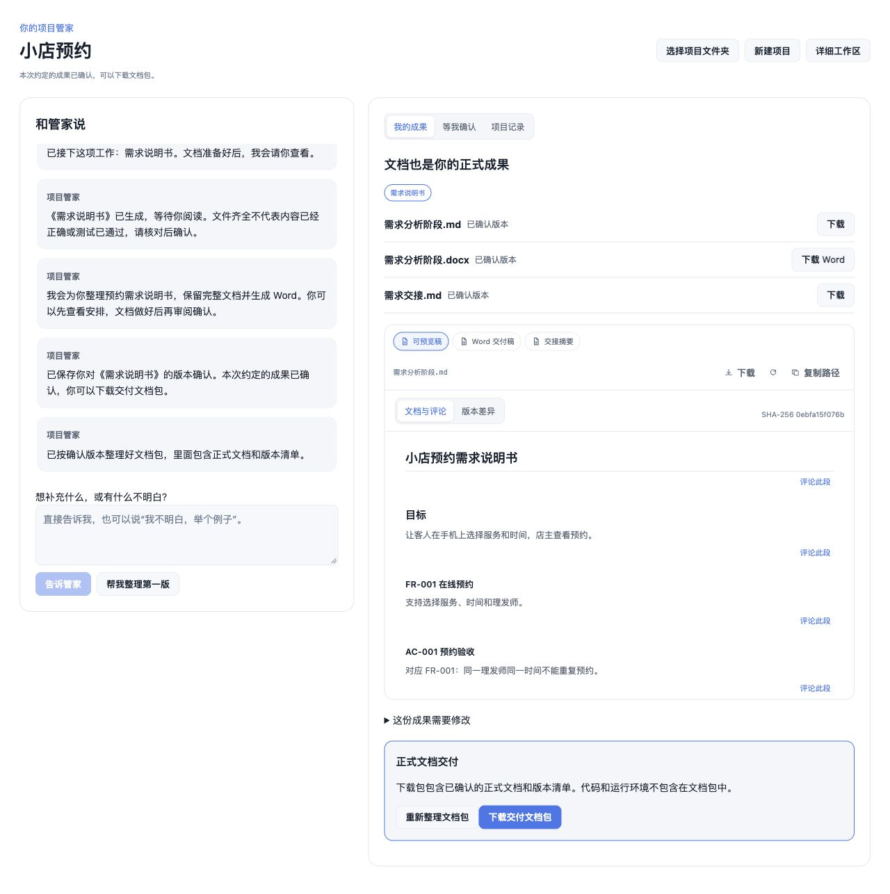
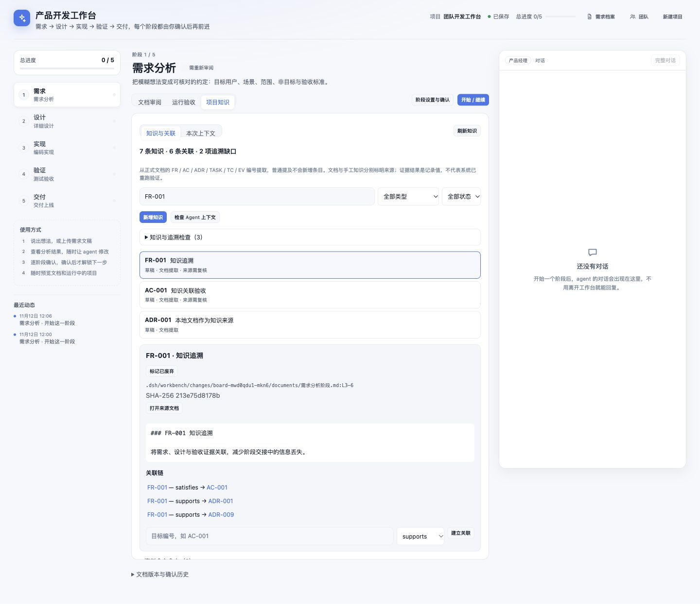
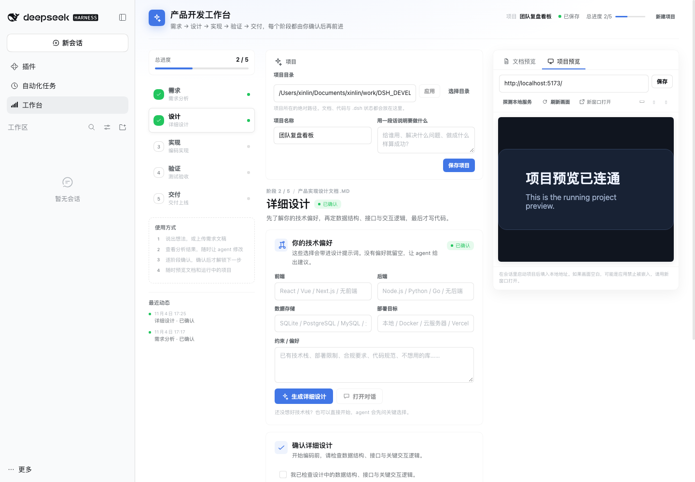

# 产品开发工作台（dsh-workbench）

一个面向 DSH Web 的五阶段产品开发插件：**需求分析 → 详细设计 → 编码实现 → 测试验收 → 交付上线**。

它不是一个“全自动写代码”的黑盒。工作台负责把每个阶段的目标、上下文、产出与人工确认点组织好，把经过结构化的工作指令注入对应阶段独立的 DSH 会话；真正执行分析与编码的是 DSH agent，每个阶段的放行权始终在人手里。



## 1.7.0：项目管家入口

默认通过一个管家沟通，选择“整理需求文档 / 形成实施方案 / 制作可用工具”。Host 持久化调度专业角色；文档可审阅、确认、单独下载并打包交付。原界面保留在“详细工作区”。升级后需重启 Host 并刷新页面。

[管家使用与实现说明](docs/personal-manager.md)。真实模型端到端行为尚未验证；页面验证使用隔离模拟执行器。



## 它解决什么问题

- **阶段不会混在一起**：每个阶段有独立的输入、产出、准出条件和人工确认。
- **编码前逐条确认**：关键数据结构、接口契约、交互分支在设计阶段定成确认点，编码时 agent 必须先问过你才动手，不是事后勾 checkbox。
- **技术方案不用懂技术**：设计阶段给出 4 个现成方案（含优缺点、代价、适合谁），选完就带进提示词；懂行的人仍可切到自定义技术偏好。
- **对话就在工作台里**：右侧「对话」页签内嵌 DSH 原生会话（输入框、流式回复、提问卡片、工具授权都在原地），发送阶段指令不再跳转到对话面板。
- **栏宽随你**：阶段栏、内容栏、右侧栏之间的两条分隔线可拖动，宽度会记住，文档/对话/预览哪里需要更多空间就调哪里。
- **需求可以随时补**：需求阶段支持粘贴、上传 `.md/.txt/.docx`，也支持让 agent 先访谈；中途的需求变更会明确影响面，并使后续确认失效。
- **产出物有固定位置**：需求 Word、设计、启动/部署文档、测试案例/结果、交付清单都写在本轮独立的文档目录；主区「文档」会自动列出当前阶段的产出与项目根目录里的其他文档。
- **文档预览与下载**：Markdown/文本直接排版预览，DOCX 抽取文本预览，PDF 用浏览器原生阅读器渲染；任何文档都能一键下载。agent 一轮结束或文件落盘后列表自动刷新。
- **实现效果可预览**：填入本地开发地址即可在右侧内嵌预览，支持桌面/平板/手机宽度、刷新和本地服务探测。
- **确认才前进**：下一阶段默认锁定，上一阶段的产出确认后才解锁；重新开始或中途改需求会使下游确认失效。
- **部署有硬门槛**：必须选择服务器、填写目标信息并勾选授权才会发送部署指令；工作台不保存密码或密钥。

## 五个阶段

| 阶段 | 工作台做什么 | 产出 | 人工确认 |
| --- | --- | --- | --- |
| 1. 需求分析 | 需求分析师 agent：分析文稿、追问模糊点、整理目标/范围/非目标/验收标准 | `需求分析阶段.docx` + `需求分析阶段.md` + `需求交接.md` | 阅读需求文档并勾选确认 |
| 2. 详细设计 | 先选技术方案（附优缺点，可换自定义），再设计数据结构、接口、状态与交互逻辑 | `产品实现设计文档.md` | 检查数据结构与交互逻辑 |
| 3. 编码实现 | 按可运行增量实现；设计阶段约定的确认点逐条对话确认后才写代码；同步维护文档 | 项目代码 + `启动文档.md` + `部署文档.md` | 对话中逐条同意 + 通用检查清单勾选 |
| 4. 测试验收 | 按验收标准写测试案例、本地执行、记录真实结果 | `测试案例.md` + `测试结果.md` | 核对通过/失败与已知限制 |
| 5. 交付上线 | 生成交付清单；按用户授权决定是否线上部署 | `交付清单.md`（+ 部署记录） | 确认部署完成或明确不部署 |

### 团队：五个角色，各有队列

顶栏「团队」把五个阶段具象成五位同事，每人有头像、职责说明、当前任务和**自己的队列**：

| 角色 | 阶段 | 职责 |
| --- | --- | --- |
| 产品经理 | 需求分析 | 访谈、定范围、写可验收的需求 |
| 设计人员 | 详细设计 | 结构、接口、交互分支与兼容性 |
| 开发人员 | 编码实现 | 按设计与确认点写代码，保持可运行 |
| 测试人员 | 测试验收 | 案例、真实执行、回归 |
| 运维人员 | 交付上线 | 交付清单、文档核对、上线与回滚 |

- **排期（FIFO）**：每位角色的队列 = 本项目里还没走完「他这个阶段」的看板，按轮次先后排序（`round` 升序）。卡片上显示「正在处理 / 待开始 / 空闲」、队列深度与「等待前序阶段」的数量。
- **对话入口**：卡片上的「对话」切到该角色当前任务的看板、聚焦对应阶段，并把输入框切到那场会话；「开始任务」还会发送该阶段的启动提示词；「查看看板」只切换、不强制打开对话。
- **完成后自动接续**：勾选「完成后自动接续队列中的下一项」（默认开），某个阶段确认后，同一位角色会自动激活队列里的下一块看板并开始对应阶段；没有再停下。
- **通用知识**：每份阶段提示词带 `【你的角色】`，写明角色与通用专业能力（如测试的等价类/边界值、运维的发布与回滚），并说明「可以提出更好的做法，但产出以文档与确认为准」。
- 有排队任务时提示词额外带 `【你的排期】按先来后到…做完当前这一项就停下来，我会把队列里的下一项交给你`，避免 agent 提前处理别的需求。
- 角色切换不影响原有执行逻辑：看板、阶段、准出条件、交接文档、确认点全部沿用。

### 多看板：每轮需求一块看板

一个项目不再只有一块看板，而是**每轮需求一块**：

```text
<项目>/.dsh/workbench/
├── boards.json            # 看板名册：activeId + [{id, name, round, stage, confirmed, updatedAt}]
└── boards/
    ├── board-1.json       # 第 1 轮
    └── board-xxx.json     # 第 2 轮
```

- **迁移**：第一次读状态时，旧的 `.dsh/workbench/boards/<boardId>.json` 会复制成 `board-1`，旧文件保留不动。
- **新一轮**：「开始新一轮增量」不再覆盖当前看板，而是**新建一块**（`flow=incremental`、`round+1`、复用项目名与目标、阶段与会话从零开始），上一轮原样保留。
- **切换**：需求档案里每条记录对应一块看板（标题 + `第 N 轮` 徽标）；「打开」会先激活那块看板再切到对应项目目录，所以能回到任意一轮的进度、文档与会话。
- **移除记录**：只删档案行（可按 `root + 看板 id` 精确删除），看板文件仍在项目里。
- 路由：`GET /workbench/boards` 列名册；`POST /workbench/boards` 支持 `{action:'activate'|'create', id?, name?}`（`root` 可放在 body 里，便于跨项目激活）。

### 增量模式：已有产品只加一部分需求

项目信息里有一个模式开关：**从零开始 / 已有产品，做增量**。增量模式不新增阶段，而是换一套口径：

- **现状基线**：需求阶段先读 `package.json` / `README` / `src` / 现有测试，产出 `现状基线.md`（技术栈与版本、启动命令、模块地图、现有测试与覆盖、已知约束）。没有基线不能确认需求（仅增量模式校验，老项目不受影响）。
- **需求口径**：FR / AC 只写本次新增或变更；单列「不改变的部分（保护项）」；验收标准至少一条是回归项。
- **设计口径**：文档必须含「变更影响分析」——受影响模块与文件、接口兼容性、数据迁移、回滚点；复用现有架构，不另起一套。
- **实现口径**：改动边界（只改必需文件、不重构无关代码、不改公开接口既有行为），每步保持可运行，跑现有测试并记录回归。
- **验收口径**：新增 AC + 回归（区分新功能缺陷与既有功能回归）。
- **交付口径**：版本号升级、变更说明（本次增量 vs 既有功能）、变更部署步骤、回滚方案。
- 每个阶段的提示词头部都会带 `【模式】在已有产品上做增量（第 N 轮）`，交接文档照旧传递。

**开始新一轮增量**会新建 `round+1`、`flow=incremental` 的独立看板，并为它创建独立文档目录。原看板、阶段会话、文档与确认快照保留，新一轮的确认从零开始。

需求档案里，增量轮次会显示「第 N 轮增量」标签；`flow` 与 `round` 都存在看板状态里。

### 五个阶段五个 agent

每个阶段都在**自己的会话、自己的 agent preset**里完成，阶段之间只通过交接文档传递状态——没有共享的对话记忆：

| 阶段 | 会话字段 | agent preset | 产出交接给下一阶段 |
| --- | --- | --- | --- |
| 1. 需求分析 | `stageSessions.spec` | `spec-analyst`（需求分析师） | `需求交接.md` |
| 2. 详细设计 | `stageSessions.design` | `design-architect`（设计架构师） | `设计交接.md` |
| 3. 编码实现 | `stageSessions.build` | `implementer`（实现工程师） | `实现交接.md` |
| 4. 测试验收 | `stageSessions.verify` | `verifier`（验收测试员） | `验收交接.md` |
| 5. 交付上线 | `stageSessions.ship` | `release-manager`（交付经理） | —（`交付清单.md` 为终态） |

- 侧栏会话按阶段命名：`需求 · 项目名`、`设计 · 项目名`、`实现 · 项目名`、`验收 · 项目名`、`交付 · 项目名`。
- 右侧「对话」dock 顶部标签显示当前阶段的 agent（需求分析 / 设计 / 实现 / 验收 / 交付），输入框、提问卡片、「完整对话」都绑定当前阶段那个会话。
- **交接**：开始一个阶段时，工作台读取上一阶段的交接文档并内联进提示词（读不到时退化为「请先读上一阶段的正式文档」），并明确告知「上一阶段由另一位 agent 完成，你们不共享对话记忆」。本阶段的提示词末尾要求写出下一份交接文档。
- **兼容旧项目**：只有 `sessionId` / `specSessionId` 的老看板，加载时自动迁移成五个阶段指向原会话（需求阶段指向它自己的、其余指向原交付会话），不会断档。
- preset 缺失时（例如换了一台机器没装 preset 包）创建会话自动回退默认 agent，不阻断阶段。

preset 定义在两个独立 bundle 里：`spec-analyst-preset/`（需求分析师）与 `stage-presets/`（设计/实现/验收/交付四个）。

### 编码前的确认点：在设计阶段定，在对话里过

「关键接口 / 关键数据结构」不再靠编码页的 checkbox 事后勾选，而是**在详细设计阶段约定、在编码阶段逐条对话确认**：

- 设计阶段多一张卡片「编码前需要你确认的关键点」，默认勾选 5 条，可增删：
  1. 核心数据结构：字段、约束与索引
  2. 关键接口：入参、出参与错误码
  3. 关键交互流程：正常路径 + 空态/加载/错误
  4. 权限与角色判断的位置
  5. 数据迁移与向后兼容（如涉及）
- 这些点会写进两份提示词：
  - **设计提示词**：要求在《产品实现设计文档.md》里把每条写到「可以直接实现」的粒度；
  - **编码提示词**：清单原样带过去，并规定行为——一次只提交一个点，先说清楚打算怎么写，然后**停下来等明确同意**；没同意不写这批代码，要求修改就重新确认；不能把「确认」当通知。
- 编码页保留原来的**通用检查清单**（可增删、勾选后才能确认阶段），另外只读展示「设计阶段约定的确认点」，附「去详细设计调整」。
- 没勾任何确认点时，编码阶段不逐条停问，按正常节奏推进。

### 详细设计：先选技术方案，再谈实现

设计阶段默认给**不懂技术的用户**准备了四个现成方案，每个都摊开「技术栈 / 优点 / 代价 / 适合谁 / 上手难度 / 成本」：

| 方案 | 一句话 | 适合 |
| --- | --- | --- |
| 纯前端本地版 | 网页应用，数据存在浏览器里，不需要服务器 | 个人或 1–3 人，先验证想法 |
| 轻量后端单机版 | 一台机器跑服务，SQLite 存数据，局域网多人共用 | 5–30 人团队，内网共享 |
| 云端多用户版 | 部署到公网，账号与权限齐全 | 跨地域团队、对外服务 |
| 不确定，让 agent 推荐 | 先让 agent 用非技术语言对比 2–3 个候选再定 | 第一次做产品、需求还在变 |

- 选择某个方案后，前端 / 后端 / 数据 / 部署四个字段会被自动填好，并把「方案技术栈 + 已知代价 + 适合场景」整段写进设计提示词。
- 选「让 agent 推荐」时，这一轮**只做选型**：agent 必须先给出候选与取舍、等你点头，不写设计文档、不写代码。
- 提示词要求 agent 在设计文档开头写「技术方案与取舍」，用非技术语言说明为什么这样选、代价是什么、以后怎么升级；如果需求与所选方案明显冲突，必须先停下来说明，不能静默换栈。
- 「我是技术同学，自己填」保留原来的自定义技术偏好：切过去时会把当前方案的字段预填进去，改完照样带进提示词（这时提示词按技术读者口吻描述）。

### 需求阶段的两种入口

- **有需求文稿**：直接粘贴，或上传 `.md`、`.txt`、`.docx`。DOCX 会在 Host 侧抽取文本并带进分析提示词。
- **没有文稿**：留空点击「先访谈我」，agent 会先问目标用户、场景、核心问题、范围和非目标，信息足够后才写文档。

### 需求文档的 Word 交付

工作台要求 agent 同时产出 Markdown 预览稿；确认需求时，若 `需求分析阶段.docx` 不存在，Host 会把 `需求分析阶段.md` 转成真正的 Word 文档（标题、列表、代码块、段落），因此 Word 交付不依赖本机安装 Office。


## 1.6：项目知识与可检查的上下文（第三批优化）

主区新增「项目知识」，包括 **知识与关联 / 本次上下文** 两个视图。

- 从正式文档提取 FR/NFR、AC、ADR、TASK、TC、EV 编号，展示来源位置、哈希、确认状态和关联链；同时支持手工补充、编辑与废弃。
- 按编号、标题、正文与资料全文搜索，并筛选类型和状态；显示缺少验收、缺少证据、未确认决策和引用冲突等检查项。
- 每个阶段可选择或排除资料、设置字符预算，检查全文、节选和未注入内容。来源变化后不会沿用过期确认；已变化的参考资料需重新核对选用。
- 所有工作台阶段任务入口在发送前构建不可变清单，记录来源版本、知识关联和实际附加正文；可回看上次记录。构建失败会阻止发送。
- 阶段提示词加入稳定编号规范；废弃条目不会通过整篇文档重新进入自动上下文。普通聊天输入不经过此封装。

本批不改写已有文档，也不执行证据中的命令。知识按轮次隔离，跨轮次/跨项目经验归并留待后续。使用前重启 Host 并刷新页面，加载新增的知识和上下文路由。

53 项测试通过，并完成隔离浏览器交互验证；未连接模型。[使用说明、编号示例和接口](docs/knowledge.md)。



## 1.5：文档主工作区与差异审阅（第二批优化）

- 中间主区展示文档或运行效果，右侧始终保留当前阶段的原生对话。项目设置、技术方案、阶段启动/确认、部署授权和通用修改框集中到「阶段设置与确认」抽屉。
- Markdown 正式文档及交接摘要可切换「文档与评论 / 版本差异」。差异默认比较本轮最近确认快照，也能选择更早的确认版本，展示新增/删除行、行号与变化统计。
- 首次审阅无确认快照时全文按新增展示；换行字节变化会明确提示。较大差异使用整段替换并显示说明；超过 2500 行时显示截断提示，不假装已展示全文。
- 点击「评论此段」绑定确切行号、原文和 SHA-256，再保存修改意见。评论保存在本轮 `reviews.json`；未提交草稿按项目、看板、文档保存在当前浏览器，切换文档后可恢复。
- 文档更新时，已有评论标记为旧版本引用；旧草稿禁止直接提交，保留内容并要求重新选择当前段落。
- 「将修改意见发给 Agent」将未解决评论、文档路径、原文及版本交给当前阶段会话。超出首批 20 条的评论引导 Agent 读取完整评论文件；Agent 处理后由用户核对并手动标记已解决，也可重新打开。
- 未解决评论会阻止确认。对已确认阶段新增/重新打开评论，会使本阶段和后续确认失效；解决评论不会自动恢复确认，需要重新审阅。
- DOCX/PDF 继续支持原有预览与下载，本批仅对 Markdown 正式产出开放差异与段落评论。根目录参考资料及其他阶段的文档保持只读预览。
- 第二批不变更既有文档位置，也不修改应用源码。重新启动 Host 后刷新工作台，加载新增的 `/workbench/review` 路由。

验证包含 35 项自动化测试，以及隔离浏览器中的桌面/窄屏布局、版本选择、段落评论、草稿恢复、修改意见发送、确认拦截与解决后进入下一阶段。隔离验证使用真实前端组件和 Host 路由，未连接模型，也未操作正在运行的用户项目。

## 1.4：按轮次保存文档与确认版本（第一批优化）

每轮需求的阶段文档与交接摘要保存在独立目录。应用代码、README 等仍保留原位置。

```text
.dsh/workbench/
├── boards.json
├── boards/<boardId>.json
└── changes/<boardId>/
    ├── documents/          # 本轮正文与交接摘要
    ├── snapshots/<sha256>  # 确认时的原始字节；插件不会覆盖
    ├── approvals/<id>.json # 历次确认回执，包含文档版本、哈希、快照路径
    └── artifacts.json     # 产出物版本与各阶段最近一次确认
```

- 页面新增「本轮文档与确认版本」：展示本轮目录、当前哈希、需复核状态、确认历史；历史文件可下载。
- 确认必须通过 Host 版本校验；普通保存状态不能创建确认。提交的哈希与当前字节不符时拒绝确认。
- 确认需要正式文档及交接摘要；需求阶段需要 Markdown、Word、需求交接，增量模式还需要现状基线。
- 首次缺少 Word 时自动生成并提示重新核对，再次确认才会绑定新文件版本。
- 文档变更或删除会使本阶段及后续确认失效，保留原快照。恢复原字节也不会自动恢复确认。
- 页面每 5 秒复核版本；状态读取、文档访问、确认请求也会复核，因此下次访问即可发现离线期间修改。
- 请求附带 `x-workbench-board`，避免另一标签页切换活动看板后写错轮次；`stateRevision` 冲突返回 409，保留本地草稿并显示保存错误，不静默覆盖。发生冲突时先保留本地输入，再刷新并重新应用修改。
- 新建看板或切换前先完成待保存内容。重新开始也新建看板，保留原历史。
- 升级后首次访问自动迁移：旧活动轮次根目录文档复制为待核对资料，原文件不动；旧确认保留为 `legacyConfirmation`，需要重新审阅。其他历史轮次没有可信文档版本时不复制当前根目录内容，页面说明需补充。迁移幂等。
- 已有运行中的 Agent 不会自动获得新的路径规则。升级后请重启 Host、刷新页面，再通过工作台「开始/继续」发送带本轮路径的上下文。两个 preset bundle 的目录约定也已同步。
- 本批确认绑定文档版本，尚未对 Git 提交或工作区代码创建快照；基线知识归并、段落评论和差异审阅属于后续批次。

验证：

```sh
npm run check
npm test
```

测试使用临时目录和独立 `DSH_HOME`，覆盖轮次隔离、快照与历史下载、变更失效、缺失交接、旧数据迁移、跨标签页写入及版本冲突。

## 安装

插件目录本身就是一个 DSH bundle。开发时把目录链接进 profile：

```bash
dsh plugin --profile web add link:/absolute/path/to/dsh-workbench
```

并在 `~/.dsh/profiles/web/package.json` 的 `dsh.profile.bundles` 中加入：

```json
{
  "dsh": {
    "profile": {
      "bundles": [
        "@deepseek-ai/dsh-base",
        "@deepseek-ai/dsh-web-app",
        "dsh-workbench"
      ]
    }
  }
}
```

重启 `dsh web` 后，左侧栏出现「工作台」图标。

> Host 新增了 `/workbench/file`、`/workbench/upload`、`/workbench/docx`、`/workbench/probe` 等路由。修改 `index.js` 后需要重启 Host；只修改 `client.js` 时刷新浏览器即可。

## 使用流程

1. 打开左侧「工作台」，确认「项目目录」（可选最近会话目录，也可用系统目录选择器或手动输入绝对路径），再填写项目名称与一句话目标。
2. 在需求阶段输入需求或上传文稿，点击「分析需求」/「先访谈我」。工作台会创建（或复用）一个项目级会话，并把阶段上下文注入；页面不会跳走，右侧「对话」页签会自动打开。
3. 直接在「对话」里回答 agent 的提问、处理工具授权，回复和文档会同步刷新；需要完整轨迹时可点「完整对话」打开原生对话面板。
4. 阅读文档，必要时在「插入修改意见」里补充；勾选确认后自动解锁下一阶段。
5. 设计阶段填写技术偏好并生成设计；实现阶段按检查点逐项确认；测试阶段先生成报告，再请求修复方案；交付阶段生成清单并按需部署。
6. 任何时候都可以在右侧「项目预览」填入本地地址查看运行效果。



## 三栏布局与宽度调整

工作台是「左侧阶段栏 / 中间文档或运行效果 / 右侧对话」三栏布局，两条分隔线都可以拖动：

| 位置 | 拖动范围 | 复位 |
| --- | --- | --- |
| 阶段栏与内容之间 | 168–360 px（并给内容+右栏留出 560 px） | 双击，或聚焦后按 `Home` |
| 内容与右侧栏之间 | 300–640 px（并给内容留出 520 px） | 双击，或聚焦后按 `Home` |

- 宽度写在页面根节点的 `--dshwb-rail-width` / `--dshwb-dock-width` 上，拖动过程中直接改 CSS 变量，不触发 React 重渲染；松手才提交状态。
- 宽度存在浏览器 `localStorage` 的 `dsh-workbench:columns`，刷新与重新打开面板都会沿用；首次加载会按当前窗口宽度收敛到合法范围。
- 分隔条是 `role="separator"`、可聚焦的窗口分割器，`←/→` 每次移动 16 px。
- 宽屏下生效；`≤1099px` 对话栏落到内容下方，`≤980px` 左栏收成顶部横条，对应的分隔条会自动隐藏。

## 工作台内的对话

中间主工作区切换 **文档审阅 / 运行验收**，右侧固定为当前阶段的原生对话。点击「阶段设置与确认」打开项目配置和阶段操作抽屉。

「对话」页签用与右侧子代理侧栏相同的方式内嵌了 DSH 的 `conversation.content`：工作台持有一个会话引用，`SessionProvider` 把它绑定到会话作用域的 `workbench.chat` 子槽，再用 `variant: "embedded"` 渲染原生会话内容。因此输入框、流式输出、提问卡片（`ask_user_question`）、工具授权和停止按钮都与原生对话一致，但不会离开工作台。

- 阶段操作和评论修改意见发送后，保留当前文档或运行预览，不再切走主工作区。
- 「完整对话」按钮仍会把同一个会话在原生对话面板中打开，便于查看轨迹或历史。
- 会话引用只在工作台页面挂载期间持有，离开页面即释放。

## 交付阶段：不部署也要出清单

「交付清单」是关闭交付阶段的唯一依据（`REQUIRED_DOCS.ship = ['交付清单.md']`），所以**选择不部署也必须产出**，否则流程会卡在「完成交付」按钮上：

- 选「无需线上部署」时，上方按钮变成「生成交付清单（不部署）」，提示词会带上明确决定：*本次不做线上部署，清单的「部署步骤」一节写成「本次不部署」的结论 + 本地启动方式 + 日后可选的上线路径*。
- 选「部署到服务器」时，提示词带上目标主机/用户/路径与方式，并要求只写步骤、不执行部署。
- 「完成交付」卡片里常驻一行提示：需要 `交付清单.md`，没有就点上方按钮让 agent 补。
- 兜底：如果交付阶段还**没开始过**（没有 `startedAt`）就点了「确认并继续」，工作台不会直接报错卡住，而是先替你发一次生成提示词，并提示「已让 agent 开始补，生成后再回来确认」。

## 需求档案（关闭页面也不丢）

工作台每次保存项目状态时，Host 会同时往 **Harness 家目录**写一份需求档案：

```text
$DSH_HOME/workbench/requirements.json
```

每条记录对应**一块看板**（项目 + 看板 id），包含：项目路径、看板 id 与名称、轮次、当前阶段、已确认阶段数、会话 id、需求原文摘要、最后更新时间。它独立于项目目录，所以关掉页面、关掉会话、甚至清掉浏览器本地存储，都还能从档案里找回来。

- 顶栏「需求档案」按钮打开档案面板：每行显示状态（草稿 / 进行中 · 阶段 X / 已交付）、阶段进度、目标、路径与更新时间。
- **打开**：把工作台切换到该项目的状态文件（进度、会话、文档全部回来）。
- **打开会话**：直接跳到该项目绑定的 DSH 会话（会话已被删除时按钮不可用）。
- **移除记录**：只删档案里的一行，项目文件与 `.dsh/workbench/boards/<boardId>.json` 都不动。
- 项目目录已不存在时标「目录不存在」，打开按钮不可用，避免切到空目录。
- 浏览器没有记住项目目录时，打开工作台会自动恢复到**最近一条目录仍存在的需求**；没有档案时才退回到「最近会话目录」。

## 文件与接口

### 工作台状态

工作台通过 `x-workbench-root` 请求头指定项目根目录；浏览器会把最近选择的目录记在本地存储。状态保存在该项目的：

```text
.dsh/workbench/boards.json
.dsh/workbench/boards/<boardId>.json
```

包含项目信息、当前阶段、会话 id、各阶段确认、构建检查点、部署配置和最近动态。部署密码、SSH 私钥、Token **不会**写入这个文件。

### 文档路径

```text
现状基线.md        # 仅增量模式
需求分析阶段.docx
需求分析阶段.md
需求交接.md
产品实现设计文档.md
设计交接.md
启动文档.md
部署文档.md
实现交接.md
测试案例.md
测试结果.md
验收交接.md
交付清单.md
```

以上阶段文件名解析到 `.dsh/workbench/changes/<boardId>/documents/`，不会回退根目录同名文件。根目录的其他参考文档仍可预览；路径穿越会被拒绝。

### Host 路由

| 路由 | 用途 |
| --- | --- |
| `GET/PUT /workbench/state` | 读取/保存项目级状态，大小上限 256 KB；项目目录由 `x-workbench-root` 请求头指定 |
| `GET /workbench/library` | 列出本轮阶段文档与根目录其他参考文档 |
| `GET /workbench/artifacts` | 当前内容哈希、确认版本、历史回执，并复核文档变化 |
| `POST /workbench/artifacts` | 按审阅哈希确认阶段，保存快照和回执 |
| `GET /workbench/review?path=<文件名>&approval=<可选确认ID>` | 读取当前正文、所选确认版本差异与评论 |
| `POST /workbench/review` | 添加评论、标记解决或重新打开，校验正文哈希及评论版本 |
| `GET/POST /workbench/knowledge` | 搜索知识、管理手工条目/关联、参考资料与阶段选择 |
| `GET/POST /workbench/context` | 预览、构建和回看有版本记录的阶段上下文 |
| `GET/DELETE /workbench/requirements` | 需求档案：`GET` 返回所有项目记录（带目录是否存在标记），`DELETE ?root=…` 只移除档案行 |
| `GET /workbench/file?path=…` | 文本、Markdown、代码、DOCX 预览，大小上限 2 MB；`soft=1` 时缺失返回 200 `{missing:true}` |
| `GET /workbench/raw?path=…` | 原始字节：PDF/DOCX/图片按原格式返回，`download=1` 变成下载；大小上限 64 MB |
| `POST /workbench/upload` | 保存 `.md/.txt/.docx` 到 `.dsh/uploads/` 并抽取文本，大小上限 8 MB |
| `POST /workbench/docx` | 将 Markdown 转为 DOCX |
| `POST /workbench/probe` | 探测本机常见开发端口或指定 loopback URL |

路由在 `webServer`/`connection` 的服务作用域里注册：服务重启会重新挂载，且每个请求先过 Connection 的信任与登录校验（未登录返回 401，不匹配的 Host/Origin 返回 403）。

安全边界：

- 所有路径都限制在所选项目根目录内；项目根必须是已存在的绝对目录，工作台不接受相对路径。
- 原始字节只按白名单扩展名返回类型，其余按 `application/octet-stream` 下载，并带 `nosniff`。
- 探测只允许 `localhost`、`127.0.0.1`、`0.0.0.0`、`::1`。
- 所有路由沿用 DSH Web 自身的认证 Cookie；没有认证的请求返回 401。
- 不接收、不落盘、不记录服务器密码或 SSH 私钥。

## 开发与验证

```bash
# 语法
node --check index.js
node --check client.js

# Host 文件路由 / DOCX 往返测试（不启动 Web）
node - <<'NODE'
import { __test } from './index.js';
const docx = __test.buildDocx('# 需求分析阶段\n\n- 验收标准', '需求分析阶段');
console.log(__test.readDocxText(docx));
NODE
```

已验证：

- DOCX 生成后能被 macOS `textutil` 与工作台自身的 ZIP/WordprocessingML 读取器正确还原。
- 状态读写、路径穿越拒绝、Markdown 预览、DOCX 转换、DOCX 上传抽取、软缺失、宿主机端口探测。
- 桌面（1440px）与手机（390px）布局；需求确认后阶段解锁；文档预览自动刷新；本地 iframe 预览。
- 浏览器运行时无未捕获异常；缺失文档的 404 已改为软缺失，避免控制台噪音。

## 目录

```text
dsh-workbench/
├── index.js            # Host：状态、文档、上传、DOCX、探测
├── client.js           # Client：五阶段 UI、状态、会话编排、预览
├── cordis.patch.yml    # bundle 插入声明
├── package.json
├── icon.svg
├── locale/
└── docs/
```

## 已知限制

- **阶段独立会话**：每轮每阶段使用独立会话，通过本轮交接文档传递信息；旧版会话绑定按兼容逻辑保留。
- **内嵌对话是同一个会话**：右侧「对话」内嵌的是原生 Conversation，与「完整对话」看到的是同一个会话；离开工作台页签会卸载内嵌视图，但不会中断 agent 任务。
- **DOCX 预览是文本抽取**：不保留字体、分页、图片等版式；PDF 用浏览器原生阅读器渲染，需要下载查看完整版式时点「下载」。
- **iframe 预览可能被目标站拒绝**：应用可能发送 `X-Frame-Options` / `CSP`，此时请用「新窗口打开」。
- **部署不接管凭据**：插件只把主机、用户、路径和授权状态传给 agent；实际 SSH 认证由你的 key/agent 完成，部署前请在会话中复核命令。
- **Host 路由变更需重启**：前端热刷新不会重新注册 Node 侧路由。
- **首次打开需要确认项目目录**：默认取 Host 启动目录或最近会话目录；如果不对，在「项目信息」中改为实际项目路径。
