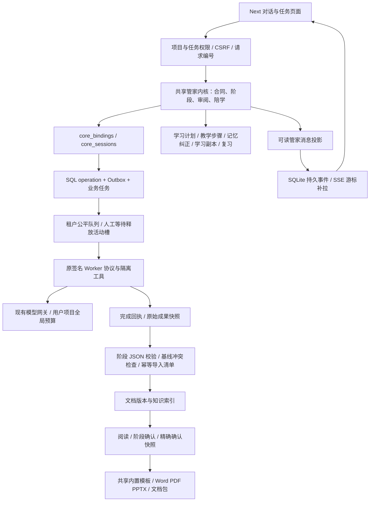

# 业务闭环补齐：本地实现与验收边界

本批是本地后续代码，未推送、未部署；服务器操作继续停止，真实模型调用为0。不能把签名 Worker 的虚构执行器测试当作模型行为或产品代码运行通过。

## 唯一事实来源与恢复

- SQL 的 operation、Worker execution、预算账本是执行事实，core 不自行宣布模型或命令完成。
- 一个业务任务绑定一个阶段板，核心记录保存合同、阶段确认与教学状态。会话记录绑定授权用户与 SQL operation；重复提交不再创建执行。队列与模型准入仍走原通道。
- 阶段最终输出使用限定文件名的 JSON 文稿。读取正式完成回执后才导入；越界文件、缺稿、快照损坏或并发编辑停止导入，保留原始成果及待核对状态。导入清单支持部分文件写入后的重核，不覆盖外部新版本。
- DOCX 使用会话固定时间，重放不会产生不同二进制。导入后重新读取只验证，不重复写版本或发布成果事件。SQL 成果确认投影跟随整阶段确认；禁止用单文档入口改变阶段审批。
- core_message_receipts 将规范消息投影到客户事件，按板/消息去重。原始 Worker JSON 与流式内部稿不作为客户回答或正式成果；诊断记录保留。
- 项目上传资料以带原路径与 SHA 的受限参考文本接入共享上下文；正式知识条目仍从文档提取。accepted 参考资料表示允许引用，不能证明材料中的事实或指令可信。
- 早期 SQL 学习计划承接到共享内核；启用后禁止旧计划/进度写入口继续修改，历史数据保留。共享计划保留最近5个旧目录，切换不调用模型；提醒需重新核对。较早 SQL 版本也有带 revision 的只读历史与恢复保护。
- 项目对话保存带事件 ID / SHA 的较早摘录，检索上传资料及最新文字成果。它是受限词法检索，不是神经语义向量库、完整仓库理解或自动事实核验。

## 客户 API（既有身份、项目归属和 CSRF 不变）

以 `/api/v1/projects/:id/tasks/:tid` 为前缀：

| 方法与路径 | 能力 |
| --- | --- |
| GET / POST workflow | 查看与修改共享阶段/教学流程；revision + requestId |
| GET knowledge | 当前板知识、来源和缺口 |
| GET document-review?name=… | 当前正文、内容哈希与审阅记录 |
| GET learning-sources | 本项目允许选择的学习资料 |
| GET learning-history / POST learning-restore | 早期 SQL 计划历史；升级后恢复走共享 workflow |
| GET delivery-templates / POST delivery-templates | 内置交付用途目录 / 按已确认快照生成 |
| GET workflow/download | 只下载当前记录指向的已核验文档包 |
| GET workflow/download?kind=learning | 下载当前已核验学习资料包 |

单份文字成果的原 download 接口支持 `format=docx|pdf|pptx`。源版本须通过 SHA 校验且不超过200KB。内置模板另存用途化文件名，登记来源审批 ID、文档版本与 SHA；同一请求重放返回原件，更换参数冲突。缺材料保留草稿和缺口，不调用模型补齐。

PDF 使用现有 PDFKit 中文字体路径 / DSH_PDF_FONT；PPTX 复用已有 pptxgenjs，保留原生文字与形状。未承诺上传 Word 版式完全复刻，自定义上传模板仍在插件管理。

## 执行隔离与规模保护

命令容器仍是禁网、非 root、只读根文件系统、受资源约束的项目卷；`.dsh` 再以只读挂载覆盖，符号链接替换失败关闭。控制面负责写元数据。陪学与沟通在模型网关剥离工具，许可入口也拒绝命令；前端不能靠参数恢复执行权。

schema 13 增加 core 绑定/会话/导入、消息去重、学习版本、对话摘录、模板交付和控制器所有权表。保留已有记录，不删除账本、未知预占或旧请求摘要。共享模块新增的端口均可选，原 DSH Host 适配继续兼容。

正式 server 启动时对同一 SQLite 持有一个同主机控制器记录；活动 PID 存在则拒绝第二个写控制进程。进程确已退出可接管；旧持有者无法删除新所有权。PID 复用时宁可拒绝启动，由维护人员核对。它没有跨主机失效检测、共享存储或真正的分布式锁，不能当作多 API 高可用。

SSE 每秒按游标有界补拉数据库事件，并对进程内通知去重；重连仅重放，不重新派发。SQLite 与项目卷仍需一致备份，真实多机扩容仍需共享事务数据库、事件基础设施、对象存储与活跃任务故障验收。

## 本地验证

实际结果见 [补齐验证记录](business-loop-completion-verification.json)。重点是完整五阶段签名 Worker 链、整阶段确认与知识导出、模板快照和请求幂等、重放不增版本、外部编辑拒绝、共享陪学历史切换、跨 SQLite 连接 SSE、控制器栅栏及只读元数据参数。

界面夹具：`node services/product-api/probes/workflow-completion-preview.mjs --fixture`，仅监听127.0.0.1:8167，无模型授权。Next 独立预览需要 MANAGER_API_ORIGIN 指向该地址。截图为明确标记的虚构状态。

尚需单独恢复服务器操作后完成：真实模型阶段 JSON/教学行为与 token 验收、真实 Docker 镜像中的隔离回归、活动任务中断恢复、部署包/字体/备份恢复与持续负载灰度。多机高可用需要后续基础设施迁移，不在本地测试中宣称完成。

最终本地回归：API、Worker、共享契约和共享内核201项中199通过、2项真实Docker条件跳过；原插件203通过；Next客户端5通过，合计407通过、0失败。类型、格式、离线手册、临时目录Webpack生产编译通过。生产编译的符号链接依赖跟踪警告仍需正式打包验收，未当成服务器安装包通过。
