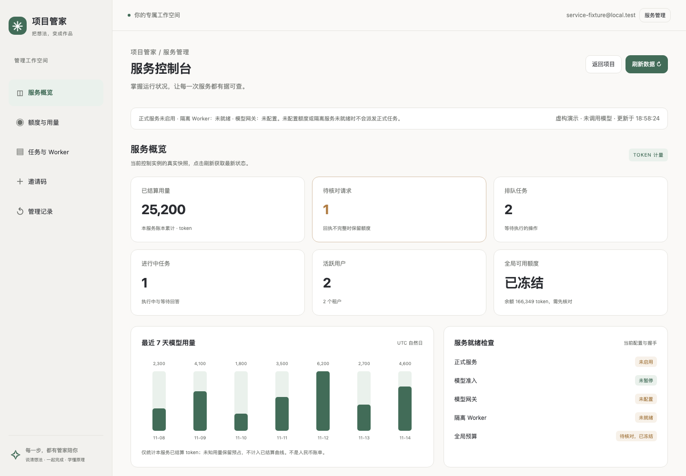
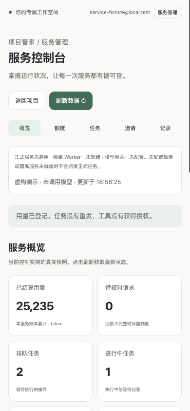
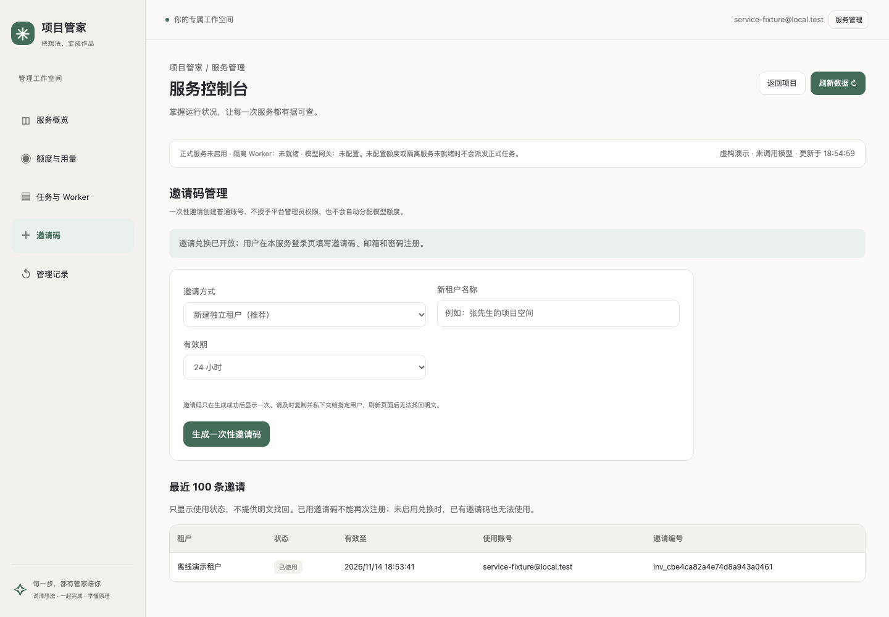
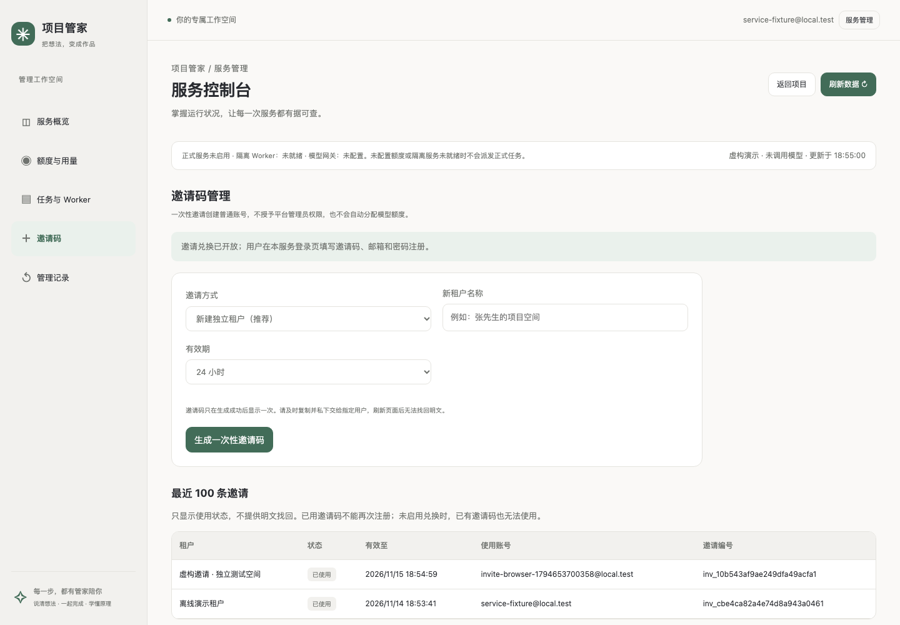
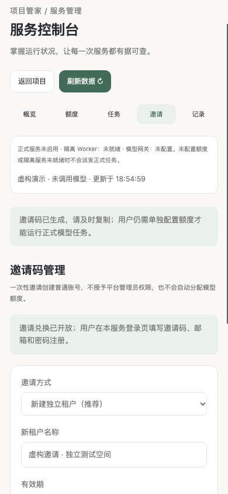
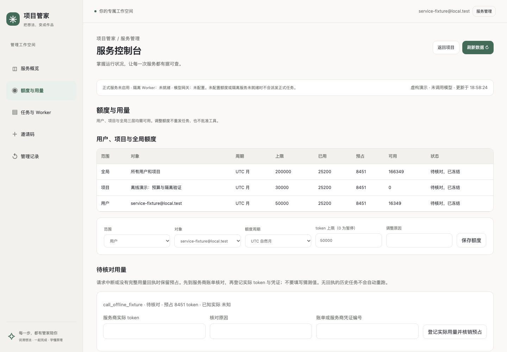
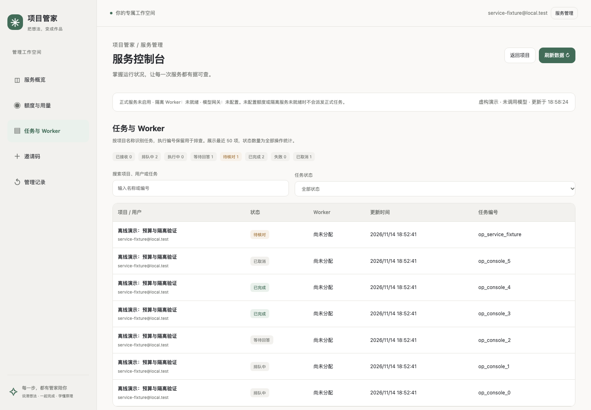
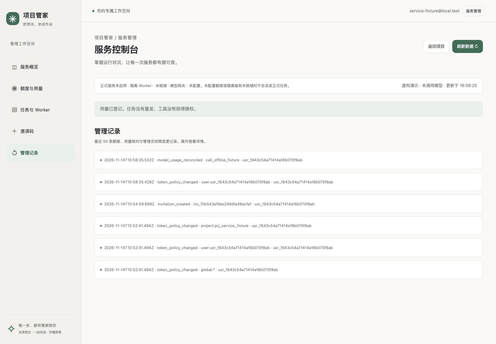
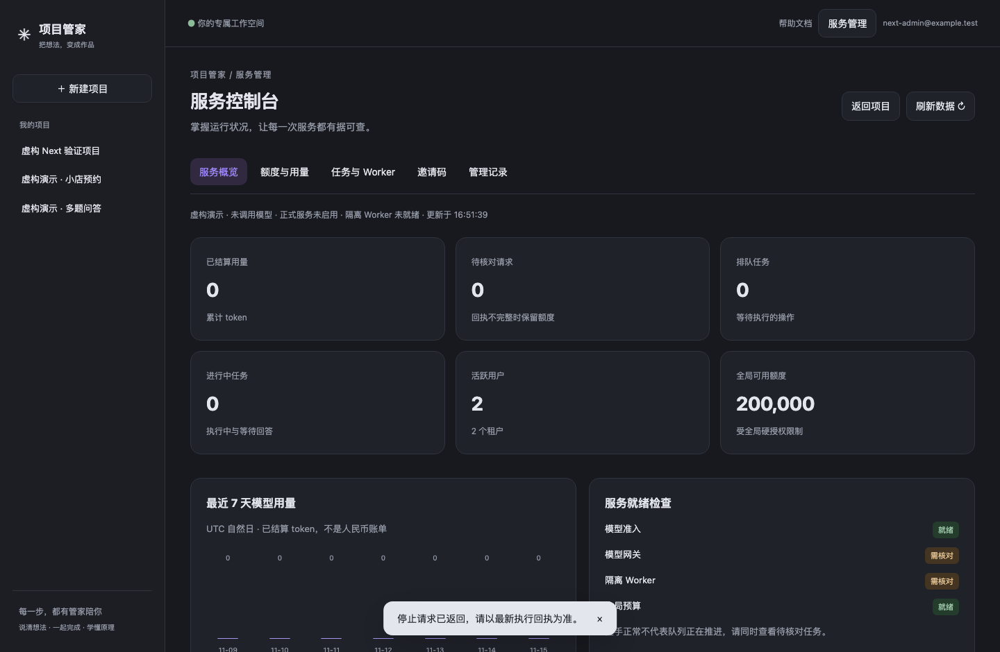
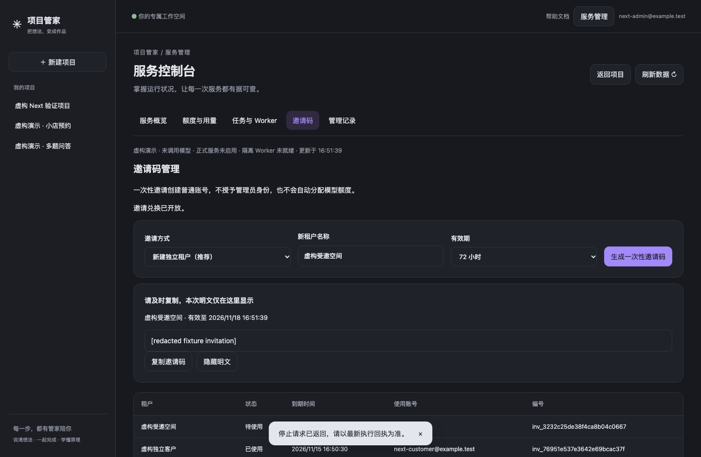

# 项目管家管理员使用手册

适用版本：personal_manager / 1.24.1　｜　最后核对：2026-11-17　｜　面向平台管理员和服务负责人

本手册说明如何使用可视化控制台管理邀请、额度和任务。客户聊天与交付操作见 [客户使用手册](manager-user-guide.md)；安装、权限授予、模型配置和备份部署见 [开发者与运维手册](manager-developer-guide.md)。管理员无需照着开发文档执行日常操作。

**图片来自当前界面的真实浏览器验证，使用虚构租户、账号、用量及任务，不是生产数据，也不表示模型实际运行或公网服务已开放。** 当前服务器是否开放以 [服务器验收记录](../../deploy/service/acceptance-status.md) 为准。本手册不会把本机演示入口当作正式服务地址。

## 1. 登录与找到控制台

1. 打开运维提供的管理地址，用已授予平台管理员权限的账号登录。
2. 点击右上角 **服务管理**，进入 **服务控制台**。
3. 电脑在左侧选择分区；手机在标题下方选择 **概览 / 额度 / 任务 / 邀请 / 记录**。
4. 点 **返回项目** 回到普通项目界面，不改变账号权限。

| 分区 | 可以做什么 |
| --- | --- |
| 服务概览 | 查看用量、排队、冻结提醒和服务就绪情况 |
| 额度与用量 | 设置用户、项目、全局额度，依据真实回执核对用量 |
| 任务与 Worker | 按名称与状态找任务，查看 Worker 状态、核对原执行回执 |
| 邀请码 | 为独立或已有租户生成一次性邀请码，查看使用状态 |
| 管理记录 | 查看最近的额度、核对、邀请及权限变更审计 |

看不到“服务管理”时，联系运维核对**平台管理员**身份。租户负责人不等于平台管理员，注册邀请码也不会授予该权限。当前控制台不能自行给账号添加管理员权限。

## 2. 每天先看服务概览

先点 **刷新数据 ↻**，确认右侧更新时间，再查看以下内容。页面展示的是快照，不自动刷新；填写中的内容未保存前，不要随意刷新。

| 指标 | 含义与处理方式 |
| --- | --- |
| 已结算用量 | 本服务账本已确认的累计 token，包含输入和输出；不是人民币费用 |
| 待核对请求 | 缺少完整用量回执等情况，需要核实后登记，不能直接清零 |
| 排队任务 | 等待执行的操作数量；不代表已经调用模型 |
| 进行中任务 | 执行中与等待回答的操作；等待用户回答不一定是故障 |
| 活跃用户 | 当前状态有效的账号数，不是实时在线人数 |
| 全局可用额度 | 当前全局策略余额；若显示“已冻结”，即使有余额也不能继续调用 |

**最近 7 天模型用量** 按 UTC 自然日统计已结算 token，日期可能与本地日期不同。未知预占、历史账本结转不计入图中的已结算数；不要把不同口径直接相加，也不要把用户、项目和全局三层统计相加当作实际用量。

接着看 **服务就绪检查**：正式服务、模型准入、模型网关、隔离 Worker、全局预算分别表示不同条件。还必须核对实际用户与项目的额度；一项正常不等于任务一定可以执行。

**API 运行信息** 只表示当前 API 进程的运行时长、内存、运行时和数据库版本，不是整台服务器或所有 Worker 的资源监控。进程运行时间长也不代表 24 小时验收已经通过。

## 3. 为新用户生成邀请码

推荐顺序：**确认服务已开放 → 新建独立租户邀请 → 用户注册 → 用户创建项目 → 配置额度 → 用小范围任务验证。**

1. 打开 **邀请码**，默认选择 **新建独立租户（推荐）**。
2. 输入租户名称，例如“张先生的项目空间”。独立租户用于隔离不同客户的项目。
3. 选择有效期：**1 小时 / 24 小时 / 3 天 / 7 天**。
4. 点击 **生成一次性邀请码**。成功后核对显示的租户和到期时间。
5. 点 **复制邀请码**。若浏览器不允许自动复制，页面会选中邀请码并提示手动复制。
6. 通过私密渠道把邀请码和**同一个服务的登录地址**交给指定用户。系统不会自动发送邮件或消息。
7. 请用户在登录页展开 **我有邀请码（首次使用）**，填写邀请码、邮箱和密码，再点 **登录** 注册。

**加入已有租户** 会让受邀账号访问该租户的项目。必须选择目标租户并勾选共享确认；按当前注册规则，该账号在租户内为负责人，但不是平台管理员。不需要共享项目的陌生客户应使用独立租户。

邀请码只在生成结果中显示明文。**隐藏明文**、离开邀请分区、返回项目或刷新页面后都无法找回；历史列表没有明文复制入口。生成失败或断网时，先看列表确认是否已创建，页面不会自动重试。

每个邀请码只能注册一次。当前没有撤销、恢复原明文或使旧码失效后“补发”的按钮；重新生成的是另一个码，遗失的有效码仍会按原期限失效。若怀疑泄露，立即联系运维，不要把新码当作旧码已经撤销的证明。

### 查看是否已使用

点 **刷新数据 ↻**，查看最近 100 条记录：

| 状态 | 含义 | 应怎么做 |
| --- | --- | --- |
| 待使用 | 尚未兑换且仍有效 | 核对地址和有效期后交给指定用户 |
| 已使用 | 已完成一次注册，显示使用账号 | 用户应直接登录，不再重复用该码注册 |
| 已过期 | 有效期已结束 | 按实际需要生成新码 |

如果页面提示 **邀请兑换当前关闭**，点击生成也不会创建邀请码。联系运维确认是否满足开放条件并启用兑换后，再刷新。此页面不能修改注册开关、开放公网、配置模型密钥或替代 HTTPS 验收。

## 4. 为用户和项目配置额度

注册成功不会自动分配正式模型额度。到 **额度与用量** 核对三层策略：

| 范围 | 对象 | 作用 |
| --- | --- | --- |
| 全局 | 所有用户与项目 | 限制服务总体可用量 |
| 用户 | 指定账号 | 限制该账号的调用量 |
| 项目 | 指定项目 | 限制该项目的调用量 |

三层都需要有可用额度且没有冻结。新用户创建项目后，如果列表还没有显示，点 **刷新数据 ↻** 再选择；本页不替用户创建业务项目。

1. 选择 **范围**、**对象** 和 **额度周期**。
2. 填写 **token 上限** 与 **调整原因**。
3. 核对对象后，点 **保存额度**，检查成功提示与表格数值。
4. 需要修改另一对象时，重新选择并核对，不要只改数字后忽略当前对象。

0 表示暂停该范围的新模型调用，不等于强制停止正在运行的任务。额度周期按 UTC 自然日、UTC 自然月或累计计量；策略创建后不能任意切换周期。可编辑额度也不能突破实例的独立授权硬上限或解除未知用量冻结。

出现版本冲突时，先刷新再核对，避免覆盖其他管理员刚做的调整。额度保存不会重新派发旧任务、批准工具或确认成果。

## 5. 处理待核对用量

调用中断、回执缺失或异常时，系统保留预占，可能冻结后续调用。**预占不是已确认支出，也不是可以随意退回的余额。**

1. 在 **额度与用量 → 待核对用量** 读取请求编号与已有回执。
2. 到模型服务商账单或支持渠道核实该次实际用量，取得可追溯凭证。
3. 填写 **实际 token**、**核对原因** 和 **账单或服务商凭证编号**。
4. 再次核对对应请求，点击 **登记实际用量并核销预占**。
5. 刷新核对剩余额度与审计记录。若提示版本变化，重新查看当前记录，不能强行覆盖。

实际 token 包括输入、输出及服务商计量的缓存输入，不可用人民币金额代填，也不能低于已知实际用量。没有回执时继续保留待核对，不填猜测数字。仍显示“预占中”时，先等待完整回执，不把正常执行中的调用当作异常核销。

**历史账本** 的实际 token 是累计值，包含原来已经用掉的部分。旧账本预占不会因为新建服务或邀请码自动清零。

用量核对只改账本，不证明原任务已经成功、停止或交付；还需按下一节核对执行。

## 6. 查找任务与核对执行

打开 **任务与 Worker**，可以按项目名称、账号或任务编号搜索，并按状态筛选。表格展示最近 50 项，状态计数统计全部操作，因此搜索结果行数不必等于顶部数量。找不到更早记录时联系运维查询，不反复新建任务。

| 状态 | 如何理解 |
| --- | --- |
| 已接收 / 排队中 | 已保存或等候执行，不等于已经调用模型 |
| 执行中 | 正在处理；结合更新时间和用户反馈判断 |
| 等待回答 | 用户需要回答问题或决定权限，先让用户查看项目对话 |
| 待核对 | 无法确认原执行结果，不要重复派发 |
| 已完成 | 执行已结束；成果仍需用户阅读后确认 |
| 失败 / 已取消 | 当前操作已终结；是否重新处理需另行确认，不自动重发 |

在 **待核对执行回执** 点 **核对执行回执**，只查询原任务，不创建新执行。观察服务未连接时，页面会说明需配置恢复通道；将任务编号、更新时间和提示交给运维。未知结果不会因为刷新、核销用量或增加额度就自动成为成功。

**已登记 Worker** 的“登记有效”只表示身份有效。“握手未报告”或“隔离未就绪”不代表可执行。Worker 停用、配置与恢复通道修复需要运维，本页没有对应修改按钮。

## 7. 查看管理记录

打开 **管理记录**，展开一条记录查看操作人、时间、对象、原因和核对凭证。当前展示最近 50 条指定类型的管理审计，包括额度调整、用量核对、邀请生成和管理员权限变化；不是完整的服务器日志。

邀请码明文不会写入管理记录。对账有争议时，保留请求或任务编号及凭证交给维护人，不在工单或聊天里附上密码、模型密钥或邀请码明文。

## 8. 常见情况怎么处理

| 情况 | 先做什么 | 联系谁 |
| --- | --- | --- |
| 看不到服务管理 | 确认账号，核对是否为平台管理员 | 运维授权人员 |
| 不能生成邀请码 | 看兑换开关提示，不重复点击 | 运维确认服务是否可开放 |
| 邀请码已用或过期 | 已用账号直接登录；过期按需要生成新码 | 管理员 |
| 邀请码丢失 | 查列表核实生成记录；原明文无法恢复，新码不撤销旧码 | 管理员；疑似泄露找运维 |
| 用户注册后不能调用 | 核对服务就绪状态及用户/项目/全局三层额度 | 管理员；环境问题找运维 |
| 有余额仍显示冻结 | 查看待核对用量及历史账本，依据凭证处理 | 管理员和账单维护人 |
| 模型已暂停 | 先确认暂停原因；增加额度不会自动解除暂停 | 运维 |
| 任务一直排队 | 看 Worker 能力、预算、未知执行与更新时间 | 管理员；异常交运维 |
| 等待回答 | 请用户回到项目对话处理，管理员不代替批准 | 项目用户 |
| 核对执行提示未连接 | 保留编号，配置恢复通道后再观察原任务 | 运维 |
| 保存额度提示记录变化 | 刷新后重新核对对象与数值 | 当前管理员 |
| 自动复制失败 | 按页面提示手动复制已选中的邀请码 | 当前管理员 |

首轮定向试用的部署状态与一次性开户安排见 [试用部署记录](../../deploy/service/trial-status.md)。该首位邀请及后续另行明确授权的追加邀请使用专门的绑定任务自动开通已批准额度，不是所有新邀请码都会自动获配额。当前五位受邀者各有独立空间，共享最新批准的 5,000 万 token 累计总上限（含已用），个人和项目仍各为 500 万；执行按顺序排队。管理员登录资料留在服务器私有文件中，由服务负责人通过受控终端查看，不通过客户聊天分发。后续模型文件配置请交运维按 [凭据配置方案](../../deploy/service/model-credentials.md) 操作。

当前试用部署额外开启“新项目默认上限”：已有用户策略的账号新建项目时，在配置值、用户上限、全局上限中取最小值作为项目累计上限，保留管理记录。五位用户共享最新5000万token总硬上限，个人/项目默认上限仍各500万，不是按项目新增额度。其他部署默认不开启，邀请码也不会因此自动授予用户策略。配置交运维处理，管理员仍可单独调整项目策略。

预算提升需运维录入明确的追加授权，原硬预算记录不可覆盖。追加授权及其前序链保留；管理页面调整全局策略仍不能超出最新硬授权。此次仅提高token总额，已有消费、待核对预占及累计1000次请求限制不重置。

## 9. 管理范围与交接

当前控制台可管理邀请、额度及用量/执行核对，**不提供**服务器命令终端、主机重启、备份还原、模型密钥编辑、邀请码撤销或管理员权限授予。相关工作交给运维，技术步骤见 [开发者与运维手册](manager-developer-guide.md)。

当前客户入口和控制台的实际部署版本可能不同于本机预览。查看服务地址与更新时间，先确认在操作哪个环境；本机验证通过不等于服务器已经升级。域名、HTTPS、正式凭据和邀请访问条件由服务负责人确认。

交接时记录：服务地址、操作账号、发生时间、租户和项目名称、任务或请求编号、页面提示、已做的核对与账单凭证。不要只说“不能用了”，也不要把重新发起任务当作恢复原结果。

## 10. 手册维护记录

本文件为管理员日常操作的主手册，同名 HTML 为离线版；客户和开发者手册保持各自入口。界面变化时更新对应真实截图，未变化的截图可以沿用。

| 日期 | 适用版本 | 修改与核对 |
| --- | --- | --- |
| 2026-11-14 | 1.24.1 / 追加预算授权 | 补充5000万累计总额、五人试用和只追加授权规则；个人/项目500万及1000次请求保护不变。控制台操作不变，原截图适用。 |
| 2026-11-14 | 1.24.1 / 新项目试用额度 | 补充运维显式开启的新项目默认策略及共享总预算约束；控制台操作不变，原截图适用。 |
| 2026-11-14 | 1.24.1 / 三位定向试用 | 新增两张独立空间邀请、绑定开户和三 Worker 串行池；共享原500万token总上限。已核对，控制台操作不变，沿用既有截图；快照8项检查和公网健康检查通过，无模型调用。 |
| 2026-11-14 | 1.24.1 / 独立试用部署 | 补充首位邀请的受限自动开户、管理员资料保留位置和运维交接；已核对，控制台操作不变，既有截图继续适用。 |
| 2026-11-14 | 1.24.1 / 服务控制台与邀请码 | 从开发者文档拆分管理员操作，整理概览、邀请、三层额度、异常核对、任务、审计和交接；沿用已验证的当前截图，虚构数据明确标注。文档整理不改变功能，不调用模型。 |

### 多人排队但无人收到回复（2026-11-14 故障处理补充）

当前小规格服务器的配置 Worker 池使用全局串行派发；任一执行缺少结束回执，会保护性阻塞整个池。进程正常和健康接口可用，并不等于队列正在推进。核对排队数量、最老任务时间、非终态执行、Worker 事件序号及模型请求结算状态，不要通过加额度、重复发送或重启来假定任务已经完成。

若历史执行无法确认结果，应保留“待核对”、用量和原日志。维护人员在获得短暂停机授权后，须先停止旧执行进程、确认无在途模型调用和工具容器，备份控制库及配置，停用旧 Worker 并撤销其租约，再为同一租户登记新 Worker，替换池成员。新 Worker 仅接收此前尚未派发的任务，不接管或重放历史异常任务。发生未知用量时仍须先核对，不能借换 Worker 绕过预算冻结。此操作目前需要运维执行，不是管理界面已有的“一键修复”功能。

完整结算且完整返回但不可执行的模型回复，在修复版中产生失败回执，不自动重试、不执行截断工具参数；网络中断或用量不明仍保持待核对。历史故障未记录停止原因时不能倒推为输出上限。上线后须观察真实队列推进及结束回执；有待用户回答的问题或许可时仍应等待用户，不能自动批准。截图入口不变，继续使用现有截图。

本次试用实例已获授权并完成隔离替换，4 条原排队消息全部产生真实回复，队列归零；1 条旧待核对记录保留。该维护操作尚无一键界面，后续未知故障仍需管理员核对，详见试用状态记录。

## Next.js 新版控制台

新版预览用顶部标签切换 **服务概览 / 额度与用量 / 任务与 Worker / 邀请码 / 管理记录**，不再依赖左侧控制台分区。手机横向滑动顶部标签即可找到对应分区。登录后仍从右上角“服务管理”进入，普通客户没有管理权限。

额度和未知用量核对沿用原规则：三层额度同时生效，未知回执保留预占；调整额度不会重发旧任务。任务页面按名称查看和筛选，回执核对只观察旧执行。握手就绪不等于任务队列正在推进。

在“邀请码”选择独立租户或明确确认共享的已有租户，填写有效期并生成；及时复制本次明文，再通过私密渠道交给指定用户。切换标签、离开控制台或点“隐藏明文”后，不再保留页面中的邀请码明文。邀请码不自动授额或授予管理员身份，注册开关仍由运维配置。

截图来自隔离预览，使用虚构账号、项目、邀请和模拟执行。独立试用默认入口已切换Next，账号与管理权限沿用原服务；截图仍是脱敏虚构示例。该批次保留现有管理操作和权限边界，不提供远程命令或模型密钥编辑。

维护记录（2026-11-15，Next灰度切换）：控制台操作与权限不变，已核对原管理员接口和普通客户403；模型增量文字不代表结束回执或已结算。遇到未完成内容仍按额度/执行核对流程处理，不重发旧任务。界面截图已在最终构建重新核对，离线版同步。

## 业务闭环本地批次：核对排队与学习

以下行为尚未部署到试用服务器。原管理员界面和按钮未改变，不需要替换已有控制台截图。

- 等待有效问题的执行可以保留引擎与租约、让出全局活动槽，供其他租户处理；同一Worker仍只接受一个未终结执行。租户轮转位置写入SQLite，重启API不会重置它。
- 用户回答后仍可能显示等待资源。答案保留在原交互记录中，待安全取得活动槽后才交给原引擎；没有重发任务或自动批准工具。
- 停止中、未知执行、过期租约或未结用量不能作为可挂起任务绕过。仍按原核对入口查实际证据，不能直接清零。
- 学习计划与进度复用共享内核校验；自评理解不等于掌握认证。陪学请求不会向模型提供命令工具，许可入口也会拒绝命令。
- 三层预算和原账本不变。上线前仍需验证活跃任务恢复、等待/恢复竞争与真实模型计划格式；本轮离线检查不替代线上验收。

## 本地业务闭环补齐版本的管理注意事项

本批尚未部署，管理员控制台的入口和按钮不变，现有截图继续适用；已核对客户新入口与原预算、执行核对能力的关系，离线版同步。

- 阶段沟通、制作与陪学都进入现有 Worker 队列和三层预算。没有新增绕过预算的模型通道，也没有自动批准工具。
- 客户看到的是管家整理后的回复和正式文档；原始结构化输出与执行回执保留作核对。阶段导入失败或版本冲突时保持待核对，不要手动把状态改成完成或重发旧任务。
- 阶段确认与普通成果确认分开：阶段文档统一回到客户的“阶段与交付”确认，避免两套审批。模板成果登记来源确认版本；缺料输出草稿，不能当作测试通过。
- PDF 直接排版依赖中文字体，无需先安装办公转换程序。字体、镜像、数据库迁移等由开发维护人员处理；缺少字体时其他格式仍可用。
- 同一台机器的正式控制进程实行单写保护。出现“Another controller owns this SQLite/workspace”时先确认是否已有进程运行，不能删除活动持有者记录来强行起第二个副本。进程确已退出后可重新启动接管；这不是跨主机容灾。
- 事件从数据库游标补拉，通知断线不会重派模型请求。仍需真实模型、活动执行故障、备份和负载验收后再灰度；本轮没有操作服务器、凭据或试用额度。

技术接口、恢复限制与验证见[业务闭环补齐说明](business-loop-completion.md)。

## 2026-11-17 发布后的管理员登录

使用运维单独交付的管理员账号，在原站点 `/login` 登录后打开 `/admin`，也可以点“服务管理”。管理员和客户共用登录页，没有单独的管理员注册表单；邀请码不授予平台权限。账号初始不分配模型额度或Worker，管理权限不代表免费执行模型任务。账号密码通过私有文件交付，切勿发到项目对话或上传资料；目前页面没有修改密码入口，需要轮换时联系受信任运维。

维护记录：业务闭环版已部署；核对真实管理员登录、授予前403、授予后管理与邀请码接口200，验证会话已退出。未登录管理接口401。控制台布局与按钮无变化，沿用已有脱敏截图；客户额度、模型凭据与历史记录不变。新增流程仍需后续真实业务验证，不能因部署通过跳过核对。

## 第二轮版本的运行管理边界（已部署）

客户新增退出、项目副本导入、集中选项、输入区授权与来源展示。管理控制台布局未变，现有截图适用。退出是撤销当前会话，不是销户；管理员账号也使用同一退出入口。

- 受控联网由运维在可信Worker配置中启用，当前没有控制台联网开关。命令容器仍无网络；网页、搜索和依赖下载是独立工具，每次仍需客户明确授权。启用服务能力不代表批准某次操作。
- 客户原项目在电脑上不变；服务器可修改副本与只读资料分别管理。资料移除不会删除副本，不要把参考列表当作全部服务器文件清单。
- 依赖下载限定固定来源、可信摘要、16MiB单包与64份/64MiB项目限制。没有自动安装或完整依赖解析功能，清理文件由受信任运维核对任务状态后进行。
- 来源保存在原执行回执和项目事件内；与任务/项目一同授权。来源提供可追溯依据，不是对事实准确性的保证；网络失败不能手动登记成功引用。
- 本轮没有修改模型预算、凭据或现有试用账号。服务器已用无模型探针验证公开GitHub读取及元数据拒绝；真实模型需求质量、其他网络目标和完整业务流程仍需另行验收；控制台不能把不确定执行改成完成来绕过核对。

维护记录：同步第二轮客户交互和网络操作边界，控制台操作不变，沿用原截图；离线版同步。

维护记录（2026-11-17，第二轮发布）：`bafa5a7` 已在原定向试用实例上线，五个Worker启用受控联网，每次客户授权规则不变。原28条模型账本和额度配置保留，未发起付费测试。管理控制台布局未变，继续使用原截图；部署、备份与回退详情见[发布记录](../../deploy/service/trial-status.md)。

### 2026-11-17 对话网关兼容修复

联网工具启用后，旧网关仅允许两项工具并限制最多两份声明，导致新请求在预占之前被拒绝。已同步五项固定工具清单，重复或未授权声明仍拒绝；派发前请求校验失败返回明确失败，不进入不确定等待。控制台入口和操作不变，原截图沿用。既有待核对执行须保留证据，不可改成成功、删除记录或直接重发；本次经负责人授权隔离旧Worker并以独立新身份继续原队列。额度和模型凭据未改动，具体结果见部署记录。

恢复结果核对：原排队消息已实际调用模型，但达到既有2048输出上限而以failed结束，7242token已完整结算；无成功交付回执，不应对客户称作已完成。队列已清空、旧待核对记录保留，禁止自动重试；输出策略优化须另行实施。

## 第三轮陪学与公式支持

管理员入口和按钮不变，沿用现有截图。用户制定计划时将看到搜索与读取两次独立的授权环节；启用Worker网络不代表替客户批准。陪学通道只保留提问、公开搜索与网页读取，命令和依赖下载依然拒绝。

计划中W来源编号来自实际读取回执，搜索结果不算已核验来源。用户拒绝或读取失败时，可得到明确标注缺口的初步方案；不要把它称作已完成领域核实。每轮网络/模型上限和既有总预算不变，逐课交付不是自动续写。

公式显示由独立网页本地字体支持，无需管理员配置外部CDN。复杂文档导出仍按原能力处理，不能因为网页公式正常就保证PDF/Word/PPTX公式均已专业排版。

维护记录（2026-11-17）：已核对第三轮客户新交互与管理员运行边界，管理员操作不变；客户截图及双方离线手册同步。
