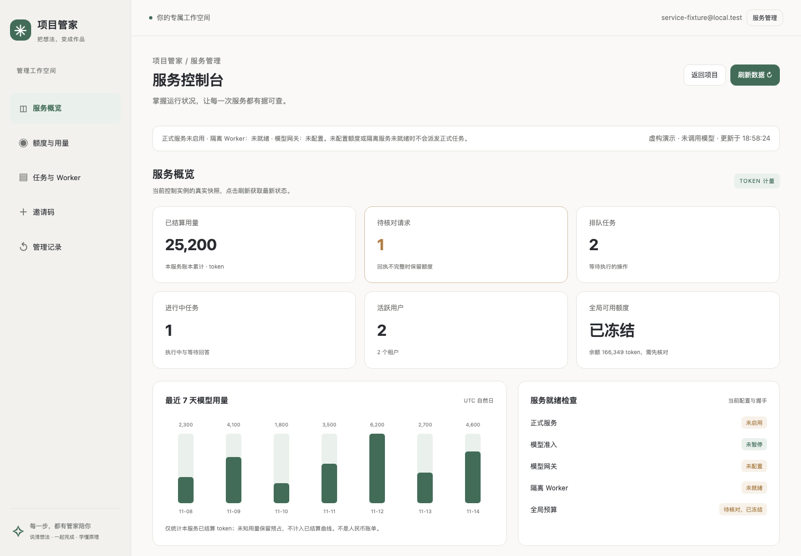
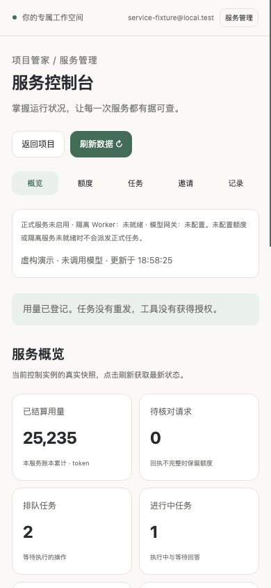
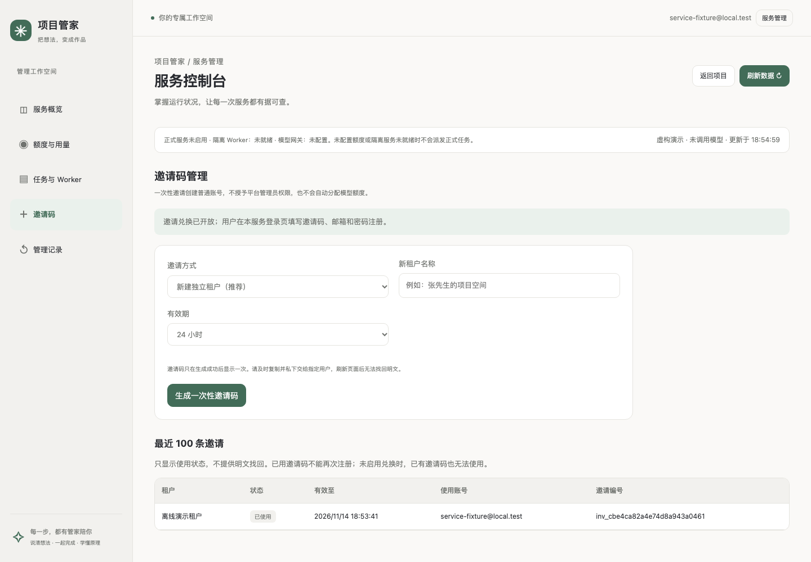
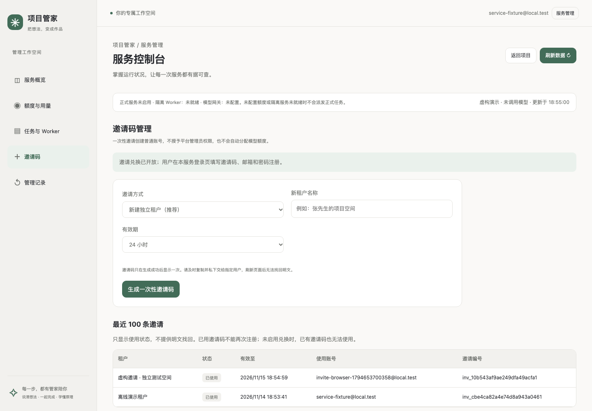
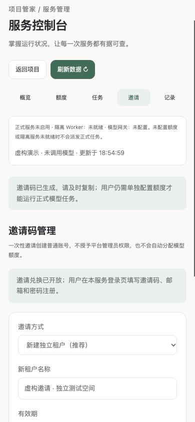
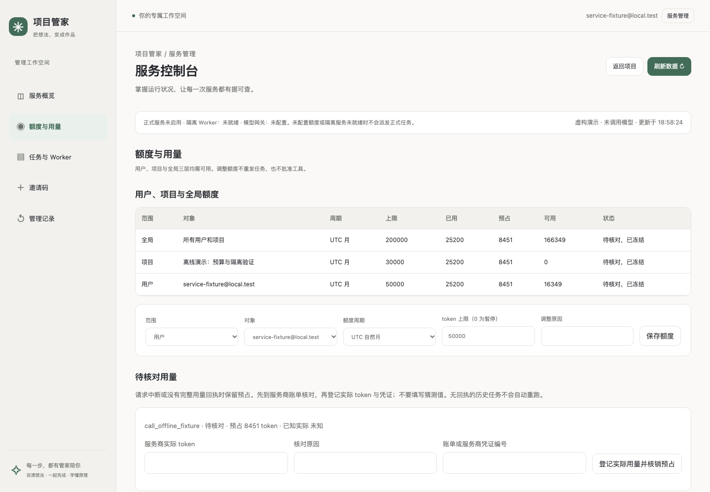
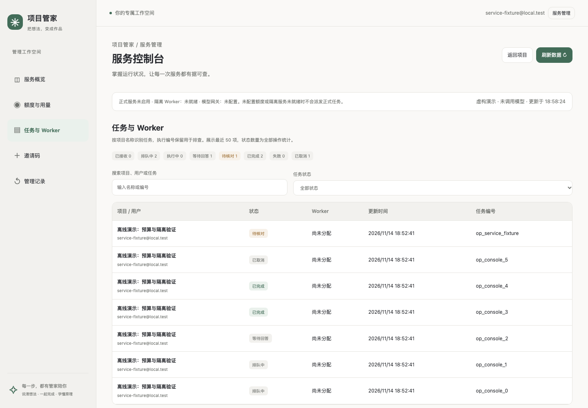
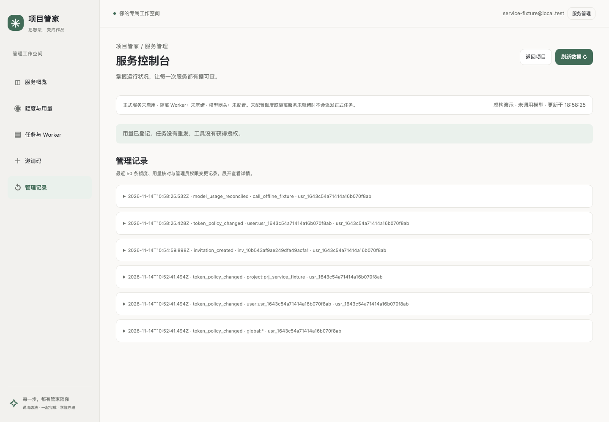

# 项目管家管理员使用手册

适用版本：personal_manager / 1.24.1　｜　最后核对：2026-11-14　｜　面向平台管理员和服务负责人

本手册说明如何使用可视化控制台管理邀请、额度和任务。客户聊天与交付操作见 [客户使用手册](manager-user-guide.md)；安装、权限授予、模型配置和备份部署见 [开发者与运维手册](manager-developer-guide.md)。管理员无需照着开发文档执行日常操作。

**图片来自当前界面的真实浏览器验证，使用虚构租户、账号、用量及任务，不是生产数据，也不表示模型实际运行或公网服务已开放。** 当前服务器是否开放以 [服务器验收记录](../../deploy/service/acceptance-status.md) 为准。本手册不会把本机演示入口当作正式服务地址。

## 1. 登录与找到控制台

1. 打开运维提供的管理地址，用已授予平台管理员权限的账号登录。
2. 点击右上角 **服务管理**，进入 **服务控制台**。
3. 电脑在左侧选择分区；手机在标题下方选择 **概览 / 额度 / 任务 / 邀请 / 记录**。
4. 点 **返回项目** 回到普通项目界面，不改变账号权限。

| 分区 | 可以做什么 |
| --- | --- |
| 服务概览 | 查看用量、排队、冻结提醒和服务就绪情况 |
| 额度与用量 | 设置用户、项目、全局额度，依据真实回执核对用量 |
| 任务与 Worker | 按名称与状态找任务，查看 Worker 状态、核对原执行回执 |
| 邀请码 | 为独立或已有租户生成一次性邀请码，查看使用状态 |
| 管理记录 | 查看最近的额度、核对、邀请及权限变更审计 |

看不到“服务管理”时，联系运维核对**平台管理员**身份。租户负责人不等于平台管理员，注册邀请码也不会授予该权限。当前控制台不能自行给账号添加管理员权限。

## 2. 每天先看服务概览

先点 **刷新数据 ↻**，确认右侧更新时间，再查看以下内容。页面展示的是快照，不自动刷新；填写中的内容未保存前，不要随意刷新。

| 指标 | 含义与处理方式 |
| --- | --- |
| 已结算用量 | 本服务账本已确认的累计 token，包含输入和输出；不是人民币费用 |
| 待核对请求 | 缺少完整用量回执等情况，需要核实后登记，不能直接清零 |
| 排队任务 | 等待执行的操作数量；不代表已经调用模型 |
| 进行中任务 | 执行中与等待回答的操作；等待用户回答不一定是故障 |
| 活跃用户 | 当前状态有效的账号数，不是实时在线人数 |
| 全局可用额度 | 当前全局策略余额；若显示“已冻结”，即使有余额也不能继续调用 |

**最近 7 天模型用量** 按 UTC 自然日统计已结算 token，日期可能与本地日期不同。未知预占、历史账本结转不计入图中的已结算数；不要把不同口径直接相加，也不要把用户、项目和全局三层统计相加当作实际用量。

接着看 **服务就绪检查**：正式服务、模型准入、模型网关、隔离 Worker、全局预算分别表示不同条件。还必须核对实际用户与项目的额度；一项正常不等于任务一定可以执行。

**API 运行信息** 只表示当前 API 进程的运行时长、内存、运行时和数据库版本，不是整台服务器或所有 Worker 的资源监控。进程运行时间长也不代表 24 小时验收已经通过。

## 3. 为新用户生成邀请码

推荐顺序：**确认服务已开放 → 新建独立租户邀请 → 用户注册 → 用户创建项目 → 配置额度 → 用小范围任务验证。**

1. 打开 **邀请码**，默认选择 **新建独立租户（推荐）**。
2. 输入租户名称，例如“张先生的项目空间”。独立租户用于隔离不同客户的项目。
3. 选择有效期：**1 小时 / 24 小时 / 3 天 / 7 天**。
4. 点击 **生成一次性邀请码**。成功后核对显示的租户和到期时间。
5. 点 **复制邀请码**。若浏览器不允许自动复制，页面会选中邀请码并提示手动复制。
6. 通过私密渠道把邀请码和**同一个服务的登录地址**交给指定用户。系统不会自动发送邮件或消息。
7. 请用户在登录页展开 **我有邀请码（首次使用）**，填写邀请码、邮箱和密码，再点 **登录** 注册。

**加入已有租户** 会让受邀账号访问该租户的项目。必须选择目标租户并勾选共享确认；按当前注册规则，该账号在租户内为负责人，但不是平台管理员。不需要共享项目的陌生客户应使用独立租户。

邀请码只在生成结果中显示明文。**隐藏明文**、离开邀请分区、返回项目或刷新页面后都无法找回；历史列表没有明文复制入口。生成失败或断网时，先看列表确认是否已创建，页面不会自动重试。

每个邀请码只能注册一次。当前没有撤销、恢复原明文或使旧码失效后“补发”的按钮；重新生成的是另一个码，遗失的有效码仍会按原期限失效。若怀疑泄露，立即联系运维，不要把新码当作旧码已经撤销的证明。

### 查看是否已使用

点 **刷新数据 ↻**，查看最近 100 条记录：

| 状态 | 含义 | 应怎么做 |
| --- | --- | --- |
| 待使用 | 尚未兑换且仍有效 | 核对地址和有效期后交给指定用户 |
| 已使用 | 已完成一次注册，显示使用账号 | 用户应直接登录，不再重复用该码注册 |
| 已过期 | 有效期已结束 | 按实际需要生成新码 |

如果页面提示 **邀请兑换当前关闭**，点击生成也不会创建邀请码。联系运维确认是否满足开放条件并启用兑换后，再刷新。此页面不能修改注册开关、开放公网、配置模型密钥或替代 HTTPS 验收。

## 4. 为用户和项目配置额度

注册成功不会自动分配正式模型额度。到 **额度与用量** 核对三层策略：

| 范围 | 对象 | 作用 |
| --- | --- | --- |
| 全局 | 所有用户与项目 | 限制服务总体可用量 |
| 用户 | 指定账号 | 限制该账号的调用量 |
| 项目 | 指定项目 | 限制该项目的调用量 |

三层都需要有可用额度且没有冻结。新用户创建项目后，如果列表还没有显示，点 **刷新数据 ↻** 再选择；本页不替用户创建业务项目。

1. 选择 **范围**、**对象** 和 **额度周期**。
2. 填写 **token 上限** 与 **调整原因**。
3. 核对对象后，点 **保存额度**，检查成功提示与表格数值。
4. 需要修改另一对象时，重新选择并核对，不要只改数字后忽略当前对象。

0 表示暂停该范围的新模型调用，不等于强制停止正在运行的任务。额度周期按 UTC 自然日、UTC 自然月或累计计量；策略创建后不能任意切换周期。可编辑额度也不能突破实例的独立授权硬上限或解除未知用量冻结。

出现版本冲突时，先刷新再核对，避免覆盖其他管理员刚做的调整。额度保存不会重新派发旧任务、批准工具或确认成果。

## 5. 处理待核对用量

调用中断、回执缺失或异常时，系统保留预占，可能冻结后续调用。**预占不是已确认支出，也不是可以随意退回的余额。**

1. 在 **额度与用量 → 待核对用量** 读取请求编号与已有回执。
2. 到模型服务商账单或支持渠道核实该次实际用量，取得可追溯凭证。
3. 填写 **实际 token**、**核对原因** 和 **账单或服务商凭证编号**。
4. 再次核对对应请求，点击 **登记实际用量并核销预占**。
5. 刷新核对剩余额度与审计记录。若提示版本变化，重新查看当前记录，不能强行覆盖。

实际 token 包括输入、输出及服务商计量的缓存输入，不可用人民币金额代填，也不能低于已知实际用量。没有回执时继续保留待核对，不填猜测数字。仍显示“预占中”时，先等待完整回执，不把正常执行中的调用当作异常核销。

**历史账本** 的实际 token 是累计值，包含原来已经用掉的部分。旧账本预占不会因为新建服务或邀请码自动清零。

用量核对只改账本，不证明原任务已经成功、停止或交付；还需按下一节核对执行。

## 6. 查找任务与核对执行

打开 **任务与 Worker**，可以按项目名称、账号或任务编号搜索，并按状态筛选。表格展示最近 50 项，状态计数统计全部操作，因此搜索结果行数不必等于顶部数量。找不到更早记录时联系运维查询，不反复新建任务。

| 状态 | 如何理解 |
| --- | --- |
| 已接收 / 排队中 | 已保存或等候执行，不等于已经调用模型 |
| 执行中 | 正在处理；结合更新时间和用户反馈判断 |
| 等待回答 | 用户需要回答问题或决定权限，先让用户查看项目对话 |
| 待核对 | 无法确认原执行结果，不要重复派发 |
| 已完成 | 执行已结束；成果仍需用户阅读后确认 |
| 失败 / 已取消 | 当前操作已终结；是否重新处理需另行确认，不自动重发 |

在 **待核对执行回执** 点 **核对执行回执**，只查询原任务，不创建新执行。观察服务未连接时，页面会说明需配置恢复通道；将任务编号、更新时间和提示交给运维。未知结果不会因为刷新、核销用量或增加额度就自动成为成功。

**已登记 Worker** 的“登记有效”只表示身份有效。“握手未报告”或“隔离未就绪”不代表可执行。Worker 停用、配置与恢复通道修复需要运维，本页没有对应修改按钮。

## 7. 查看管理记录

打开 **管理记录**，展开一条记录查看操作人、时间、对象、原因和核对凭证。当前展示最近 50 条指定类型的管理审计，包括额度调整、用量核对、邀请生成和管理员权限变化；不是完整的服务器日志。

邀请码明文不会写入管理记录。对账有争议时，保留请求或任务编号及凭证交给维护人，不在工单或聊天里附上密码、模型密钥或邀请码明文。

## 8. 常见情况怎么处理

| 情况 | 先做什么 | 联系谁 |
| --- | --- | --- |
| 看不到服务管理 | 确认账号，核对是否为平台管理员 | 运维授权人员 |
| 不能生成邀请码 | 看兑换开关提示，不重复点击 | 运维确认服务是否可开放 |
| 邀请码已用或过期 | 已用账号直接登录；过期按需要生成新码 | 管理员 |
| 邀请码丢失 | 查列表核实生成记录；原明文无法恢复，新码不撤销旧码 | 管理员；疑似泄露找运维 |
| 用户注册后不能调用 | 核对服务就绪状态及用户/项目/全局三层额度 | 管理员；环境问题找运维 |
| 有余额仍显示冻结 | 查看待核对用量及历史账本，依据凭证处理 | 管理员和账单维护人 |
| 模型已暂停 | 先确认暂停原因；增加额度不会自动解除暂停 | 运维 |
| 任务一直排队 | 看 Worker 能力、预算、未知执行与更新时间 | 管理员；异常交运维 |
| 等待回答 | 请用户回到项目对话处理，管理员不代替批准 | 项目用户 |
| 核对执行提示未连接 | 保留编号，配置恢复通道后再观察原任务 | 运维 |
| 保存额度提示记录变化 | 刷新后重新核对对象与数值 | 当前管理员 |
| 自动复制失败 | 按页面提示手动复制已选中的邀请码 | 当前管理员 |

## 9. 管理范围与交接

当前控制台可管理邀请、额度及用量/执行核对，**不提供**服务器命令终端、主机重启、备份还原、模型密钥编辑、邀请码撤销或管理员权限授予。相关工作交给运维，技术步骤见 [开发者与运维手册](manager-developer-guide.md)。

当前客户入口和控制台的实际部署版本可能不同于本机预览。查看服务地址与更新时间，先确认在操作哪个环境；本机验证通过不等于服务器已经升级。域名、HTTPS、正式凭据和邀请访问条件由服务负责人确认。

交接时记录：服务地址、操作账号、发生时间、租户和项目名称、任务或请求编号、页面提示、已做的核对与账单凭证。不要只说“不能用了”，也不要把重新发起任务当作恢复原结果。

## 10. 手册维护记录

本文件为管理员日常操作的主手册，同名 HTML 为离线版；客户和开发者手册保持各自入口。界面变化时更新对应真实截图，未变化的截图可以沿用。

| 日期 | 适用版本 | 修改与核对 |
| --- | --- | --- |
| 2026-11-14 | 1.24.1 / 服务控制台与邀请码 | 从开发者文档拆分管理员操作，整理概览、邀请、三层额度、异常核对、任务、审计和交接；沿用已验证的当前截图，虚构数据明确标注。文档整理不改变功能，不调用模型。 |
