# 项目管家开发者与运维手册

适用版本：personal_manager / 1.24.1；最后核对：2026-11-14。面向开发、测试及部署维护人员。日常服务管理请看 [管理员手册](manager-admin-guide.md)。客户操作请看 [客户使用手册](manager-user-guide.md) 或其离线 HTML；不要让客户执行本手册的服务端命令。

## 独立前端视觉优化（2026-11-14）

参考 [LobeChat / LobeHub](https://github.com/lobehub/lobehub) 与 [LibreChat](https://github.com/LibreChat-AI/LibreChat) 的公开对话产品呈现方式，采用项目导航、以对话为主的工作区、按需展开成果。实现为本仓库原生 HTML/CSS/JS，没有引入上游代码、素材、依赖或模型选择器。

前端新增语义化消息身份、底部输入、开场草稿、成果数量、侧栏开关和 Esc 焦点返回；桌面与手机共享现有接口，手机成果视图暂时替代对话，可随时关闭。深色主题跟随系统，支持减少动画偏好。消息仍经安全格式化器呈现，用户文本用 textContent；权限、确认与下载依然显式操作。

源码：`apps/manager-web/index.html`、`app.js`、`styles.css`。没有修改生产服务器服务或正在观察的验收版本。刷新本地旧页面即可取得静态文件；旧端口可能连接不同的实验数据库，不代表模型能力自动升级。

预览与重现（两个终端，Node 24；8098 空闲）：

```sh
node services/product-api/probes/ui-style-preview.mjs --fixture
node services/product-api/probes/verify-ui-style.mjs --fixture
```

预览使用一次性虚构控制库、固定测试账号 `ui-fixture@local.test`／密码 `Fixture-Style-2026!`，仅监听本机，无 Worker 或模型授权，不能部署为正式账户。Chrome 验证脚本当前使用 macOS 应用路径，19 项检查覆盖登录、导航、消息格式、成果显隐、历史版本限制、Esc 焦点、开场不自动发送、问答/许可、手机溢出和深色主题；生成 7 张真实截图，不将其作为模型成果证明。测试摘要输出到 `/tmp/manager-style-ui-result.json`。本轮另运行产品 API 回归：107 项通过、0 失败、1 项依赖显式 Docker 镜像配置的条件用例跳过；该用例并非本轮通过，前序服务器 Docker 结果见验收记录。语法、DOM 引用、文档链接与图片路径检查通过。客户手册引用当前相关截图；下文附录旧截图为历史记录。

## 服务器验收批次变更摘要

- 独立 ECS 验收实例：独立账户、目录和数据库、回环监听与固定 Docker 镜像；未修改原应用和公网入口。
- 不可变验收授权：schema 9 增加整轮 token 与请求数硬上限，管理员编辑策略也不能突破；旧未知预占保留。
- Worker 池：使用已登记身份，全局单活动执行，未知状态阻断新派发；只对只读问题等待请求恢复连接，不重放模型或写操作。
- 运维工具：源码归档、一致性备份、新目录还原、分钟采样及真实时长观察；克隆不自动启动，避免重复执行和收费。
- 真实验证：6 次、3636 token；问答、成果确认下载、等待时 API 重启、控制通道断网、三用户排队、Docker 边界及备份还原通过。158 项 Node 与 1 项 Python 测试通过。
- 当前仍为 24 小时私有观察阶段。临时模型令牌已删除，准入暂停；域名 HTTPS 未准备好，邀请关闭。实际时窗和最终状态以 [验收记录](../../deploy/service/acceptance-status.md) 为准。

上述是服务器验收批次的增量。共享业务内核、独立前端、统一 Worker 协议和三层正式预算属于前序批次，不能把工作区全部差异算成本轮新增。

## 1. 架构与源码入口

| 层 | 入口 | 职责 |
| --- | --- | --- |
| 原插件 | `dsh-workbench/` | DSH 内嵌界面与 Host 适配 |
| 独立前端 | `apps/manager-web/` | 面向客户的账号、对话、问题与成果界面 |
| 共享业务 | `dsh-workbench/core/`、`packages/manager-core/` | 任务、文档、知识和陪学的共享实现 |
| 产品控制面 | `services/product-api/` | 账户、租户、项目、操作、事件、预算和模型网关 |
| Worker | `services/worker-bridge/` | 签名协议、执行日志、互动和隔离工具运行 |
| 运维 | `deploy/service/` | 独立服务归档、备份、观察与验收 |

设计与实现：[共享内核](shared-manager-core.md)、[独立产品设计](standalone-manager-design.md)、[统一 Worker 协议](unified-worker-protocol.md)、[预算与执行隔离](service-budget-isolation.md)、[Worker 接入](worker-integration.md)。独立前端不会自动获得原插件所有陪学、交付与通用项目执行能力，应逐项核对。

## 2. 本地检查与开发

使用 Node 24。安装步骤与依赖由各组件清单决定，不能把本机模型凭据或运行数据库复制为开发样例。以下命令从仓库根目录执行，均不调用真实模型：

```sh
npm run check --prefix services/product-api
npm run check --prefix services/worker-bridge
npm run contracts:check --prefix services/worker-bridge
node --test packages/manager-core/*.test.mjs packages/manager-contracts/test.mjs packages/manager-contracts/*.test.mjs services/product-api/tests/*.test.mjs services/worker-bridge/tests/*.test.mjs deploy/service/*.test.mjs
python3 deploy/service/test_release.py
npm run docs:guide --prefix dsh-workbench
git diff --check
```

Docker 边界用例需可用 Docker 与已有的固定镜像，按测试要求配置 `MANAGER_ISOLATION_TEST_IMAGE`；跳过不代表通过。启动开发 API 的入口是 `services/product-api/server.mjs`，模拟、只读诊断和正式 Worker 是不同模式，不能混用。真实验证另行核对授权、预算和测试项目，不能重置请求编号后无界重跑。

## 3. 部署、凭据与恢复

独立产品使用 [独立服务部署工具](../../deploy/service/README.md)；原 DSH 插件使用 [插件 ECS 部署指南](../../deploy/README.md)。两套归档和入口不同。实际新服务只监听服务器回环地址，localhost 页面可能是本地实例，不能仅凭浏览器地址判定服务器已公开上线。

模型秘密仅由服务端网关读取，不能交给客户浏览器、Worker 工具容器或写进 Git。`PRODUCT_API_MODEL_CALLS_PAUSED=1` 允许删除临时模型授权后保持查询和观察；恢复正式付费服务需另行配置凭据及额度。

停机一致性备份须只停止目标实例，确认无后台写入后执行；恢复到全新目录，先校验 SQLite、成果摘要与执行日志，不启动恢复克隆。控制库包含签名身份，备份按私有敏感数据管理。具体命令见部署工具说明，不把服务器私有证据目录加入源码包。

24 小时观察通过仅说明该私有空闲观察窗符合门槛；没有覆盖活动 Worker 硬崩溃、生成中模型断流、真实用户长期负载或公网 HTTPS。未经这些验收，不宣称可无条件开放公共服务。

## 4. 管理控制台实现与验证

管理员日常操作已单独整理为 [管理员图文使用手册](manager-admin-guide.md) 和 [离线 HTML](manager-admin-guide.html)，包含概览、邀请、额度、用量与执行核对、任务与审计。此处保留开发接口和验证说明，避免两份操作步骤逐渐不一致。

实现：`services/product-api/src/service-dashboard.mjs` 扩展管理员专用 `GET /api/v1/admin/service` 的 `dashboard` 字段，沿用平台管理员、会话和来源校验。只返回受限字段，不返回 Worker 签名秘密、模型凭据、消息正文或宿主路径。账号、租户、队列等跨租户汇总只对平台管理员可见，普通用户请求仍为 403。没有新增远程命令、进程重启、备份恢复或密钥编辑接口；当前控制台管理的是管家应用，不替代 ECS 主机管理。

前端复用客户主题，支持手机分区和系统深色模式。旧版 API 没有 `dashboard` 时提示更新，不伪造数据。已有额度、核对和审计接口保留；登记身份、握手能力与运行验收是三个不同状态。

接口：平台管理员专用 `GET /api/v1/admin/invitations` 返回租户与邀请元数据，`POST /api/v1/admin/invitations` 接受 `mode`（new/existing）、`name` 或 `tenantId`、整数 `hours`（1–168）及已有租户必需的 `confirmShared=true`。POST 仅成功响应包含 token，列表及审计不包含 token 或摘要。沿用会话、Origin 与 CSRF 校验；新租户、邀请和 `invitation_created` 审计同事务提交，验证失败不留下孤立租户。不改变 schema 9；注册兑换在密码散列之后的写事务中重新核对是否已用及到期时间，避免并发消费。

仅本机虚构验证（仓库根目录，Node24；不要修改生产注册开关）：

```sh
PRODUCT_API_PREVIEW_PORT=8099 PRODUCT_API_ALLOW_REDEEM=1 node services/product-api/probes/service-admin-preview.mjs --fixture
node services/product-api/probes/verify-admin-invitations.mjs --fixture
```

验证：新增 4 项 API/并发用例通过；产品 API 回归合计 113 项通过、0 失败、1 项 Docker 条件用例跳过；邀请码真实浏览器 11 项通过。可视化控制台的回归、语法和文档资源检查同步执行；无真实模型调用，无服务器部署或推送。

## 5. 文档维护规则

管理员控制台操作变化同步更新 `manager-admin-guide.md` 与 `npm run docs:admin --prefix dsh-workbench` 生成的离线版；开发文档说明实现、配置和验证，管理员文档说明日常操作。

客户操作、名称、状态或使用边界变化，必须同步更新 `manager-user-guide.md` 和离线 HTML；界面变化更新受影响的真实截图。内部实现、配置、迁移、测试或部署变化更新本手册或其链接专题，同时在客户手册维护记录注明“已核对，用户操作不变”。不得以开发文档替代客户手册。原图若仍适用可以沿用，模拟图必须保留说明。规则来源：[AGENTS.md](../../AGENTS.md)。

## 附录：独立前端开发验证历史

以下从原客户手册迁入，保留各阶段截图及当时的未实现声明以便追溯。**这是历史记录，不是当前部署状态，也不是客户操作前提**。最新能力及限制以上文、专题文档和服务器验收记录为准；不要将下文的“尚未接通”判断覆盖后续已完成的受限链路。

## 独立管家网页：本地验证中的问答方式

独立网页已有账号、项目、问题回答与成果查看；统一执行服务已通过受限真实模型验证，但默认不开启通用项目执行，也没有开放多人试用。现有插件的操作保持不变。详细方案见 [独立管家产品详细设计](standalone-manager-design.md)。

管理员启动本地产品服务后，你可以登录并打开一个演示项目。当管家需要确认几件事时，每道问题会单独列出：

1. 单选题选择一个答案；标注“可以选择多项”的问题可选几个答案。
2. 不符合选项时，在“补充说明或其他回答”中填写自己的想法。
3. 每道题都回答后，点击“提交全部回答”。漏答或选项失效时会提示修改，不会替你猜答案。
4. 网页收到实时更新时，同一问题里未提交的选择和文字会保留；关闭网页后不保证保留。
5. 执行取消或等待到期后，这张问题卡会移除，旧回答不能继续提交。网络中断时撤卡可能延迟；重新连接并刷新后，以服务器状态为准。

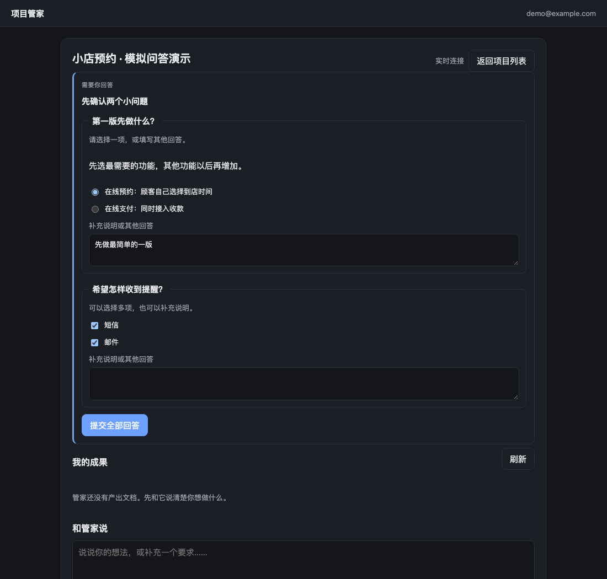

*当前独立前端的真实浏览器截图，使用虚构的“小店预约”项目和模拟 Worker 请求。展示单选、多选与补充说明，不代表真实模型已完成项目。*

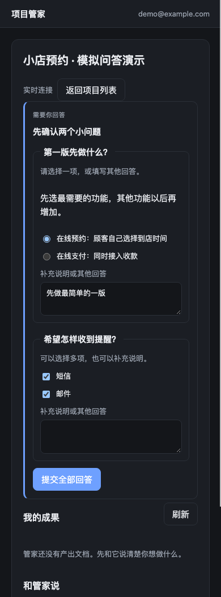

*390px 窄屏验证截图；截图内的选择和文字是测试人员输入的演示答案。*

权限请求只提供“允许一次”和“拒绝”，看清说明后再决定。回答问题不等于授权执行，允许一次也不等于确认成果文档。

统一模型网关、额度管理、真实任务派发与多用户隔离仍待完成，不能将 owner 账号或原生登录链接分享为多人服务。

### 管理员开启模拟验证时

打开项目后照常发送一句话。输入区旁会提示“模拟模式”或当前模拟任务状态；收到的回复会以“模拟执行”开头。它只用于确认消息能正常排队、处理和回传，不代表管家已分析项目，也不会生成真实产品。

若显示“模拟结果待核对”，请联系管理员核查，系统不会自动重复执行。一直排队时也先联系管理员，不要反复发送同一条需求。普通模式仍会先保存消息，真实执行尚未接通。

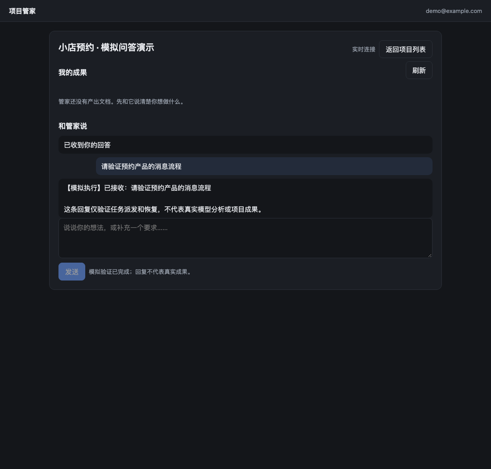

*当前独立前端真实截图，使用虚构项目和本地模拟引擎。测试输入、回复和状态均为模拟验证，不是模型实际完成。*

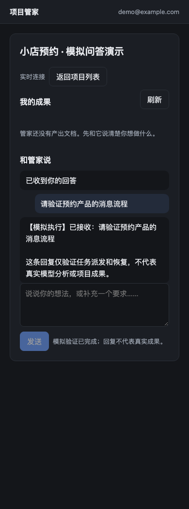

*390px 窄屏验证；“模拟验证已完成”仅表示消息流程通过，不表示真实项目完成。*

管理员操作与恢复边界见 [模拟派发说明](simulation-dispatch.md)。

### 完整模拟体验：允许、回答、看文档

管理员开启“交互模拟”后，可以按下面路线体验：

1. 发送想法，看到生成示例文档的许可请求。愿意继续就选“允许一次”；选“拒绝”会结束本次模拟，不生成成果。
2. 回答“希望帮助谁”和“想先看哪种示例”，再提交全部回答。
3. 在“我的成果”点击阅读。文档会明确写出“模拟交付示例”，只是根据演示输入拼成的示例，没有调用真实模型。
4. 确认内容后自行点“确认这一版”，或点“下载”保存 Markdown 文件。阅读和下载不会替你确认。
5. 不想继续时，在排队或等待回答期间点“取消模拟任务”。问题卡会移除，旧答案不能继续提交。任务已完成时，不能再通过取消撤回已有文档。

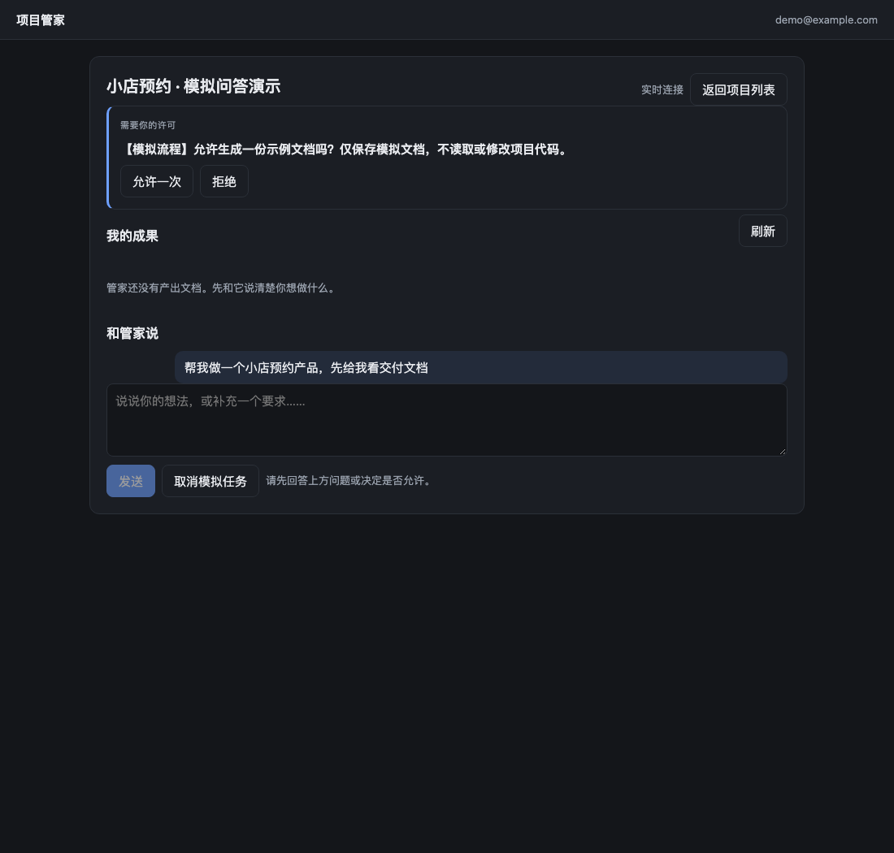

*当前独立前端真实截图，虚构“小店预约”项目。许可只针对这次生成模拟示例，不授权修改业务项目。*

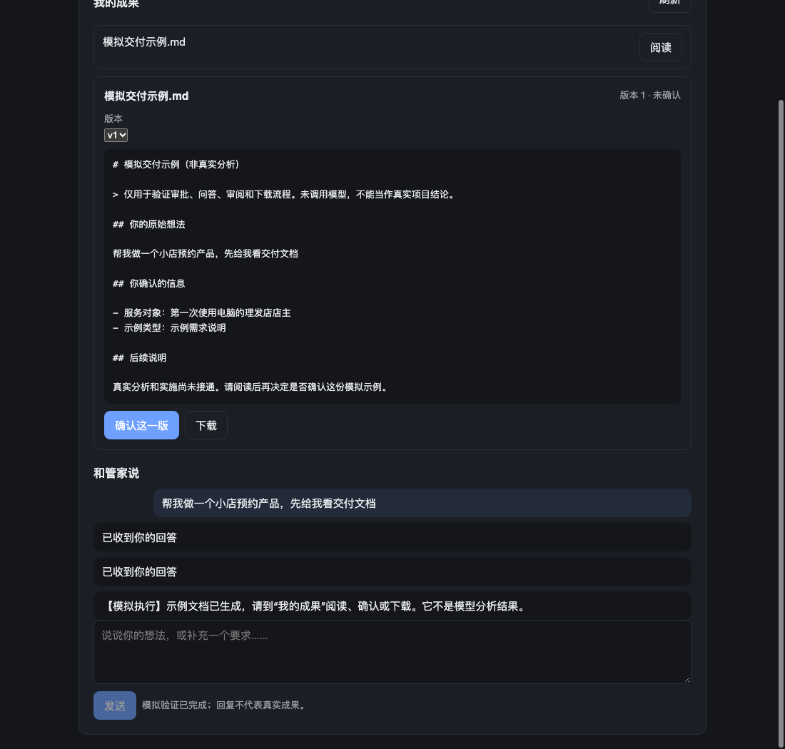

*文档默认“未确认”。截图为本地模拟正文，不是模型实际分析结果。*

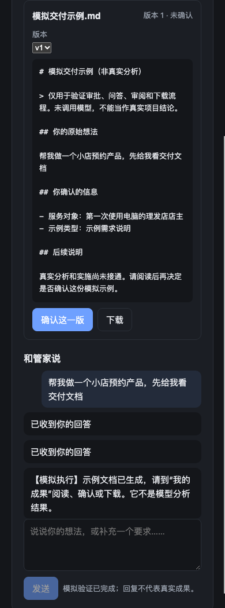

*390px 窄屏验证，确认和下载均可操作；实际浏览器文件下载已验证。*

等待太久显示“结果待核对”时，请联系管理员。不要反复发送或把未核对当作失败重试；系统不会自动批准、回答或确认。刷新与恢复会尽量继续原问题，但租约已失效时不会继续执行。

本地运行与恢复规则见 [完整模拟流程说明](simulation-flow.md)。

### 准备真实模型测试时

当前本地页面是模拟预览。真实模型测试已有 [24 项正式案例与操作方案](real-model-test-plan.md)，包括个人博客新建、旧项目新增搜索、文档交付和学习答疑。

完整正式产品案例尚未验收。前序完成一次真实 DeepSeek 账号基础烟测（输入 24、输出 7 token，无工具）；它仅证明模型通道可用，不表示独立网页已切换到真实任务。详情见 [真实烟测记录](real-model-smoke-result.md)。管理员需先完成真实执行、权限回传和费用控制，再与你确认使用哪个模型、预算多少、只处理哪些测试资料。不要在聊天里填写 API Key，也不要把生产项目直接当作试验样本。

测试开始后，你仍只需要对接管家：说需求、回答问题、决定是否允许、看文档并确认。不愿继续时要求暂停；若实际执行是否停止尚无法确认，系统必须提示待核对，不能当作成功停止后自动重试。

### 使用本轮真实答疑验证页

管理员已经为本轮准备一个单独的真实验证页面：`http://localhost:8091/`。它与你原来的 `127.0.0.1:8090` 模拟页面分开登录，原项目资料不受影响。使用本地测试账号登录，打开“个人博客 · 真实答疑验证”。这里不用填写 API Key。

**当前模型调用已暂停**：续测工具请求返回错误且没有用量回执，管理员保留预算占用，尚未恢复新回答。你仍可看历史、阅读和下载已有成果；此时再点发送会提示暂停并保留草稿。

你可以说：“请用生活比喻解释浏览器和服务器的区别”，或者“帮我把个人博客的想法说清楚”。点“发送”后会显示真实答疑状态；等待时刷新并重新打开项目，完成的回复仍会保留，不需要再发一次。

当前是**真实模型只读答疑验证**：能沟通需求、解释原理；不会替你改项目、执行命令或部署，也不会产出可确认下载的正式文档。回答会显示清晰的标题、段落、列表、重点和代码；复杂表格暂按文字显示。不要把模型说的方案理解为已经执行。

每次请提简短问题，超过 6,000 字节会提示拆分。遇到“结果待核对”，先停止重复发送并联系管理员核对本轮调用；管理员会保留未知用量，不自动重试。页面目前没有得到真实引擎确认的停止按钮，不能以关闭网页代替停止。

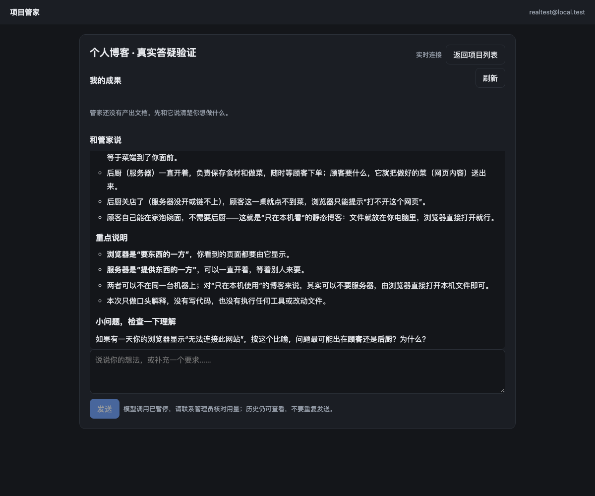

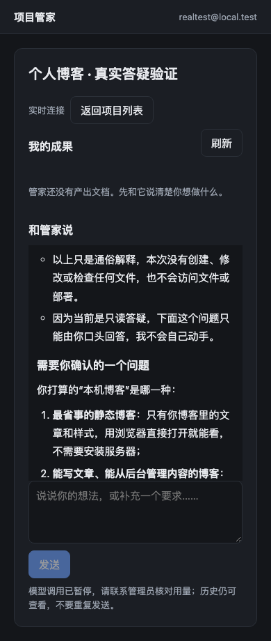

### 阅读真实文档与历史版本

打开“真实文档交付 · 版本验证”，在“我的成果”点击“阅读”。用“版本”下拉框切换v1/v2，旧版仍可阅读和下载；旧版不能确认，需要切到最新一版。已确认版本会显示“这一版已确认，无需重复确认”。阅读和下载不会自动确认文档，也不会授权执行工具。

此示例复用了前轮真实模型的需求与设计回复，由测试服务整理成两个版本；不是本轮模型新生成，也不表示已打通原生代码修改。当前新登记文档每份最多1MB；旧系统中已经被覆盖且没有保存副本的历史正文不能自动恢复。

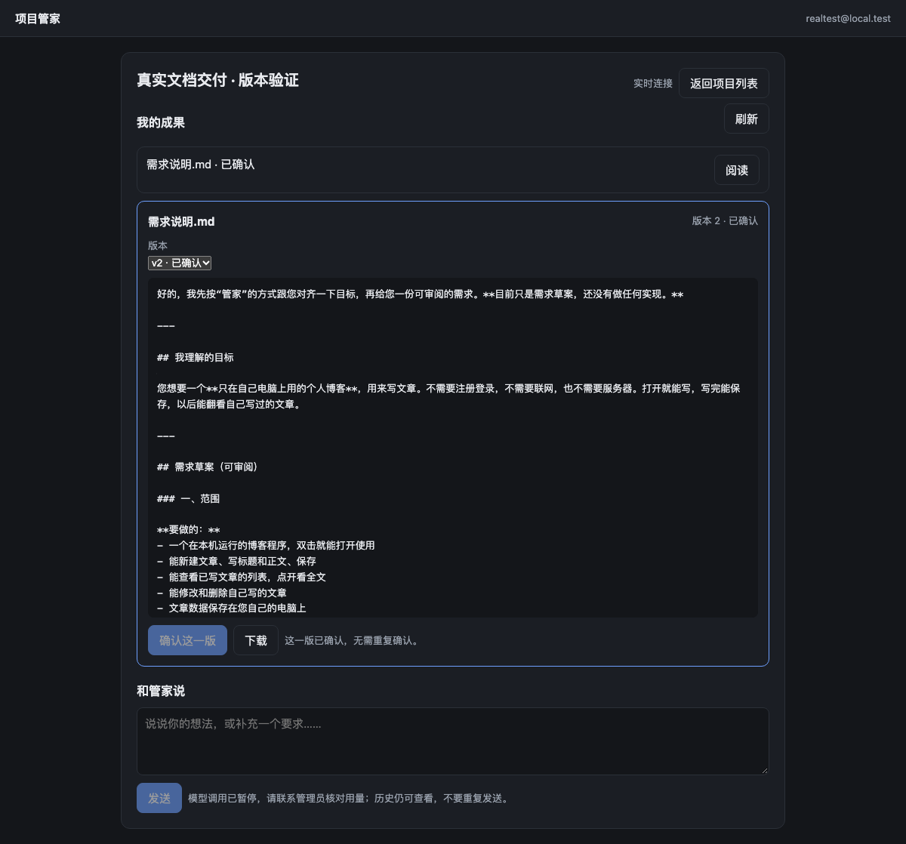

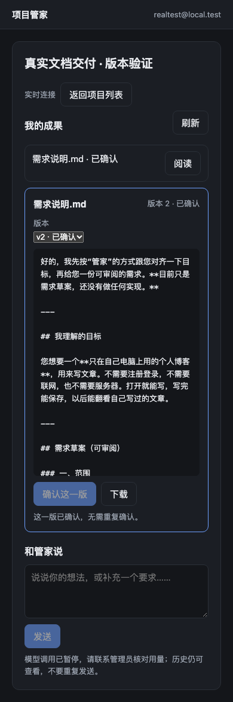

只有接入原生停止回执的验证实例才会显示“停止当前任务”。必须看到引擎确认停止才算完成；提示“待核对”时不要重复执行。当前8091只读实例未开放此按钮。此前仅有夹具模型验证；2026-11-14 已补真实 DeepSeek 的提问、审批拒绝、文档交付、接回原任务和等待时停止验证，具体范围见下文。

续测结果与当前预算暂停原因见 [待验证链路记录](pending-chains-run-20261114.md)。

本轮用量与完整能力边界见 [真实自动验证记录](real-model-run-20261114.md)。这里只完成只读阶段，不能替代后续完整正式验收。

### 统一执行服务：问答、授权、成果和停止在同一条任务中

管理员连接统一执行服务后，你仍然只使用“和管家说”。发送后会依次看到“已排队”“管家正在处理”，需要补充信息或决定工具权限时会显示问题卡或授权卡。按题回答；工具只能由你明确允许或拒绝，回答问题不会自动允许工具。

成果出现在“我的成果”后，点击“阅读”，核对内容后再点击“确认这一版”，也可下载。任务结束回执只是服务已经结束，不等于文档正确、产品完成或你已确认。下面是真实模型针对虚构博客的答疑交付记录，便笺工具权限被拒绝；交付的是答疑文档，没有执行博客代码修改。

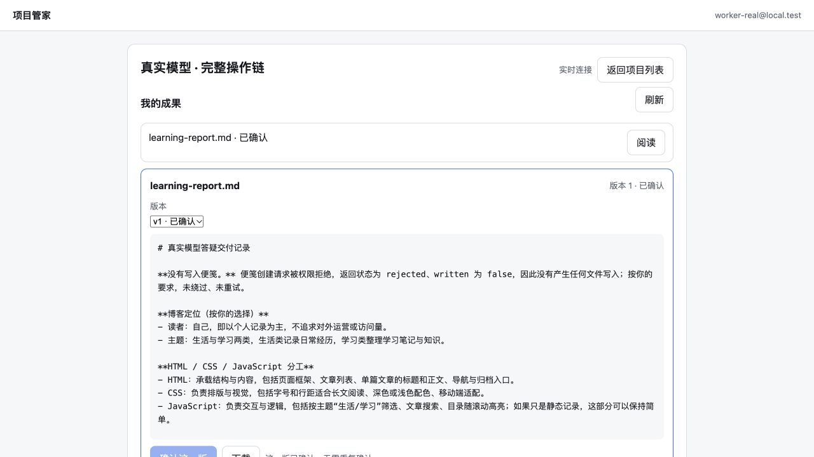

需要停止时点“停止当前任务”。若仍在排队，会直接取消尚未派发的安排；若已运行，需要等服务明确确认停止。看到“结果待核对”时不要重复发送同一任务，联系管理员检查原任务。刷新或短暂重连会读取原记录，不会因此再做一次。

本轮真实验证页面为本机 `http://localhost:8093/`，验证结束后已暂停新的模型调用，仍可阅读历史和成果。暂停提示不表示历史被清空。当前原8091实例仍保持其先前预算暂停状态，两者不要混用。

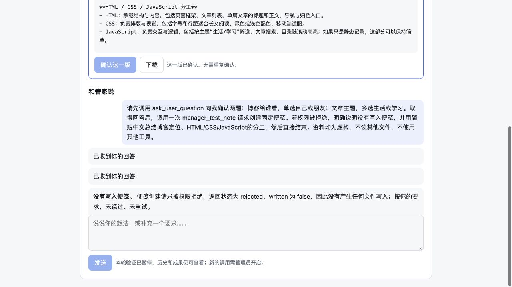

本轮使用真实 DeepSeek 4 次、9,153 token，工具审批均为拒绝，没有自动批准工具；取得了真实原生停止回执。旧预占17,432未释放。尚未验证任意代码修改、允许工具后的真实写入或模型生成中停止，不能将此示例当作全部产品验收。管理员方案、预算与边界见[统一 Worker 协议与验证](unified-worker-protocol.md)。

管理员说明：本轮将任务、正式文档、知识和陪学的规则提取为[共享管家业务内核](shared-manager-core.md)，插件与独立产品 API 使用同一份实现。**已核对，用户操作不变**，现有截图仍适用。独立网页尚未新增完整陪学操作页面，也不会因本次内部重构自动开启任务执行；管理员仍需接通运行服务。共享数据只允许一个运行进程写入，切换入口前先停止旧进程并备份，不要同时用两个实例修改同一项目。
