# 项目管家使用手册

适用版本：1.24.0　｜　最后核对：2026-11-13　｜　面向第一次使用工作台的用户

**你只需要和“项目管家”沟通，不需要理解后台有哪些角色，也不需要学习开发流程。** 文档也是正式成果，可以阅读、提出修改、确认和下载。

本手册的“小店预约”是虚构示例。截图来自当前界面的隔离演示环境，沟通与成果状态由示例数据构造，未调用真实模型，也不代表软件已经完成或通过测试。简洁模式始终以单列对话呈现；完整管家在窄屏时，左右两栏会变成上下排列。

## 先选择适合你的显示方式

顶部现在可以选择 **简洁模式** 或 **完整管家**。首次使用默认进入简洁模式；以前明确选择过“完整管家”的浏览器仍保留选择。显示方式会被记住，不改变旧项目的交付约定，也不清空未发送的消息。

简洁模式像一个持续聊天的窗口：管家的说明、问题和下一步安排按顺序出现在对话中，输入框保持在底部。**看完最新回复，接着看“项目管家 · 下一步”**：有问题时选一个答案；有安排时核对后点“同意并开始”；成果齐全时点“查看并确认成果”。点击查看成果不会替你确认文档。

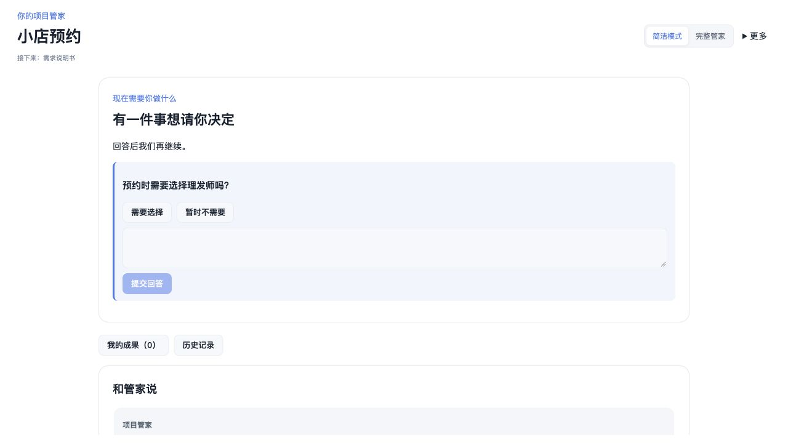

顶部 **我的成果 · 数量** 随时打开独立阅读面板；**更多 → 项目记录** 查看处理历史。可以点“返回对话”或按 Esc 关闭，未提交的文档评论在当前页面中保留。刷新或离开页面前仍请先保存重要意见。项目文件夹、新建项目和详细工作区也在顶部 **更多** 菜单。下面的完整管家截图展示相同项目的详细能力，随时可以切回。

底部的 **请解释一下 / 补充一个要求 / 告诉我做到哪了** 只把提示放入输入框，你可以修改后再点“告诉管家”，不会自动发送。向上翻旧消息时不会被新消息强行拉走；要继续看最新安排，点 **回到最新进展 ↓**。运行期间，底部输入区旁会保留 **停止这项工作**，授权详情从对话中的下一步入口查看。

## 1. 先记住这条路线

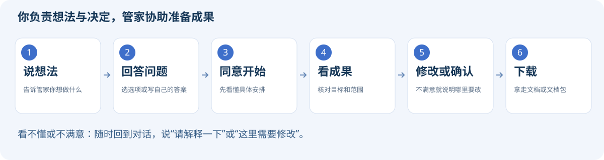

**先说清楚 → 回答问题 → 看懂安排后同意开始 → 阅读成果 → 修改或确认 → 下载。**

最常用的是“和管家说”和“我的成果”。第一次使用时，可以先跳过模板、来源选择、知识管理和“详细工作区”；需要 PDF、演示文稿或统一排版时，再看第 6 节。

| 你现在想做什么 | 去哪里 | 点什么 / 说什么 |
| --- | --- | --- |
| 说明想法或补充要求 | 和管家说 | 填写消息 → 告诉管家 |
| 不知道如何开头 | 对话末尾 / 和管家说 | 简洁模式点“帮我整理下一步”；完整管家点“帮我整理第一版” |
| 回答一个具体问题 | 对话中的问题 | 点击选项；其他答案展开“我有其他回答” → 填写 → 提交回答 |
| 让管家按建议做事 | 对话末尾 / 建议的下一步 | 看懂安排 → 简洁模式“同意并开始” / 完整管家“按这个安排开始” |
| 看内容是否正确 | 我的成果 / 等我确认 | 阅读本类文档；有问题先提修改 |
| 接受当前内容 | 确认当前文档版本 | 勾选“我已阅读” → 确认这一版 |
| 拿走一份文件 | 我的成果 | 下载 / 下载 Word |
| 拿走已确认的整套文档 | 正式文档交付 | 整理交付文档包 → 下载交付文档包 |

## 2. 第一次开始：选位置，说想法

“项目文件夹”就是存放项目资料和成果的位置。如果不知道选哪里，可以请协助安装的人提前准备一个专用文件夹。已经是正确的项目时，不必重复切换。

1. 打开顶部 **更多**，点击 **选择项目文件夹**，选中本次要处理的文件夹。
2. 新建一轮工作时，在 **更多** 中点击 **新建项目**。它会在当前文件夹建立一轮新的需求记录，保留旧记录；不会自动替你在电脑上创建一个独立的项目文件夹。
3. 看到“你好，今天想一起完成什么？”时，像聊天一样写出想法。不知道怎么写，可以点下方示例，再改成自己的情况；点示例不会自动发送。展开 **给这件事起个名字（可选）** 可以命名，留空时会用想法的开头作为建议名称。点击 **下一步：选择想要的成果**，这时还没有开始执行。
4. 第二步：选择本次希望先拿到的成果，核对下方“本次约定”，再点 **确认目标，请管家接下项目**。需要修改想法时，点 **上一步：修改想法**，填写内容会保留。

可以照着下面说：

> 我开了一家理发店，希望客人能在手机上预约。请先帮我把需求写清楚，暂时不做在线支付。我不懂开发，请每次只告诉我下一步需要决定什么。

*图 1：先像聊天一样说明问题，项目名收在可选项中，不需要填写技术方案。图中为虚构示例项目。*

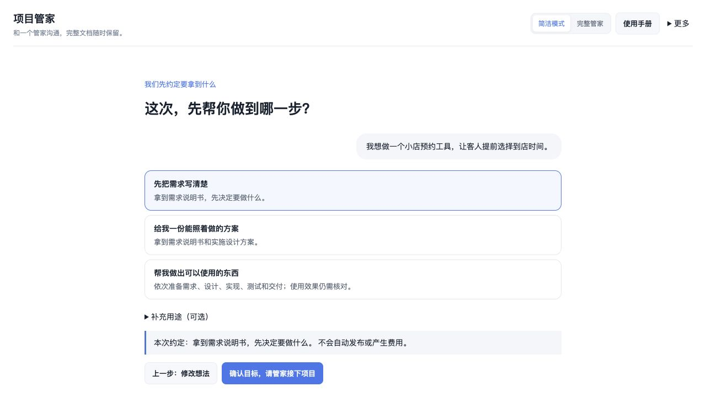

*图 1B：管家接着询问“这次，先帮你做到哪一步？”。默认选中“先把需求写清楚”；请按实际需要选择，并核对本次约定。*

| 选择 | 这次会准备什么 |
| --- | --- |
| 先把需求写清楚 | 需求说明书，先决定要做什么 |
| 给我一份能照着做的方案 | 需求说明书和实施设计方案 |
| 帮我做出可以使用的东西 | 需求、设计、实现、测试和交付；仍需你核对使用效果 |

**补充用途（可选）** 中可以选择毕业设计、产品开发或产品概念 / 融资。用途不会替你扩大交付目标，也不会自动补齐真实素材。建立约定后仍需核对管家提出的具体安排，再点“同意并开始”。旧项目沿用原有交付约定；切换显示模式不会改成“只写需求”。想调整范围时先告诉管家并核对新安排，发送一句话不代表约定已经改变。

**已经有一个项目怎么办？** 选择它所在的文件夹，告诉管家现状、希望新增或修改的内容，以及哪些功能必须保留。例如：“这是已有预约项目，请增加取消预约功能，不要改动现有登录方式。”新开一轮记录不会自动建立代码副本；重要项目建议先做好备份。

## 3. 回答问题，再决定是否开始

管家可能先问一两个问题。知道答案就点选项；有不同答案，展开 **我有其他回答** 后填写并提交。没有选项的问题会直接提供回答框。不确定时可以点底部“请解释一下”，检查草稿后发送，或在消息框说：

> 我不太懂这个问题，请用具体例子解释，推荐一个简单方案。

简洁模式点 **帮我整理下一步**（完整管家中为“帮我整理第一版”），会请管家先整理问题或执行建议。出现 **这次准备这样做** 后，检查安排是否符合意图；同意时再点 **同意并开始**（完整管家中为“按这个安排开始”）。不合适就先告诉管家哪里需要调整。

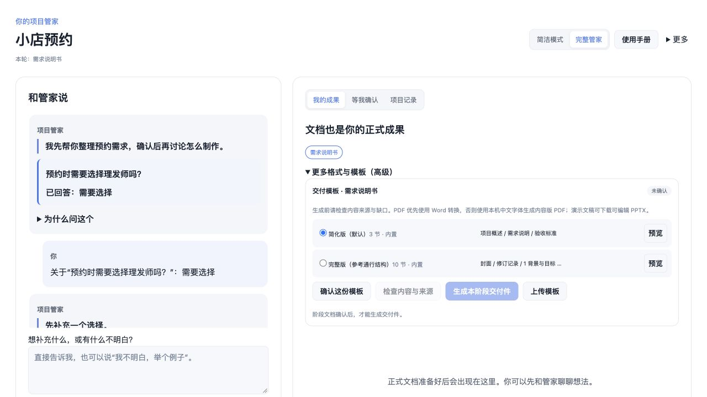

*图 2：问题卡用于补充信息；“建议的下一步”说明准备做什么。*

这三个动作作用不同：

| 操作 | 它表示什么 |
| --- | --- |
| 告诉管家 / 提交回答 | 沟通、补充事实或作出选择 |
| 按这个安排开始 | 同意执行当前这份具体安排 |
| 确认这一版 | 阅读后接受当前这一版成果，保存确认记录 |

**回答问题不等于同意执行，执行结束也不等于你已经接受成果。**

运行中会显示任务进度和已运行时间。需要了解工具权限时，点击 **查看授权与处理详情**；看不懂授权内容时先暂停并请懂的人协助核对。不要反复点击开始。

## 4. 看成果：对就确认，不对就说哪里要改

文档准备好后，简洁模式点 **查看并确认成果** 或 **我的成果** 打开完整阅读面板；完整管家仍可在右侧阅读；也可以选择 **等我确认** 查看待审阅的内容。页面较长时，向下滚动寻找“确认当前文档版本”。

阅读面板先说明本类提供几份文件、重点看哪里以及当前缺口；这些提示不替代原文。

先核对三件事：

1. **目标对不对**：是否解决你真正的问题？
2. **范围对不对**：应做的是否遗漏，不应做的是否多做了？
3. **结果能否判断**：有没有清楚说明做到什么程度才算完成？

以小店预约为例，要看清楚同一时间能接待几位客人、如何取消预约、本轮是否包含在线支付。

**有问题时**，可以在消息框直接说明哪里不对，或点击文档旁的“评论此段”，保存意见，再点“请管家处理修改意见”；简洁模式会自动返回对话、将意见放入输入框并聚焦，检查后再发送。希望明确安排修改时，无论成果是否已经确认，都可以展开 **这份成果需要修改**，填写要求并点 **提交修改安排**。例如：“同一时间最多接待两位客人。”返回对话，核对修改安排并点 **同意并开始**；修改完成后重新阅读、确认新版。

**内容正确时**，阅读本类全部文件，核对并解决仍未完成的评论，勾选 **我已阅读本类文档，并确认当前内容符合需要**，点击 **确认这一版**。实现成果还需要完成页面列出的检查项。

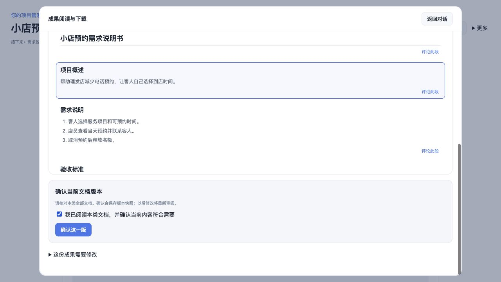

*图 3：这是确认区域的特写。示例已勾选阅读项；实际使用时请先核对内容。*

确认后，工作台会保留当时的文档版本。后续修改相关文档时，需要重新审阅；受影响的后续成果也可能需要重新确认。不能仅凭“文档已经生成”判断软件能正常使用，测试报告中的结果也需要核对实际证据。

## 5. 下载：先拿走需要的文件

**只要一份文档**：在“我的成果”点击对应的 **下载** 或 **下载 Word**。看到 `.docx` 就是可以用 Word / WPS 打开的文档；`.md` 是文本原稿。不需要了解文件名中的技术细节。

**要整套已确认的文档**：本次约定的成果全部确认后，页面会出现 **正式文档交付**，点击 **整理交付文档包**，再点 **下载交付文档包**。得到的 ZIP 可以解压成多个文件。

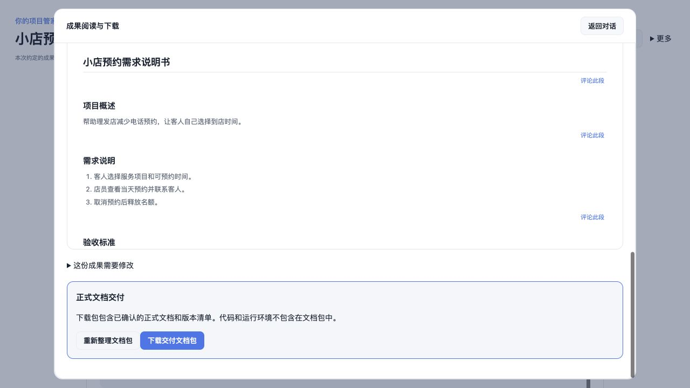

*图 4：整包入口在成果区域的下方。示例项目已具备全部约定文档的确认记录。*

文档包包含已确认文档及版本清单，**不包含项目代码、运行环境、账号或部署服务**。模板另外生成的 PDF / PPTX 交付件请在模板区域单独下载，不要默认它们已经包含在这个 ZIP 中。

如果暂时没有整包入口，可以先下载单份文档，再查看顶部“接下来”或“等我确认”，核对是否还有约定成果没有确认。

## 6. 需要 PDF 或演示文稿时，再使用交付模板

这一节是可选操作。单份文档下载不要求确认模板；只是阅读和下载已有需求 Word 时，可以先跳过高级选项。

1. 打开“我的成果”，选择要交付的成果类别；在简洁模式中展开 **更多格式与模板（高级）**。
2. 阅读并确认该类别的原始文档，再选择一个模板。第一次建议先用 **简化版（默认）**。
3. 点击 **确认这份模板**，再点 **检查内容与来源**。
4. 显示“内容检查通过”后，点击 **生成本阶段交付件**，从新出现的文件列表下载。

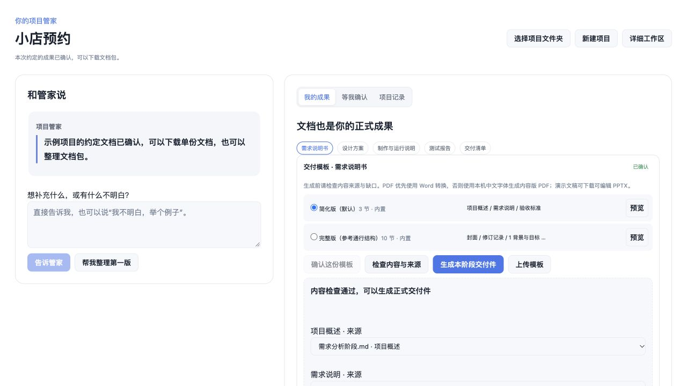

*图 5：模板确认和文档确认是两个动作；检查通过只说明生成条件满足，不代替你审阅内容。*

**检查报告有缺口时**，先告诉管家缺了什么，补充并重新确认原始文档，再检查一次。同一章节对应多个来源时，可以选择正确的来源；不知道选哪个就先请人协助，避免随意拼接。改变来源选择后必须重新检查。

如果只是想先看排版，可选择 **保留缺口，生成标记草稿**。带“草稿”的文件还有内容待补充与确认，不应当作已经完成的正式成果。

| 文件 | 用途与当前限制 |
| --- | --- |
| Word（`.docx`） | 可编辑文档；复杂上传模板的占位符需要符合支持范围 |
| PDF（`.pdf`） | 方便阅读和打印；没有 LibreOffice 时可生成内容版，复杂 Word 版式可能不同；服务器缺中文字体时会给出提示 |
| PPTX（`.pptx`） | 答辩、概念演示等演示类交付可生成可编辑幻灯片；不是每种成果都会生成 PPTX，当前使用基础版式 |
| HTML（`.html`） | 浏览器打印稿，可用“打印 / 另存为 PDF” |
| 版本与来源记录 | 需要追溯时使用，日常阅读可以先跳过 |

缺少作者信息、真实实验数据、截图或其他材料时，需要提供真实材料；管家不会因此自动获得这些材料，也不应虚构内容。

## 7. 按钮灰了、卡住了，怎么办？

**先点一下灰色按钮。** 当前版本会弹出提示，说明最先需要完成的条件；鼠标停在按钮上也能看到说明。满足一个条件后，提示可能变成下一项条件。

| 你看到的情况 | 下一步怎么做 |
| --- | --- |
| 提示先填写内容 | 写下想法、消息、回答或修改要求，再点按钮 |
| 提示先确认模板 | 点“确认这份模板”，再检查内容与来源 |
| 提示先确认文档 | 阅读对应类别的全部文档，完成检查项和审阅确认 |
| 提示先检查来源 | 点“检查内容与来源”；补齐缺口或改过映射后重新检查 |
| 正在处理 / 停止中 | 等待任务结束；需要停止时点“停止这项工作”，不要重复提交 |
| 需要核对执行情况 | 先查看原会话，使用“重新检查状态”核对，避免重复执行 |
| 管家服务未连接 | 重启 DSH Host，再刷新页面；不熟悉启动操作时请协助安装的人处理 |
| 生成失败或缺少文件 | 查看处理记录，把错误告诉协助人员；不要把失败当作完成 |
| 生成 PDF 提示缺字体 | 先下载 Word / HTML；请管理员配置中文字体后重试 |

“停止”不会撤销已经写入的文件。离开页面后记录仍保留；需要继续时回到同一项目。如果 Host 已关闭，任务可能中断，重开后先查看状态，不要假设任务一直在运行。

## 8. 下次继续，以及哪些操作先不用学

顶部 **使用手册** 可以直接打开当前图文手册，支持离线图片和打印。升级后若入口暂不可用，请先重启 DSH Host。

回到同一个项目文件夹，可以继续查看记录和成果。需要另一个独立目标时再新开一轮，不必每次聊天都点“新建项目”。

- **项目记录**：看处理历史、错误和原会话入口。
- **详细工作区**：供需要查看阶段、队列、知识和上下文的人使用；第一次可以先不进入。它与管家共享项目，不建议同时启动两边的执行任务。
- **选择项目文件夹**：切换实际处理的资料位置，不是下载位置。
- **备份项目**：让协助人员同时保留项目中的工作台记录；只复制下载文档不能完整恢复所有任务和会话。

## 9. 简洁模式实施进展

第一、二批已经提供简洁首页、真实状态动作卡、一次一个问题、模式切换、独立阅读面板、明确版本确认、常用下载、高级导出折叠和内置手册入口。

第三批已提供两步创建、明确交付目标和默认简洁入口；用户之前选择的完整管家仍保留。已用虚构项目、模拟模型响应和真实工作台接口走通创建、问答、明确执行、修改、审阅确认和下载；不代表真实模型或真实新手试用通过。建议再邀请 3–5 位普通用户试用，记录误点和需要帮助的环节。

1.18.0 根据反馈进一步调整为对话式首页：下一步安排跟随对话，输入和停止入口固定，项目命名与自定义回答按需展开。操作以本手册最新截图为准。

## 项目陪学：带我学懂这个项目

产品做出来后，你可以继续请同一个管家解释原理。也可以学习一个导入的现成项目，不必先通过工作台生成它，更不必先创建开发需求。

1. 先通过顶部“更多 → 选择项目文件夹”打开想学的业务项目。
2. 点击顶部 **带我学懂这个项目**。学习记录按项目和当前轮次保存，与开发对话分开；点击 **返回项目工作** 可以继续原来的开发任务。
3. 点击 **选择学习资料**，可以点 **先选项目说明和技术清单**，也可以自己勾选说明（通常叫 README）和想学的功能源码，最多 12 份。如果看不懂文件用途，可以先只选说明，请管家解释后再逐步添加。这里选择的是当前项目里的资料，不会自动上传你电脑上的其他文件。
4. 点击 **原理导读**，它会把示例问题放进输入框；你可以改写，再点击 **请管家讲解**。例如：“我完全不懂电脑，请用生活例子解释这个产品怎样完成一次预约。”
5. 看不懂时点 **换个生活例子**，或直接问“刚才说的接口是什么意思，在这个项目里起什么作用？”

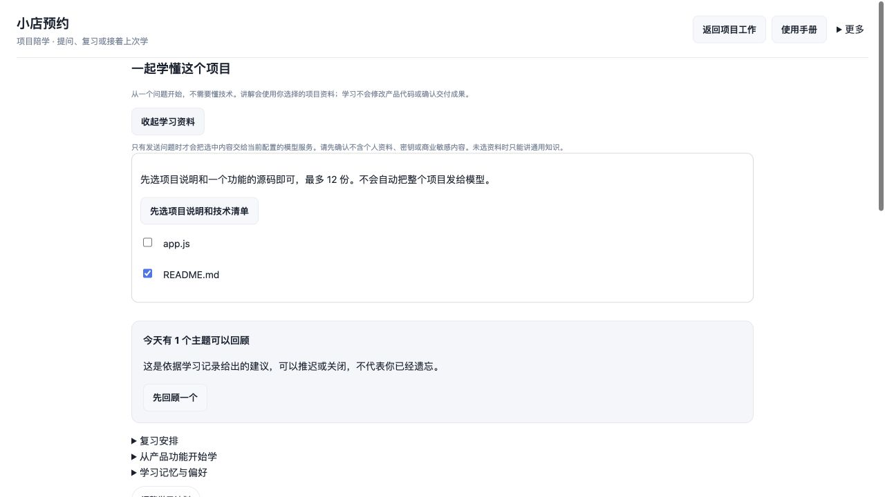

只有点击发送时，选中资料的受限摘录才会交给当前配置的模型服务。不要选择含个人信息、密钥或商业敏感内容的文件。系统会跳过常见凭据文件、隐藏目录、依赖目录和符号链接，并拦截部分常见密钥格式；这些检查不能识别所有敏感内容，仍需你确认资料范围。

**怎样看回答依据？**

讲解中的 `[S1:L1-L2]` 表示本次资料 S1 的第 1–2 行。展开回答下面的 **本轮资料与缺口**，可以看到文件名、摘录行数、版本指纹和未提供的内容。引用行号会检查范围，但不代表系统已自动证明每条结论正确。

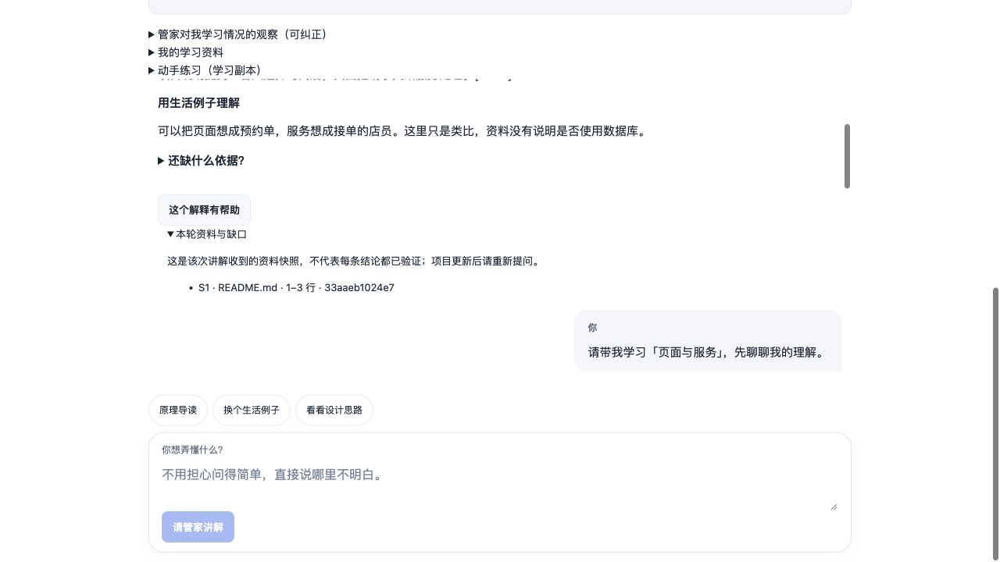

管家应把项目事实、通用知识和推测分开说明。缺少设计记录时，不会把推测说成开发者当时的想法；没选资料时，只能讲通用知识。项目修改后，旧回答仍对应当时的资料；请重新提问，获取当前文件的解释。

**出错和中途退出怎么办？**

- 没有资料：确认选对项目文件夹；资料列表只展示部分常见文本，超大目录只列部分文件。当前最多扫描 1,500 个目录条目、下探 4 层，并展示至多 200 份普通项目文件，另附本轮正式 Markdown 文档。
- 某份资料被跳过：查看缺口提示。单文件超过 128 KiB、疑似含凭据或不是普通文本时不会提供内容；每次最多 12 份，总摘录上限约 48,000 字符，单份约 16,000 字符，长文件可能只有部分内容。
- 正在执行其他任务：可以阅读学习记录，等当前任务结束后再提问；学习与开发共用串行调度，不会并发偷偷修改项目。
- 回答报错或中断：根据提示重新检查状态或停止当前任务；停止后再发送问题，不要反复点击。已收到的记录会保留。
- 返回项目或刷新：已发送的学习记录保留；长对话的较早记录会归档，可以在下载的学习资料中查看。模型每次只接收有限的最近对话，并非无限记忆。未发送的问题和资料选择在同一浏览器中保留。换浏览器不会同步未发送草稿。

学习默认不修改产品代码、不确认交付文档，也不触发开发安排。它仍需要已配置的模型服务；已提供问答、原理导读、学习计划、学习副本编辑与资料导出。练习反馈没有自动执行代码，不是实际测试报告；目前不支持联网查找和核验外部学习链接。已有正式交付文档的阅读和下载不受影响。

### 安排学习计划，接着上次学

点击 **帮我安排学习计划**，管家会一次问一件事：想学到什么程度、目前的基础、每天可用的时间。可以选择示例目标，也可以在输入框里说自己的目标；最后点击 **请管家安排**。计划会基于本次所选资料，不会自动读取整个项目。

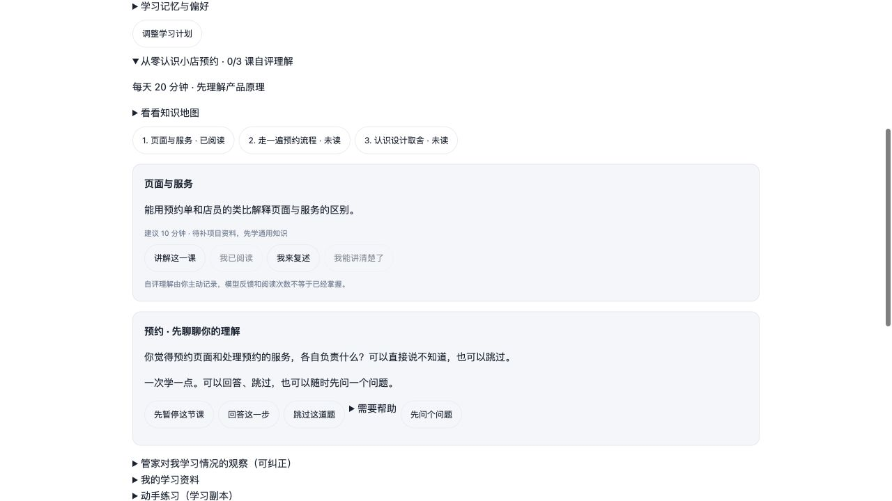

展开计划可以查看知识地图，点击课程名字切换主题，再点 **讲解这一课**。听懂后可以标记 **我已阅读**；点击 **我来复述**，用自己的话回答提示问题，再发送给管家获取反馈。

**我能讲清楚了** 需要先标记已阅读并完成一次复述才能使用，由你主动记录“自评理解”。这不是考试合格证明，也不是模型自动认定你已掌握。随时可以回到旧课复习，问答会留在学习对话中。

点击 **调整学习计划** 可以重新安排，旧计划与进度在项目记录文件中保留最近 5 份；当前界面展示新计划，课程状态重新开始。下次提问、逐课讲解或整理资料时，如果计划来源变化或本轮未提供，会提醒你重新选择资料或调整计划；不会自动重写旧课或偷偷替换旧回答。

### 什么时候复习，由你决定

完成步骤作答或记录自评理解后，展开 **复习安排** 可以看到建议日期与原因。待澄清或仍不确定的回答通常建议明天再看；有理解依据的回答通常 3 天后回顾，后续复习可逐步延长，最长 14 天。这只是透明的安排规则，不是精确预测你什么时候会忘记。

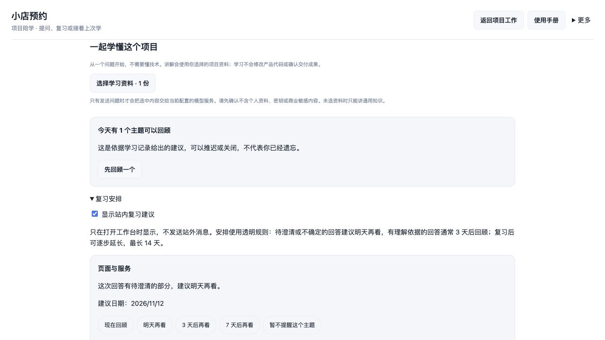

- 到期时会显示 **先回顾一个**；也可以随时点 **现在回顾**，用一个不同的小问题重新理解。
- 没时间时选 **明天再看 / 3 天后再看 / 7 天后再看**。
- 不想继续这个主题时点 **暂不提醒这个主题**。之后可以选择日期重新安排；新回答不会偷偷解除你的单主题暂停。
- 关闭 **显示站内复习建议** 后，不显示到期提醒，记录仍保留，你可以手动回顾。
- 纠正一条观察后，基于该观察的旧误区提醒会停用，等待重新确认。

提醒只在打开工作台时出现，不发送站外消息、不自动调用模型，也不会自动确认你已经掌握。复习继续使用当前选中的资料；历史回答中的项目事实仍需要本轮资料核对。

### 从你认识的产品功能开始

选好资料后，展开 **从产品功能开始学**，点击 **整理项目知识地图**。管家会列出资料支持的功能，例如“预约”，并整理概念及前置知识；不需要你先知道对应的代码文件叫什么。

点击功能名字或概念的 **从这个概念开始**，先看说明、流程和推荐文件清单。只有点击 **确认资料，开始学习** 后，才会读取这些文件的受限摘录并开始陪学。功能入口不要求先创建课程计划。

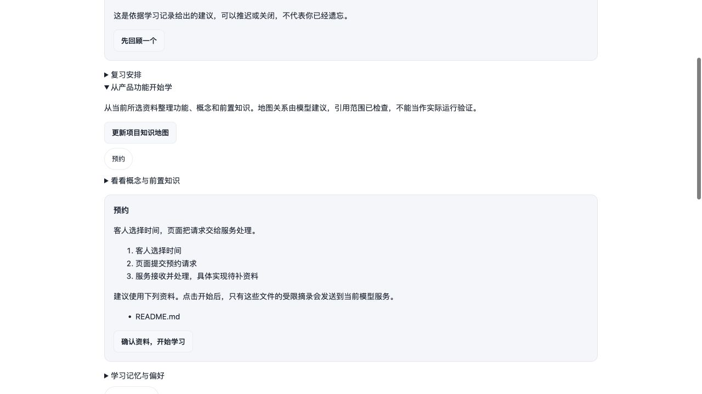

地图中的关系是模型提出的教学建议，不是系统实际运行过的调用链。通用基础、项目资料和推测会分开标注；引用范围会检查，但仍需要核对解释是否成立。如果推荐资料发生变化或不能读取，系统会让你先重新生成地图，避免沿用旧关系。

### 管家如何记住之前的学习

展开 **学习记忆与偏好**，可以查看最近使用了哪些学习观察和较早问答。它们仅帮助管家了解你的学习过程，不作为本轮项目事实。你纠正过的误区会优先采用纠正说明，相关旧反馈不会再次被检索使用。

回答下面的 **这个解释有帮助** 可以记录你喜欢的讲解，之后匹配旧问答时会优先考虑它。这里按当前问题、概念和关键词匹配，每次最多使用 5 条观察与 4 段较早问答，并不是无限记忆。

可以关闭 **使用同项目、同轮次较早的学习记录帮助讲解**。关闭不删除记录，也不停止记录新问答；当前对话仍需最近有限消息，但不再检索旧问答和学员观察。地图整理者和资料整理者不接收这份旧学习记忆。

### 像和老师聊天一样学一课

点击 **讲解这一课**，管家会先用一个简单问题了解你已有的认识。选择 **回答这一步**，在下方输入自己的想法；不懂时可以直接说“不知道”，也可以点 **跳过这道题**。跳过不会被记成学会或答错。

当前问题直接显示在步骤卡片里；多次提示或重启后仍保留同一道题。陪学开始时课程目录会收起，需要时可以展开。

之后会经历“一起理解 → 试着解释或预测 → 看看反馈 → 换个场景试试 → 回顾与下次安排”。点击 **继续下一步** 推进，需要作答时由你发送回答；发现误区时可能回到简单解释。

展开 **需要帮助** 可选择 **再简单一点 / 给我一点提示 / 换个例子 / 看完整示例**。提示逐步从概念、生活类比深入到相关代码片段，但不会运行代码。点 **先问个问题** 可以随时插入普通答疑，不自动推进当前步骤。点 **先暂停这节课** 后记录保留，下次可点 **接着上次学**。

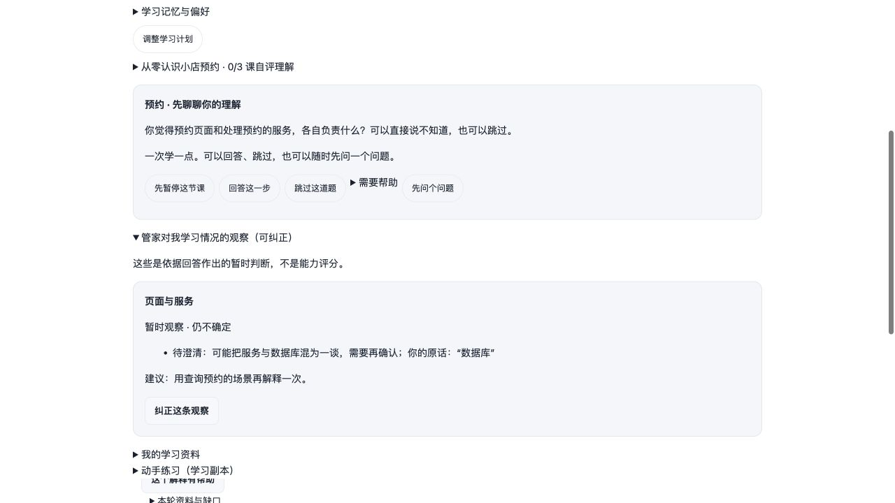

展开 **管家对我学习情况的观察（可纠正）**，可以看到本次回答表现出的理解、需要澄清的部分和建议。每条观察引用你的原话，都是暂时判断，不是能力评分，也不会自动改变“自评理解”。如果判断不对，点 **纠正这条观察**，在输入框说明原因并点 **保存纠正**；之后管家会看到你的纠正，原来的误区判断不再作为有效观察使用。

### 把学习资料带走

展开 **我的学习资料**，点击 **整理学习资料**。管家会根据本次所选资料生成项目原理导读和术语词典。你仍可以在对话里继续追问，不需要重新开始。

- **下载 Markdown**：得到包含导读、计划、词典、问答和练习记录的文字文件，方便继续编辑。
- **下载离线 HTML**：用浏览器直接打开，断网也能读；可以通过浏览器“打印 → 保存为 PDF”保留 PDF。
- **下载学习资料包**：ZIP 内有六份 Markdown、离线 HTML 和资料版本清单，包含学习观察、用户纠正与复习安排。它不包含项目源码或运行环境，也不会读取或打包系统中配置的模型凭据。你自己写进聊天的话会出现在问答记录中，下载或分享前应自行检查。

代码或学习资料改变后，先重新提问或整理资料，再下载最新版本。系统在读取所选资料时核对来源，不会持续监控整个项目；历史导出保留当时的内容，不自动更新。

### 在学习副本里动手练习

1. 先选择想练习的项目文件，展开 **动手练习（学习副本）**。
2. 阅读说明，勾选 **我确认仅创建学习副本，不执行代码**，再点 **创建学习副本**。只复制本次选中的可用文本文件，不是复制整个产品；遇到被跳过的资料需返回问答核对范围。
3. 点击文件名，在编辑框里修改。例如，把一条提示文字换成自己的说法，或者给一个函数补充解释。
4. 点击 **保存学习副本**。尚未保存时，反馈按钮会提醒你先保存。
5. 点击 **请管家反馈练习**。管家读取已保存的副本，解释修改和可能的问题；不会运行代码，也不能把这份反馈当成测试通过。

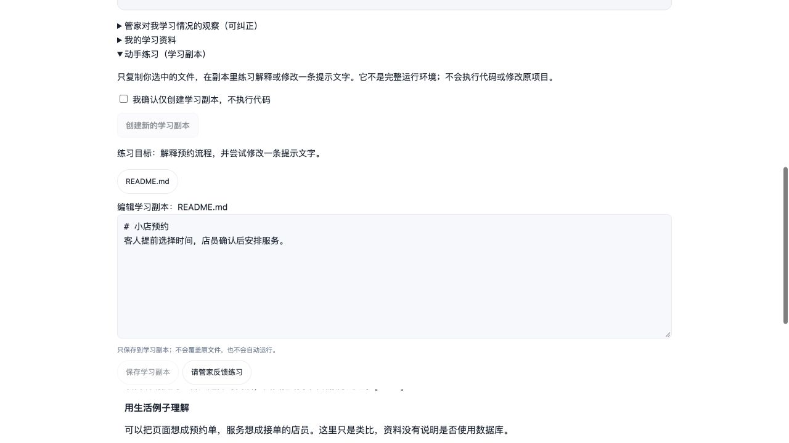

原项目文件不会被上述保存操作覆盖，业务交付和文档确认状态不变。副本保存在项目的工作台学习目录下，不是安全执行沙箱，也不是完整运行环境；本功能没有代码运行按钮。练习反馈会注明没有实际执行代码。当前编辑器对超过 16,000 字符的文件只读显示，可换一个较小的文件练习。

创建新副本不会删除旧文件，当前界面切到新副本。已保存内容在项目中保留；未保存的编辑草稿仅在同一浏览器按文件版本保存，不会自动提交给模型。需要分享或运行完整项目时，回到项目工作流程另行处理。

## 云端邀请试用时

如果管理员提供的是服务器地址，用收到的专属 HTTPS 地址和原生登录方式进入，不要分享登录链接。管家的聊天、成果阅读与确认方式不变。管理员需先完成部署验收；仓库中的示例域名不是已经上线的服务。

如果管理员正在进行私有验证，可能会让你打开 `http://localhost:3081/`。这个地址通过当前电脑的 SSH 隧道连接服务器，其他人的电脑不能直接使用；隧道断开或电脑重启后，请管理员重新连接。若提示未配置模型，在左下角更多菜单 → 设置 → 模型中自行填写 API 密钥并保存，不要把密钥发给管家。

服务器里的“项目文件夹”属于服务器，不是你电脑的文件夹。处理已有项目时，先请管理员安全导入到该实例的 `/workspace`，再告诉管家希望保留和新增什么；点击选择文件夹不会自动上传电脑资料。不要在普通聊天消息里粘贴模型密钥或密码。

下载的文档包可以带回自己的电脑，但不包含完整运行环境和会话备份。需要换服务器或恢复工作时请联系管理员；不必自己复制系统配置。邀请试用采用独立实例，仍限可信用户使用。

## 10. 手册维护记录

本文件是管家模式面向普通用户的唯一主使用手册。可离线阅读的同名 HTML 由它生成；技术实现请看 `personal-manager.md`。

| 日期 | 核对版本 | 更新内容 | 核对方式 |
| --- | --- | --- | --- |
| 2026-11-12 | 1.14.1 | 首次建立新手路线、五张实机界面示例、确认与下载说明、故障对照及后续简化建议 | 对照当前界面与接口；在隔离示例项目中验证模板检查、文件生成和文档打包 |
| 2026-11-13 | 1.14.1 | 补充简洁模式实现方案入口和分批计划；已核对，当前用户操作不变 | 对照方案与当前功能边界；重新生成离线版 |
| 2026-11-13 | 1.15.0 | 第一批：简洁首页、动作卡、一次一个问题、模式切换与更多菜单；更新受影响截图和离线版 | 157 项自动测试；隔离浏览器验证模式切换保留草稿、问题集中显示、完整能力仍可访问 |
| 2026-11-13 | 1.16.0 | 第二批：独立阅读面板、明确确认、常用下载、高级导出折叠和内置手册入口；同步受影响截图 | 160 项测试；浏览器验证未确认状态不被查看动作改变、关闭及切换模式保留评论、下载不依赖模板、文档包生成 |
| 2026-11-13 | 1.17.0 | 第三批：两步创建、独立交付目标、默认简洁入口及审阅前修改引导；更新首次引导截图与离线版 | 163 项测试；隔离模拟任务旅程、窄屏及键盘检查；真实模型与真人试用未在本批执行 |
| 2026-11-13 | 1.18.0 | 对话式简洁模式：自然开场、可编辑示例、下一步接在对话末尾、自由回答按需展开、固定输入与停止入口、回到最新及审阅意见返回；更新截图与离线版 | 166 项自动测试；隔离桌面与 390px 窄屏、长对话、草稿及审阅往返验证；无真实模型调用或真人试用 |
| 2026-11-13 | 1.18.0 部署准备 | 补充云端专属登录、服务器文件夹、项目导入和备份边界；已核对，现有界面操作不变，截图继续适用 | 对照部署文件与服务边界，重建离线版；真实服务器上线另行验收 |
| 2026-11-13 | 1.18.0 私有部署验证 | 补充私有隧道访问、断线恢复及模型设置入口；已核对，现有管家界面操作不变，原截图继续适用 | 真实 ECS 首页、管家接口、中文 PDF / 可编辑 PPTX 和重启持久化通过；浏览器核对空白模型设置，重建离线版；真实模型任务待验证 |
| 2026-11-13 | 1.19.0 项目陪学第一批 | 新增学习入口、显式资料选择、独立问答、原理导读及本轮依据；新增两张真实界面截图，说明来源范围、敏感资料检查和未实现能力 | 171 项自动测试；隔离真实界面与 Host 路由验证选择、讲解、引用和 390px 布局，模型回答为模拟；未验证真实模型教学质量 |
| 2026-11-13 | 1.20.0 项目陪学第二批 | 逐个询问学习偏好、知识地图、课程目录、逐课讲解、复述反馈和独立自评进度；新增计划截图 | 176 项自动测试；隔离浏览器走通三问安排与阅读/复述入口，模型为模拟；重建离线版 |
| 2026-11-13 | 1.21.0 项目陪学第三批 | 增加学习资料、术语词典、三种导出、明确确认后的学习副本编辑和只读反馈；更新五张学习截图及长页面滚动，长期问答自动归档并随资料导出 | 184 项自动测试；真实界面/Host 路由与模拟模型验证整理、7 文件 ZIP 完整性、副本保存不改原文件、桌面与 390px 滚动；重建离线版 |
| 2026-11-13 | 1.22.0 教学优化第一批 | 增加六步陪学、可跳过诊断、分级帮助、暂停续学与有原话依据的可纠正学员观察 | 190 项自动测试；真实组件与 Host 路由、模拟模型验证诊断回答和观察展示；同步截图与离线版，未验证真实教学效果 |
| 2026-11-13 | 1.23.0 教学优化第二批 | 增加功能—概念—前置关系、推荐资料确认、来源变化拦截和可关闭的相关学习记忆检索 | 198 项自动测试；真实界面与 Host 路由、模拟模型验证地图生成和确认后进入陪学；同步截图与离线版 |
| 2026-11-13 | 1.24.0 教学优化第三批 | 增加可控站内复习、持久化本步问题、学习观察与复习导出；更新受影响截图；提供本地教学评测案例与工具 | 203 项自动测试；隔离真实界面与模拟模型验证推迟/开始复习、8 文件 ZIP 完整性和窄屏；12 个评测案例仅准备与本地检查，未运行真实模型或真人教学实验 |
