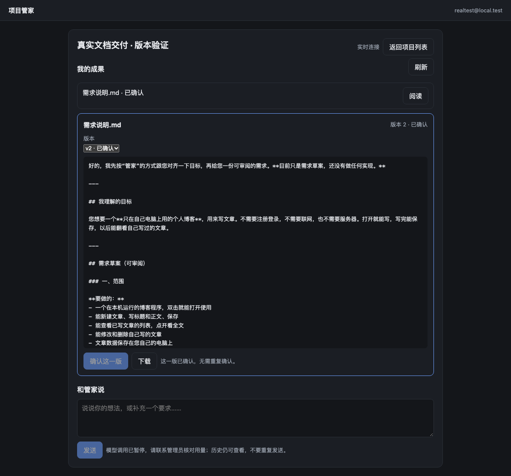
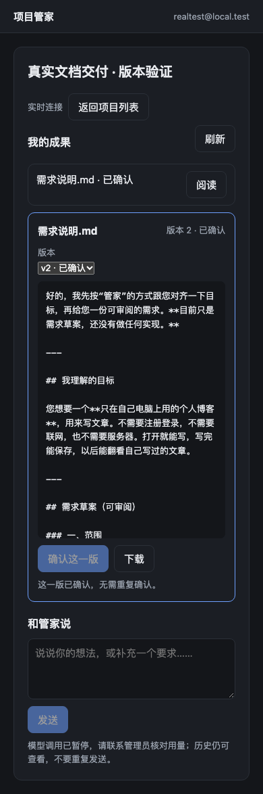

# 2026-11-14 待验证链路续测

## 当前结论

**真实文档版本、确认与浏览器下载已验证；原生提问、拒绝和停止通过真实 DSH 引擎＋协议夹具验证，但真实 DeepSeek 工具调用仍阻断。** 未推送、未部署、未修改用户现有模型凭据/profile，未自动批准工具权限。

## 真实调用为何暂停

本轮追加了1次真实工具请求，上游返回 HTTP 400，没有 usage。保留该次 **17,432 token 预占**，不记为0、不删除锁、不重置预算、不重发请求。账本现有10次尝试：9次已结算（加此前31 token，共 **14,671**），1次未知占用 **17,432**；可用余额 **167,897 / 200,000**，执行保持冻结。金额仍未计算。

排查发现测试 profile 没有显式加载 `dsh-tool-ask-user`，但测试网关要求首次调用该工具。已补齐 profile 组合，并增加发送前“所需工具已声明”的检查。**原400响应正文当时未保存，不能断言此项是唯一根因。** 已增加受限、脱敏的HTTP错误诊断供后续核对；没有为取得错误正文而重发。

工具参数按 [DeepSeek 官方 Anthropic 兼容说明](https://api-docs.deepseek.com/guides/anthropic_api/) 核对。网关目前只支持显式授权的 `ask_user_question` 与固定 `manager_test_note` JSON工具，仍禁止通用Shell、图片、外部工具和任意路径。工具声明、历史及返回结果同样纳入32KB输入与输出预算限制；不能把此受限适配当作通用工具预算网关。

`localhost:8091` 仍可登录、阅读历史与已有成果，界面明确显示“模型调用已暂停”。新消息会明确拒绝，草稿保留，不会无限排队或触发新模型请求。相同已接收请求可回放，不重新扣费。恢复真实调用前必须核对未知请求；不能仅依据HTTP400就自行释放预算。

## 不新增模型调用的验证

| 链路 | 方法与结果 | 证据性质 |
| --- | --- | --- |
| 原生多题追问 | 原生工具发两题；单选/多选答案经租约签名桥接返回；漏答400，完整答案200 | 真实DSH引擎、真实BFF；模型响应为协议夹具 |
| 原生权限拒绝 | 原生工具调用ApprovalService，产品回答deny后返回rejected；目标便笺不存在，保留独立审计记录 | 同上；未点击允许，未执行便笺写入 |
| 原生停止 | 产品HTTP停止入口向活动Agent发取消；真实turn/end为aborted、reason=user；等待卡取消后才返回停止确认 | 同上；验证的是等待工具时停止，未覆盖上游生成中停止 |
| 真实文档交付 | 复用前轮真实需求回复为v1，拼接前轮设计回复为v2，通过Worker签名和有效租约注册 | 来自真实模型的既有字节；第二版由测试服务整理，不冒充本轮模型新生成或原生文件编辑 |
| 版本与审阅 | 初始未确认；v2注册后v1仍可读；确认旧版409，错误hash409，明确确认最新版本200 | 真实产品API与文件快照 |
| 浏览器下载 | Chrome选择v1/v2、实际下载v2，下载SHA-256与登记值一致；390px无溢出 | 真实浏览器，无模型调用 |

协议夹具使用单独临时账本和虚构响应，**其构造usage不是实际DeepSeek用量，没有写入真实预算表**。它验证真实引擎与桥接行为，不验证真实模型会正确选择、填参或使用工具。

## 修正的问题

- 新注册文档在登记时校验真实字节hash并保存不可变快照，单份最多1MB；新版不再覆盖旧版正文。相同最新hash重复登记返回原版本。
- 项目目录不能以符号链接指向其他项目或根目录外。仍不替代执行容器/操作系统的强隔离。
- 停止必须取得引擎明确回执；缺回执进入待核对，不用按钮消失冒充成功；并发状态改变时拒绝误报成功。
- 修复异步加载结束重新启用“已确认/历史版确认”按钮的问题，显示确认条件；切换项目时清除上一项目阅读面板。
- 补充HTTP错误脱敏、原生IPC通道退出及上游请求收尾，防止进程结束时漏记用量。

最终离线回归 **101项全部通过**；语法检查、真实文档浏览器版本切换与下载复查通过。

## 可复现入口

所有命令需Node24，在 `services/product-api` 下运行：

```sh
# 离线回归和语法检查
node --test tests/*.test.mjs
node --run check

# 真实引擎＋协议夹具，不调用外部模型、不写真实额度账本
node probes/run-native-interaction-cases.mjs --fixture-mode

# 仅对已有交付成果做浏览器阅读和下载复查，不调用模型
node probes/verify-real-delivery-browser.mjs
```

`run-native-interaction-cases.mjs` 不带 `--fixture-mode` 时属于真实付费测试；当前冻结账本会在启动前拒绝，不能改目录或删除账本绕过。第一次真实失败与夹具结果分别保存。

本地证据：真实账本和原400结果在 `control-data/authorized-20261114-200k/`；完整引擎夹具验证在 `control-data/native-fixture-48aqlt/`，HTTP停止复查在 `control-data/native-fixture-sBDzsR/`。真实交付结果为 `real-delivery-result.json`、`real-delivery-browser.json`。这些均被Git忽略；保存的是脱敏证据，不含owner凭据。

## 尚未验收

真实DeepSeek正确发出工具调用、原生结构化追问和审批拒绝仍须复测；新项目编码、真实工具修改已有项目、上游生成中停止、真实压缩包交付及全部24项正式案例尚未通过。当前证据不得写成“全链路已完成”。




