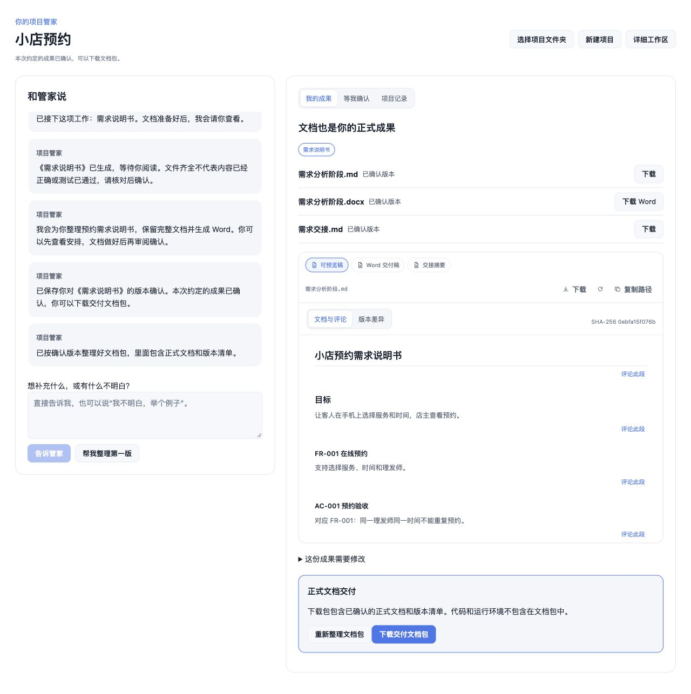

# 项目管家（personal_manager）

管家是工作台的默认入口。用户围绕一个项目与管家沟通；后台由需求、设计、实现、测试和交付角色执行。文档始终是正式成果，可阅读、逐段评论、确认具体版本和下载。

本分支版本为 1.7.0。原五阶段界面保留为“详细工作区”，可随时返回管家。



## 使用步骤

1. 选择存放项目的文件夹，或沿用当前工作目录；“新建项目”在当前目录建立新一轮记录，保留旧记录。
2. 选择本次目标：整理需求文档、形成实施方案，或制作可用工具。填写项目名和想法后，请管家接下项目。
3. 与管家交流，或点击“帮我整理第一版”。管家一次提出少量必要问题或一份具体安排。
4. 点击“按这个安排开始”才会委派执行任务。管家回复本身不能替用户批准执行。
5. 在“我的成果”阅读文档。可以评论段落，将意见交给管家；已确认成果通过“这份成果需要修改”重新开启相关审阅。
6. 阅读本类全部文件，解决未完成评论后，勾选并“确认这一版”。实现成果另有逐项检查清单。确认绑定本次文件哈希，期间文档变化会拒绝旧确认。
7. 完成本次交付目标后，整理并下载文档 ZIP，内含确认快照和版本清单。需求文档提供 Markdown 与 Word；其他阶段暂提供 Markdown。

仅交付需求的项目在需求确认后结束，不自动进入设计或开发。“形成实施方案”到设计确认结束；“制作可用工具”覆盖完整五阶段。管家不会自动执行外部部署、付款或删除。未来需继续开发时，当前版请新建一轮并明确交付目标；不自动覆盖已执行项目的交付约定。

## 执行与恢复

调度位于 Host，不依赖浏览器轮询驱动任务。关闭页面后任务记录保留；Host 重启后重新观察原会话，不盲目重发消息。

任务具有排队、创建、提交、运行、等待审阅、需要补充、停止中、已停止、失败和待核对状态。网络/Host 在提交时中断会进入“需要核对执行情况”，阻止再次提交，避免重复执行。查看原会话后可重新检查状态或请求停止。停止请求只有在观察到实际会话结束后才标记完成；已产生的文件不会撤销。

同一项目由原工作台与管家共享 Host 串行锁。管家还会检查已有阶段会话及执行前的上下文版本。并发编辑文件仍可能发生，因此不建议同时在详细工作区启动另一个执行者。

DSH 工具审批保持原生机制：当前版通过“查看授权与处理详情”进入原生会话处理审批或异常的追问；管家不自动批准权限。专业角色被要求将业务问题交回最终回复，由管家转述，但模型可能仍调用其原有追问工具，需要在原生详情处理。

## 架构

- `manager.js`：交付约定、沟通记录、任务状态、调度、重试去重、文档确认和交付打包。
- `manager-adapter.js`：DSH 0.2.1-rc.2 `sessionController` 的创建、重命名、消息、投影/历史读取和取消适配。
- `cordis.patch.yml`：注册 `personal-manager` preset，仅配置沟通 persona，不添加执行工具。
- `index.js`：受 DSH 认证保护的 `/workbench/manager` 接口、任务恢复注册表和定时监督。
- `client.js`：管家首页、交付目标、对话、安排卡、成果、确认与项目记录。

管家使用专门会话处理每次沟通，前台提供一个持续的项目对话。每次请求附带交付约定、确认状态、最近至多 16 条且合计至多 24,000 字符的历史，以及按既有资料选择构建的版本化文档上下文；它不是无限长的单一模型上下文。后台输出被当作数据交给管家总结。管家输出的 JSON 是建议，不是工具权限；服务端校验允许的阶段和交付范围，并等待用户点击执行。

专业任务继续使用阶段 preset 和版本化上下文清单。任务提交前再次核对上下文指纹。执行结束只代表模型回合结束；系统检查文件齐全后标记“待审阅”，不推断业务正确或测试通过。缺文件时保留缺口；用户确认仍是独立动作。

## 数据

项目内：

```text
.dsh/workbench/changes/<boardId>/
├── manager.json           # 交付约定、消息、任务、操作去重记录
├── documents/             # 当前正式文档
├── contexts/              # 执行输入清单
├── approvals/             # 不可变确认记录
├── snapshots/             # 内容哈希快照
└── deliveries/<id>.zip    # 已确认文档包
```

`$DSH_HOME/workbench/manager-projects.json` 记录需要恢复监督的项目位置，不存模型密钥。浏览器按项目与轮次保存未发送消息草稿。模型的输入提示保存在 Host 任务记录，GET 接口不向界面回传这些内部提示。

复制或备份项目时应同时保留 `.dsh/workbench`；恢复后台监督还需要保留 DSH 会话存储与上述注册表。此版本仍面向个人/可信环境，尚无多租户授权隔离。

## API

- `GET /workbench/manager`：当前轮次的状态、任务、成果与确认摘要。
- `POST /workbench/manager`：操作包含 `requestId`、当前 `revision` 和 `action`。
- 操作：`configure`、`message`、`dispatch`、`cancel`、`recheck`、`revise`、`approve`、`package`。
- 项目和轮次沿用 `x-workbench-root`、`x-workbench-board`。这些标头不是多租户访问控制。
- 重复操作编号不重复创建任务；过期 revision 返回冲突，输入草稿保留。

文档包只包含本次交付范围内的确认快照，不含项目代码、环境、依赖或凭据。即使工作文件后来变化，旧 ZIP 仍准确代表当时的确认版本；界面只有在当前交付再次满足确认条件时才展示下载入口。

## 验证与当前边界

79 项自动测试覆盖既有功能及管家协议、交付范围、任务去重、版本冲突、缺文件、取消确认、Host 重启、不确定提交、上下文变化和快照打包。

浏览器在独立临时项目中使用真实前端、Host 路由和模拟 SessionController 验证接单、安排、文档生成、确认、ZIP 下载、详细工作区切换及 390px 布局。另启动独立 DSH_HOME 的真实 DSH 实例，确认配置合成与会话服务注入。没有调用真实模型，也没有修改真实用户项目或重启正在使用的 DSH。

语音输入、朗读、云端多用户、精细计费、独立软件预览入口、模型成本上限和原生审批在管家页内的整合仍待后续实现。当前可通过详细工作区查看运行预览和原生会话。

## 升级

更新插件后必须重启 DSH Host 并刷新页面，以加载新的管家接口与 preset。三个原有 bundle 均需保持启用。不要只更新前端文件。
