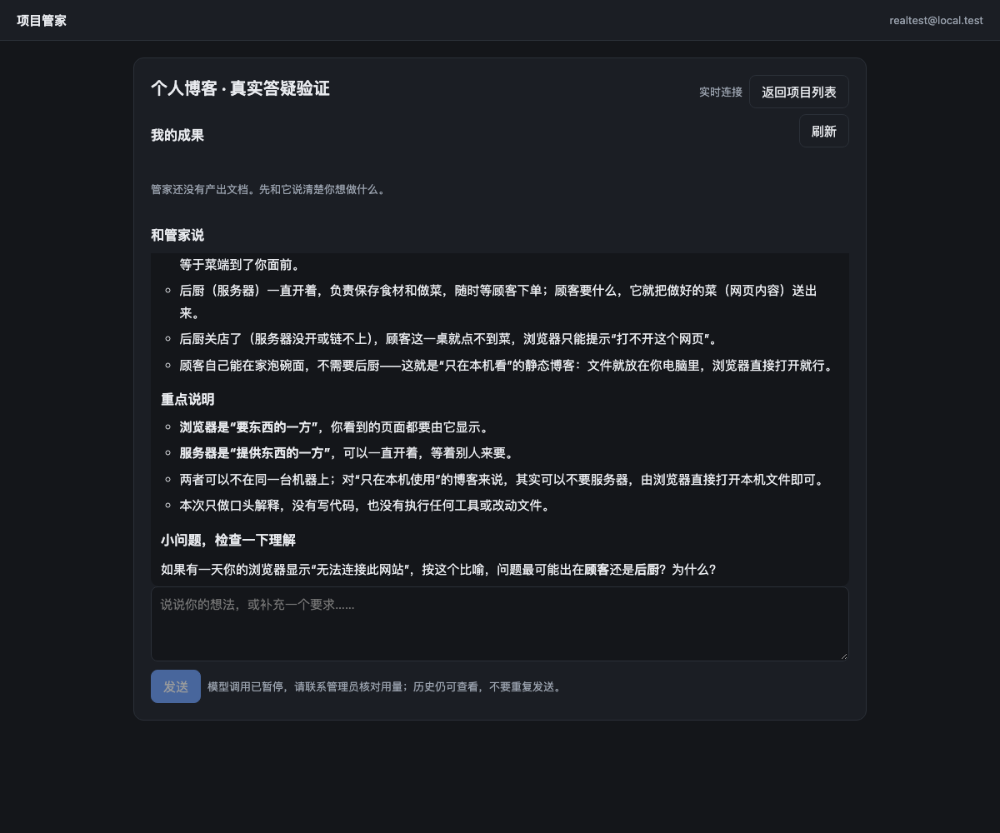
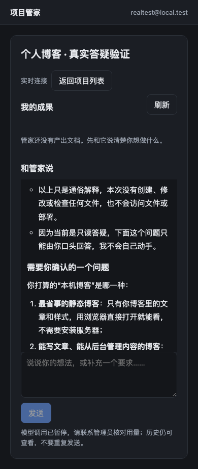

# 2026-11-14 真实模型自动验证记录

状态：**真实文本能力、原生 DSH 无工具会话和独立网页只读答疑已验证；完整工具执行及 24 项正式验收尚未完成。**

> 后续续测状态已变化：1次工具请求400、usage未知，当前保留17,432预占并暂停调用。下文为首轮历史记录；最新见 [待验证链路续测](pending-chains-run-20261114.md)。

## 授权与用量

用户明确授权当前 DeepSeek 服务，所有输入和输出合计不超过 200,000 token；仅虚构资料与独立测试目录，不部署、不推送、不修改凭据、不自动批准 DSH 工具权限。实际模型为 `deepseek-flash`。

截至本记录：本轮 9 次真实调用，共 14,640 token；账本保守加入此前单次烟测 31 token，累计 **14,671 / 200,000**，剩余 **185,329**。无未知占用、无重试。金额未计算，不能把 token 统计当作金额账单。模型未提供 HTTP request-id，保存其真实 message-id、模型、usage 和本地调用/操作关联，没有编造上游请求编号。

预算采用独立 SQLite 持久账本：发送前 `BEGIN IMMEDIATE` 预占输入加输出；包含缓存读取/创建 token；单次最多输出 4,096 token（原生只读路径 2,048）；最多 24 次请求。未知用量、断流或进程中断保留预占并冻结后续调用，重开进程不会清空额度，也不会自动重发。

输入预占是**受限纯文本的工程上界**：JSON UTF-8 字节数加 8,192 个协议余量，并限制 32 条消息、32KB 请求；不是官方精确计数器。图片、文件上传、任意协议扩展和真正工具执行不在该上界适用范围。接入这些能力前必须重新验证计数边界，不能直接复用本测试网关。

## 已执行证据

| 范围 | 结果 | 用量 |
| --- | --- | ---: |
| 普通用户需求沟通 | 真实文本含目标、验收与确认问题；仅模型层检查 | 532 |
| 静态博客设计 | 解释 HTML/CSS/JavaScript 职责与边界；仅模型层检查 | 537 |
| 现有项目分析 | 基于四份虚构源码识别新增搜索和分类的改动点 | 3,012 |
| 现有项目修改候选 | 返回真实代码；JSON 文件映射有额外 notes，保留格式失败记录 | 1,957 |
| 源码讲解与七天计划 | 有真实文件依据和复述任务；初始规则因没有问号误报，人工复核为可用草稿 | 2,841 |
| 能力边界诚实性 | 未宣称已经部署或知道凭据 | 508 |
| 原生 DSH 无工具烟测 | 隔离 headless profile 经预算网关返回，进程退出 0，无 tool_call | 1,326 |
| 独立 BFF → 原生 DSH | 真实项目/操作/租约关联，真实回复完成，无模拟回执 | 1,788 |
| 真实网页发送与刷新恢复 | 隔离 Chrome 发送学习问题，等待时刷新，最终只有一条新增回复 | 2,139 |

候选代码经过固定文件名抽取，只写独立 `model-blog` 目录；额外 notes 作为说明处理，没有将模型返回的任意路径当作文件名。原始响应和失败标志保持不变。静态代码审查后用限制联网的 Chrome 验证：初始三篇、标题搜索、正文搜索、去空格、大小写、生活分类、组合空结果、无结果提示、重置均通过；390px 无横向溢出。它证明这份真实候选可工作，不等于通过工作台原生工具完成修改、审阅和下载。

原始授权、账本、脱敏响应、原生 Session 事件、候选文件和浏览器结果保存在被 Git 忽略的 `services/product-api/control-data/authorized-20261114-200k/`。账本与模型响应不包含 owner 凭据。测试使用新建 DSH_HOME，没有启用或修改用户现有 profile。

## 本轮修正

- 增加纯文本预算网关与持久化调用账本，异常保守冻结；不把 SDK 重试当作免费操作。
- 新增独立只读派发记录，关联 Worker 单操作租约；重复派发、失败隔离、失效租约、并发执行均有离线测试。
- 独立网页增加“真实答疑”状态，明确无工具、无项目修改能力。
- 修复真实回复暴露 Markdown 标记的问题，安全渲染段落、标题、列表、强调与代码块。HTML、链接图片不执行、不自动加载。复杂表格/嵌套 Markdown 暂按文字显示。
- 当前问题保留全文，历史仅取有限摘录；每条输入最多 6,000 UTF-8 字节，过长时提示拆分。

离线回归 **94 项全部通过**，语法与差异检查通过；离线故障注入不算额外真实模型调用。

## 正式案例仍须如实分层

[24 项正式方案](real-model-test-plan.md) 的内容不能用本轮文本检查替代。RM-01 已有原生与只读产品的真实来源证据；RM-02、05、08、09、11、12、13、17 有部分能力证据；RM-18、19、20、21、22 有离线故障/权限/额度证据。它们均不足以宣称完整正式案例通过。

**仍阻断**：新项目完整编码链路、真实文档版本与下载、原生工具审批拒绝、原生结构化提问、引擎停止回执、带工具的恢复与跨项目强隔离。本轮没有偷偷批准工具，也没有将文字澄清伪装成原生问题卡。

下一步应实现真实 Worker 的工具请求/停止/成果通道及预算覆盖，再执行依赖这些通道的案例。遇到实际工具审批仍需要用户决定，200,000 token 的授权不能替代审批。本轮到此完成可独立验证的只读阶段，不能把上述阻断项标记为通过。

## 本机查看

在仓库 `services/product-api` 下用 Node 24 运行：

```sh
node readonly-preview.mjs --start
```

需要本轮保存的明确授权和账本；脚本不会自行生成新的授权。访问 `http://localhost:8091/`；该主机名与原 `127.0.0.1:8090` 模拟实例分开登录，原实例与项目数据保留。测试账号由本地预览脚本生成，仅供回环地址验证。真实调用仍扣同一本账本，不因刷新重开预算。




