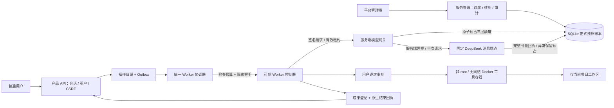

# 正式预算、执行隔离与管理员核对（Service v1）

本次把固定实验账本之外的正式服务能力落在独立产品 API 和 Worker 上。现有插件、只读预览和已授权真实验证实例不自动切换；原 Service v1 批次未调用真实模型或部署；后续服务器验收及独立授权见 [实际验收记录](../../deploy/service/acceptance-status.md)。

## 1. 服务边界与数据流



模型凭据只由产品 API 读取；浏览器、Worker 配置和工具容器都不持有它。Worker 的签名凭据只用于控制面通信，也不挂入工具容器。正式入口使用内置隔离运行时，不能通过配置任意 `engineModule` 绕回宿主执行。原诊断用引擎仍可独立使用，但不会通过正式隔离能力检查。

## 2. 统一 token 预算

- 新任务将登录用户写入 `operations.actor_user_id`，请求体不能指定计费用户。迁移前没有归属的任务不得直接付费执行。
- 三层策略为 `global:*`、`user:<id>`、`project:<id>`。缺少任意一层、额度为零、超额或有未知用量，均拒绝新的模型请求。
- 策略可选 UTC 自然日、UTC 自然月、累计。周期创建后不可直接切换，调整额度需要原因和当前版本号；并发旧版本会被拒绝。
- 每次请求在 `BEGIN IMMEDIATE` 中检查三层额度并写入一条预占；同一调用归属被三层共同统计，不能把三层相加当作实际费用。不同用户、不同项目仍竞争同一全局余额。
- 计量为输入＋输出，包含缓存读取/创建输入。预算不是人民币账单，也没有提供金额报价、扣费或充值功能。
- 当前请求只接受有界文字和内置工具结构，JSON 最多 32KB，预占为 UTF-8 JSON 字节数＋8192 协议余量＋最大输出。该保守估计仅适用于当前文字协议；不能直接扩展为图片、文件或任意工具模型的收费估算。
- 完整回执且用量在预占和输出边界内才结算；HTTP 错误、断流、取消、用量缺失或超量转 `unknown`。已知超量也计入冻结预占，不能低估。
- 未结预占跨日/月继续保留。进程重启不清零；超过 180 秒没有结算的 `held` 在下一次调度、网关调用或管理员查看时转未知。模型 HTTP 超时为 120 秒，无重试。
- 未知用量冻结关联用户/项目/全局；当前采用保守的全局停止，防止继续使用无法核实的预算。管理员必须对照上游账单提供实际 token、原因与凭证编号；不得低于已知实际用量。核对有乐观版本锁和审计，不重发原任务，不批准工具，也不伪造引擎结束。

主要表：`token_policies`、`service_model_calls`、`service_budget_carryovers`、`platform_admins`，数据库迁移版本 9（新增不可变 `service_run_authorization`；兼容原版本 8）。旧 `quota_accounts` 人民币占位表保留兼容，不作为本服务收费依据。

### 旧实验预算结转

旧实验账本不会自动变成“全局额度已清零”。启用正式服务前，先停止旧实验调用，备份数据库及 WAL，再显式导入每一本账本：

```sh
cd services/product-api
PRODUCT_API_DB=/srv/manager/control/product.sqlite node service-admin.mjs import-ledger /absolute/path/to/old/budget.sqlite
```

只读快照导入已用＋未知预占，作为全局累计承诺，跨周期保留；同一真实路径不能重复导入。导入不会修改旧文件、授权、冻结状态，也不会重新请求模型。不要复制同一账本后以另一条路径导入，也不要继续向已导入的实验账本新增调用。未知历史预占仍冻结正式全局预算；取得服务商凭证后，在服务管理中核对**历史累计实际 token（包含原已用）**。旧账本仍保留原始记录，审计结论写在正式服务内。

现有两本实验记录合计：已用 23,824、未知预占 17,432，共承诺 41,256 / 原授权 200,000。此次没有导入或解冻真实旧账本，避免替管理员认定未知用量。本轮离线测试用独立数据库验证结转。

## 3. 隔离执行

- 镜像必须固定 `仓库@sha256:<64位>` 或本地 `sha256:<64位>`，禁止浮动 tag；`--pull=never`，没有 Docker 或镜像就拒绝执行，无宿主降级。
- 每次握手动态核对 Docker 和镜像；开始模型循环前核对项目目录可读写，环境不合格时不花费模型预算。
- 容器仅挂载服务端选择的当前项目目录到 `/workspace`；拒绝目录越界、项目根符号链接和工作台源码保护根的重叠。用户不传宿主绝对路径。
- UID/GID 1000:1000、只读系统根、无网络、丢弃全部 capability、no-new-privileges、不挂 Docker socket、不传宿主凭据；临时目录为限额 tmpfs。
- 默认 1 CPU、256MB、64 PID、30 秒、输出上限 16KB；参数有硬上限。超时、取消或输出越界时终止并强制清理容器。
- 模型只提供 `ask_user_question` 与 `run_project_command`。命令展示给用户，只有该次明确允许才进容器；拒绝、过期或取消不会执行。模型循环最多 8 次、每次输出默认 1024、配置上限 2048 token。
- 控制器以模型真实回复生成独立 Markdown 成果，登记校验和后再提交结束回执；文件操作不等于用户已确认交付。

这是容器工具边界，可信 API/Worker 控制器仍属于管理员维护的软件。Docker 共享宿主内核，不是虚拟机级恶意租户隔离。当前无外网，不能在任务内联网安装依赖；依赖应由管理员预装进固定镜像。应用预览端口、依赖代理、网络白名单、硬盘写入配额、分布式调度和金额计费尚未提供；不能将这一版宣传为任意不可信代码的公共托管平台。

## 4. 管理员入口与权限

普通租户 owner 不等于平台管理员，不会在首次注册时自动获得服务管理。运维人员在本机控制面授予现有用户：

```sh
cd services/product-api
PRODUCT_API_DB=/srv/manager/control/product.sqlite node service-admin.mjs grant-admin <existing-user-id>
# 撤销：使用 revoke-admin 同一用户；现有登录会话会立即失去管理员接口访问权。
```

管理员登录后顶部显示“服务管理”：查看三层额度、调整上限、核销未知用量、查看当前执行、点击“核对执行回执”、展开管理审计。每个管理员接口都校验实时平台角色、会话、Origin 和 POST 的 CSRF。核对执行只观察原 engine/lease，不新建引擎；无法证明结束的任务继续保留待核对，不提供“一键清除并重跑”。

接口：

| 方法 | 路径 | 用途 |
| --- | --- | --- |
| GET | `/api/v1/admin/service` | 三层额度、预占、历史结转、环境就绪、执行和最近审计 |
| POST | `/api/v1/admin/budgets` | 范围/对象/周期/上限/版本/原因 |
| POST | `/api/v1/admin/reconcile` | 调用或 `kind: legacy` 的实际用量/版本/原因/凭证 |
| POST | `/api/v1/admin/executions/check` | 依据服务端执行记录观察原回执 |
| POST | `/internal/v1/model-messages` | 签名 Worker、活动租约、统一执行绑定的模型请求 |

管理员凭证编号是人工核对记录，不会替代上游账单真实性验证；不能凭空证明请求未计费。审计与业务数据在同一 SQLite 中，需管理员正常备份及权限保护，不是外部不可篡改账本。

## 5. 正式服务启用配置（本轮未启用真实服务）

先备份控制库；Node 24+；创建**仓库之外**的工作区根目录。API 与 Worker 对该根目录需共同拥有读写权限；Linux 推荐都以 UID 1000 专用服务用户运行，项目由 API 创建为 0700，容器同 UID 可写。Docker 权限属于可信控制器，不能授予业务容器。控制库、Worker journal、nonce、凭据文件均不得放在业务项目挂载目录。

1. 按 [统一 Worker 文档](unified-worker-protocol.md) 注册 Worker、保存私有签名密钥；用独立数据库建立正式账户。
2. 停止旧实验调用，显式结转相关账本；授予平台管理员，配置全局、用户、项目三层预算。
3. 运维人员配置现有 DeepSeek **账户授权令牌**的 0600 只读文件；当前沿用既有固定 Anthropic 消息端点和 `x-dsh-auth-token` 账户协议，不自动把任意第三方 API Key 当成该令牌，也不读取本机开发账户作为正式凭据。不要在浏览器、命令行参数、Git 或 Worker 配置里填写模型秘密。
4. Worker 使用以下私有配置（示例不是可直接启动的凭据）：

```json
{
  "formalService": true,
  "workerId": "wrk_registered",
  "tenantId": "ten_registered",
  "secretFile": "/srv/manager/private/worker-secret",
  "directory": "/srv/manager/control/worker-journal",
  "productApiUrl": "http://127.0.0.1:8096",
  "workspaceRoot": "/srv/manager/projects",
  "host": "127.0.0.1",
  "port": 8094,
  "model": "configured-model-name",
  "maxCalls": 8,
  "maxOutputTokens": 1024,
  "isolation": {
    "image": "your-prepared-image@sha256:<real-64-hex-digest>",
    "cpus": 1,
    "memoryMb": 256,
    "pids": 64,
    "timeoutMs": 30000
  }
}
```

5. API 显式开启，模型名称必须与 Worker 一致：

```sh
PRODUCT_API_FORMAL_SERVICE=1 \
PRODUCT_API_WORKER_PROTOCOL=1 \
PRODUCT_API_WORKER_ID=wrk_registered \
PRODUCT_API_WORKER_URL=http://127.0.0.1:8094 \
PRODUCT_API_DB=/srv/manager/control/product.sqlite \
PRODUCT_API_WORKSPACE_ROOT=/srv/manager/projects \
PRODUCT_API_MODEL=configured-model-name \
PRODUCT_API_MODEL_CREDENTIAL_FILE=/srv/manager/private/model-grant \
PRODUCT_API_PORT=8096 \
PRODUCT_API_ORIGIN=http://127.0.0.1:8096 \
node server.mjs
```

Worker 启动：`node services/worker-bridge/worker.mjs --config /srv/manager/private/worker.json`。真实对外访问仍需原部署方案的认证、HTTPS、反向代理与入口限制；本轮没有更改公网服务。

正式预算仅约束走此网关的调用，不能控制其他程序直接使用同一账户产生的费用。初版是一套 SQLite 控制面及每个注册 Worker 的串行任务，不支持多控制实例并行调度或绕过本服务的外部费用自动同步。

## 6. 验证与复现

Verification: **351 tests passed** (148 product/core/contracts/Worker + 203 plugin; 19 newly added), 0 failed, 0 skipped. Docker boundary and the complete offline signed execution chain ran with an existing pinned local image. Model calls this round: 0. Syntax, packaging, contract synchronization and diff checks passed. Offline guide: 35 embedded images, 15 sections.

无真实模型调用；所有模型回执为注入的虚构 SSE，不把容器实际运行等同于模型实测。新增用例覆盖三层缺省拒绝、跨数据库句柄共享上限、独立用户/项目上限、缓存用量结算、重启、跨月预占、超量、未知冻结、人工核对、旧账本只读结转、平台权限、Origin/CSRF、签名模型请求、非隔离 Worker 拒绝及容器边界。

真实 Docker 测试使用本机已有固定镜像，不拉取外部镜像；验证 UID1000、只读根、宿主/其他项目不可见、无公网访问、超时清理。额外完整离线链路验证网关、签名 RPC、逐次审批、容器写入和成果登记。

```sh
MANAGER_ISOLATION_TEST_IMAGE=sha256:<locally-present-image-id> \
node --test services/product-api/tests/service-budget.test.mjs services/worker-bridge/tests/isolation.test.mjs
```

不设置镜像变量时，Docker 实测与完整容器链路显式跳过，其他离线测试照常运行。不能把跳过算作通过。UI 演示：`cd services/product-api && node probes/service-admin-preview.mjs --fixture`，仅 localhost:8095，独立临时数据库；虚构账号 `service-fixture@local.test` / `Fixture-2026!`。该预览没有真实网关或 Worker，顶部如实显示未启用。普通真实用户不会自动取得该演示管理员。

## 服务器验收增量

固定授权记录在首次模型请求前写入且不可更改，限制整轮 token 与请求次数，不能通过管理员提高可编辑策略突破硬上限；旧未知预占仍保留原账本。Worker 池由已登记身份组成，全局只运行一个非终态执行，未知执行阻止继续派发。只重连只读等候问题请求，不重试模型或变更请求。

`PRODUCT_API_WORKER_POOL_FILE` 指向 0600 的 Worker 池描述；`PRODUCT_API_MODEL_CALLS_PAUSED=1` 暂停新模型准入及付费派发，仍允许查询、恢复观察，且可在删除临时模型文件后启动。隔离 UID/GID 可显式配置为不小于 1000，默认 1000。服务器验证没有改成任意代码并发执行或解除逐次工具审批。
