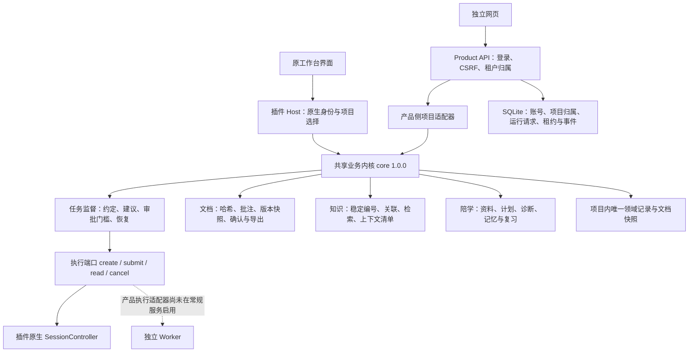

# 共享管家业务内核：设计与实施记录

适用：插件 1.24.1 开发树、独立产品原型；内核版本 1.0.0。实施日期：2026-11-14。

## 目标与取舍

把任务监督、交付约定、正式文档审阅、项目知识和陪学放在一份服务实现中。插件 Host 与独立产品 API 负责身份、传输和运行适配，业务层不依赖 Cordis、HTTP、租户会话或模型凭据。

本轮采用仓库内的模块化内核，而非新增网络微服务。这样可保留原插件的数据和安装方式，不必引入另一套数据库、部署或网络一致性机制。内核仍是 Node.js 服务，现阶段包含文件系统资料与快照适配，不是浏览器 SDK，也不是可直接移植到任意数据库的纯函数库。

## 已实现的结构



18 个业务模块的唯一源码位于 `dsh-workbench/core/`。插件原位置只保留两行兼容导出，既有引用、测试和 Host 路由不必更换。`packages/manager-core/index.mjs` 是独立产品的仓库内公共入口，引用同一份源码，不复制文件、不生成另一份业务实现。

源码放在插件包内是有意的：插件已有独立安装与 Docker 打包流程；`npm pack` 包含 `core/` 后，插件安装到仓库以外仍可运行。无需让已发布插件反向依赖仓库中的 `packages/`。第三方运行依赖继续由插件的 package.json / package-lock.json 锁定；本轮没有增加依赖。独立产品运行前需要安装 `dsh-workbench` 的生产依赖。

| 服务 | 唯一实现 | 两端共用的规则 |
| --- | --- | --- |
| 任务 | `core/manager.js` | 交付约定、建议与执行分离、请求去重、修订号、阶段确认、待核对与恢复 |
| 文档 | `core/artifacts.js`、`reviews.js`、`document-policy.js`、交付模块 | 当前字节哈希、未解决评论门槛、不可变快照、确认失效、交付版本选择 |
| 知识 | `core/knowledge.js` | FR/NFR/AC/ADR/TASK/TC/EV、引用关系、缺口、搜索、来源版本与字符预算 |
| 陪学 | `core/learning*.js` | 显式资料选择、凭据与路径排除、计划、六步教学、可纠正观察、记忆、复习、自评门槛 |
| 默认阶段状态 | `core/project-state.js` | 同一套 version 3 默认值与实现检查项，不再在产品 API 另写默认状态 |

`createProjectServices(ports)` 返回任务、文档、知识与陪学服务。插件与产品适配器都从该工厂获得服务。内核依赖检查禁止导入父目录的 Host 实现。

## 状态归属与兼容

领域事实继续存储于目标业务项目内，既有路径和结构均保留：

- 阶段状态：`.dsh/workbench/boards/<boardId>.json`，需求导航目录为 `.dsh/workbench/boards.json`；
- 管家约定、对话、任务、学习进度与近期学习记录：`.dsh/workbench/changes/<boardId>/manager.json`；
- 正式文档、确认清单、批注与知识：同轮的 `documents/`、`artifacts.json`、`reviews.json`、`knowledge.json`；
- 已确认版本、学习归档与上下文：沿用原来的快照与历史目录。

产品 API 从已鉴权项目行的 `board_id` 取得轮次；未绑定时使用服务端生成的 `project.id`。工作区固定为配置根目录下该 project.id 的目录。浏览器不能通过提交 root、boardId、sessionId 来改变绑定。已有插件项目需要管理员先放入授权工作区，并在数据库中绑定正确 board_id；本轮没有增加自动导入、复制或重写历史记录的动作。

SQLite 的 `operations`、outbox、Worker 租约与模型预算属于运行层；它们不是第二套开发阶段确认状态。既有模拟/只读消息链路继续作为单独的验证通道，不会被自动升级为五阶段管家，也不把模型回复转换为阶段确认。新增共享 manager API 才管理上述领域任务；两类任务目前没有自动双向迁移或关联。

`core/board-records.js` 统一保存阶段记录与需求导航投影，`boardSummary` 也只有一份。独立 API 创建的轮次可以直接被原插件的目录及阶段读取函数识别，无需再建一份空白需求。API 每次读写及监督执行前均重检服务端项目/轮次绑定；绑定改变时拒绝继续旧任务。工作区必须在插件保护目录之外。

单文档的版本确认与整阶段确认含义不同：原成果 API 继续记录用户对一份不可变版本的确认，但调用共享版本/哈希规则；整阶段确认还必须通过共享内核的前序阶段、所需文档、实现清单与批注检查。单文件确认不会悄悄推进阶段。

产品适配器对同一项目进行串行读写，旧 revision 返回冲突；新 API 实例可重读同一记录。当前仅支持一个运行进程拥有工作区写权限，**不支持插件 Host 与产品 API 同时写同一项目**，也没有分布式锁。共用代码和数据格式不代表跨进程写入已经安全；切换入口时先停止旧写入者，并备份整个项目数据。损坏或不兼容状态会拒绝读取，不会用空白记录覆盖。

## 独立产品 API

以下路径均位于 `/api/v1/projects/:id/`。每个接口先校验登录与 Origin，再校验项目属于当前租户；POST 还统一校验 `x-csrf-token`。跨租户一律返回 404，防止泄露项目存在性。

| 方法与后缀 | 共用服务 |
| --- | --- |
| GET `manager` | 约定、领域任务、正式文档进展、学习展示和内核版本 |
| POST `manager/actions` | 与插件相同的业务动作：配置、消息、建议执行、修订、阶段确认等 |
| GET / POST `knowledge` | 同一知识索引、搜索、修订号与更新校验 |
| GET `document-review?name=...` | 正式文档段落、版本、差异与评论 |
| POST `document-review/comments` | 新增、解决与重开评论 |
| GET `learning` | 当前计划、教学步骤、记忆设置和复习安排 |
| GET `learning/sources` | 可供选择的项目文本资料 |
| POST `learning/context` | 按 paths 显式选择、脱敏并截取本轮资料，不调用模型 |
| POST `learning/actions` | 与插件相同的陪学动作，拒绝非陪学动作 |

动作示例（身份 cookie 与 CSRF 从正常登录流程取得，不要把真实令牌写进文档）：

```json
{"action":"configure","requestId":"request-example-001","revision":0,"mode":"requirements","goal":"为虚构小店整理预约需求"}
```

先读取当前 manager.revision，再提交动作。并发变更得到 409 时刷新并核对；不要直接重写文件或编造新的确认。重试同一动作保留 requestId，沿用插件既有去重语义；同一 requestId 不应用于不同意图。

## 运行端口与能力边界

插件继续注入已有 SessionController 适配器、项目锁、阶段读写、注册表、Word 生成和 ZIP 函数；监督器与原生权限流程不变。移动执行保护代码后，保护目录仍按插件根目录推导，单独安装和仓库安装都继续拒绝业务 Agent 操作插件本体。

产品侧 `createApp({..., managerRuntime})` 可由可信运行层注入：

- `adapter`：完整的 create、submit、read、cancel 方法；
- `generateWord`：需求 Markdown 转正式 Word；
- `zip`：文档与 ZIP 学习资料打包；Markdown / HTML 学习导出不依赖 ZIP 端口。

运行层负责启动 `app.managerCore.restore()` 和周期 `tick()`，退出时 `dispose()`。本轮测试使用内存夹具注入，未把测试适配器接入真实服务；常规 server.mjs 不提供该运行适配器，也不启动共享任务监督循环。完整阶段执行必须先接通并验证真实 Worker、文档生成与权限回传，不能只把能力标记改成 true。

缺少执行适配器时任务动作返回冲突且不创建任务；缺少阶段文档生成或导出端口时明确拒绝相关动作。知识、资料选择、学习设置和已有记录查看无需模型。原独立网页仍保留现有布局；新共享知识/陪学 API 已可供页面接入，但**完整陪学前端和五阶段产品交互尚未在本轮新增**。

本轮未调用模型，未解除之前真实测试预算的冻结或调整任何凭据。现有 8091 运行实例未重启；重启加载新代码后才会出现新增接口，原预算/测试数据不应重置。

## 验证与维护

本轮增加 16 项回归（5 项内核/打包、11 组产品共享服务），原插件 203 项、协议/API/桥接/内核合计 117 项，合计 320 项通过。覆盖：

- 所有兼容入口与内核导出的函数/对象引用一致，阻止维护两份代码；
- npm pack 后从仓库外加载插件和内核，安装依赖从现有锁定依赖提供；
- 新增 POST 逐路由 CSRF、Origin、匿名与跨租户拒绝；
- 插件/API 读取同一约定、知识索引和需求目录，实际 Host 可读取 API 新建轮次；重试去重、旧 revision、并发串行与重开恢复；
- 任务监督器夹具执行与恢复不重复提交；
- 文档批注阻止确认、哈希冲突和源文件修改后旧确认失效；
- 教学计划经过共享监督器生成，未复述不得记录自评理解；
- 项目符号链接拒绝、学习资料显式选择与隐藏/越界文件拒绝；损坏文件保留、绑定变更停止旧任务、无效模式拒绝及运行能力变化后的请求重放。

测试没有调用真实模型；夹具回复和课程不代表真实教学质量或 Worker 联调通过。无界面变化，现有截图继续适用；同步主使用手册和离线 HTML。

```sh
# 仓库根目录，Node 24
node --test dsh-workbench/tests/*.test.mjs
node --test packages/manager-core/*.test.mjs packages/manager-contracts/test.mjs packages/manager-contracts/*.test.mjs services/product-api/tests/*.test.mjs services/worker-bridge/tests/*.test.mjs
cd dsh-workbench
npm run check
npm run docs:guide
```

后续修改业务规则必须改 `dsh-workbench/core/` 的唯一实现；不得把规则重新写回兼容入口、HTTP handler 或浏览器。新增运行适配器应针对同一业务服务跑一致性测试，明确区分运行请求、领域任务、文档版本确认与阶段确认。
