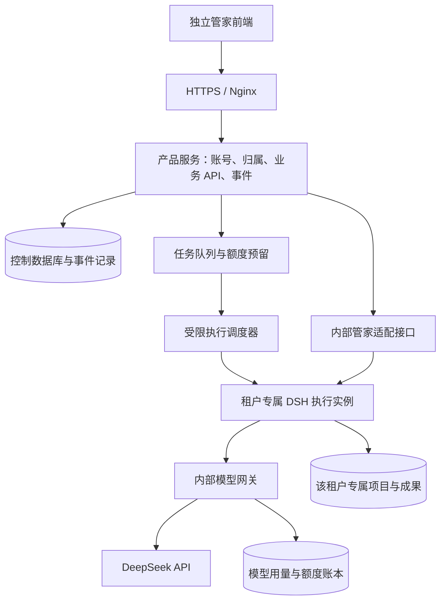

# 独立管家产品详细设计方案

状态：**待实施的设计方案，不代表已实现或已部署**。设计日期：2026-11-13。基线：`personal_manager` / 工作台 1.24.1 / DSH 0.2.1-rc.2。

产品名称暂用“项目管家”，品牌名可后续替换。本文确定第一版的产品范围、系统边界、接口契约与分批验收；具体依赖版本在实施前锁定。现有 DSH 插件继续可用，不在本次方案编写中改动运行代码、服务器、模型凭据或权限。

## 1. 目标与范围

用户打开你的网页，使用普通账号登录，即可创建项目、与一个管家沟通、审阅和下载成果，并学习项目原理。用户不需要安装 DSH、获取原生启动令牌或填写模型 API Key；界面不暴露 DSH 侧边栏、会话管理、模型设置、服务器文件路径及五个执行 Agent。

服务端保留 DSH 的执行能力。模型由运营者统一付费，通过独立模型网关使用服务专用 Key，而非将运营者的真实 Key 复制给每个执行环境。

第一版的边界：

| 纳入范围 | 暂不纳入 |
| --- | --- |
| 自有品牌前端、普通账号登录、邀请加入 | 开放匿名使用、公开自助注册 |
| 项目列表、对话、明确的下一步、进度和取消 | 默认无限额度、无限并发 |
| 文档阅读、评论、版本确认和下载 | 用户自己配置模型、任意安装插件 |
| 项目陪学、资料范围确认、计划与复习 | 以模型判断代替用户确认或真实测试 |
| 普通问答、权限审批在独立页面内完成 | 隐藏原生审批后自动批准工具权限 |
| 小规模可信用户的隔离试用 | 在当前共享 ECS 上面向陌生用户开放任意代码执行 |
| 管理员统一模型配置、额度与用量管理 | 首版支付、订阅收费、发票及团队协作 |

“看不到 DSH”指用户操作与产品界面独立，不等于关闭底层认证、删除必要开源声明，或宣称底层全部为自主开发。具体发行授权在对外发布前按实际依赖许可证核对。

## 2. 当前代码评估

以下为本仓库核对结果，并非对未来能力的假设。

| 现有能力 | 复用方式与必要调整 |
| --- | --- |
| `manager.js` 的交付约定、任务与恢复 | 复用业务状态机，增加可信身份上下文与统一执行入口 |
| `manager-message.js`、`manager-presentation.js` | 复用结构化回复校验、动作和展示投影，不执行模型输出中的任意动作 |
| `learning*.js` | 复用资料边界、陪学、观察、计划、记忆、复习与导出；归属校验覆盖全部学习数据 |
| `artifacts.js`、`reviews.js`、`delivery-*.js` | 保留确认快照、版本评论与交付语义，下载改为按成果 ID 授权 |
| `manager-adapter.js` | 目前只适配会话创建、发送、读取与取消；新增权限审批、用户追问、用量及执行归属适配需要先验证 |
| `client.js` | 当前在 DSH 模块加载与 UI 注入环境内运行，不能只换一个 HTML 就作为独立前端发布 |
| `index.js` 的 `/workbench/*` | 使用原生 DSH 认证；允许 `x-workbench-root` 指定现存目录，**不能原样公开给多用户** |
| `deploy/instance.py` | 每个实例独立 home/workspace 卷，可作为执行隔离起点；尚无产品账号、共享模型网关与运营额度 |

不通过 iframe 嵌入 DSH、CSS 隐藏侧边栏或向浏览器转发原生 Cookie 来实现独立产品。新增产品 API，仅公开所需业务能力。

## 3. 用户体验与信息架构

### 3.1 导航

桌面侧栏只保留“我的项目”和最近项目，帮助与账号放在底部。项目内部默认进入“和管家聊”，旁边可进入“我的成果”和“带我学习”。手机使用折叠项目导航和底部输入区，不展示开发工具式多层标签栏。

```text
项目管家                              项目名称 · 当前进度
我的项目          ┌────────────────────────────────────┐
  小店预约        │ 和管家聊    我的成果(3)    带我学习 │
  教务管理        │                                    │
                  │ 管家：先确定客人怎样选择预约时间。 │
                  │                                    │
                  │ 下一步：请你决定是否需要选择店员。 │
                  │ [需要] [暂时不需要] [我来说明]      │
帮助              │                                    │
账号与剩余额度    │ 直接说你的想法……             [发送]│
                  └────────────────────────────────────┘
```

这是交互线框，不是已实现界面的截图。顶部主操作控制在三个以内，其他功能按用途归入菜单；禁用入口继续提供具体启用条件。

### 3.2 首次与日常使用

1. 打开邀请链接，设置账号密码；首次使用前说明资料将发送给配置的模型服务及适用范围。邀请本身不包含模型密钥。
2. 首页用一句话介绍想做什么，或选择“了解一个已有项目”。项目名可选；仍需单独确认本次成果范围。
3. 与管家沟通；问题一次聚焦一件事。看懂安排后明确点击开始，不把普通聊天当作执行授权。
4. 页面展示“正在整理需求”“需要你决定”“成果待你阅读”等业务状态；技术阶段可在进度详情中解释。
5. 文档在独立阅读面板展示；打开、评论、确认版本、下载是不同动作。修改后受影响的确认继续失效。
6. 学习模式沿用选择资料、逐步讲解、提示、暂停、纠正观察和自评；开发完成不等于用户已学会。
7. 刷新或换设备后，从服务器恢复已接收的消息和任务；未发送草稿另行提示保存，不声称一定跨设备同步。

### 3.3 原生审批与用户追问

产品界面须承接两种不同交互：

- 业务问题：例如“第一版是否包含在线支付”，以普通问题卡呈现。
- 执行权限：例如“是否允许安装依赖或运行迁移”，以权限卡呈现，展示操作、范围、影响、允许/拒绝和过期时间；技术原文可展开查看。

权限卡必须对应真实待决的 DSH 请求。不能用普通聊天按钮冒充底层批准，也不能把按钮统一做成“继续”而隐去权限含义。拒绝后要显示影响与替代路径。审批结果由服务端提交到底层并核对确认，前端点击成功不等于执行已经获准。

## 4. 系统架构



### 4.1 组件职责

| 组件 | 职责 | 不允许承担的职责 |
| --- | --- | --- |
| 独立前端 | 普通账号体验、对话、审阅、陪学、任务展示 | 保存服务 Key，指定磁盘根目录，连接任意 DSH 会话 |
| 产品服务/BFF | 身份与归属校验、输入校验、业务映射、事件与下载授权 | 将浏览器请求原样代理到 DSH，挂载 Docker socket |
| 管家内部桥接接口 | 调用既有业务服务，投影结果与底层审批/追问 | 信任浏览器声明的用户身份，公开原生管理路由 |
| 调度器 | 启停预定义实例、绑定卷、资源与租约管理 | 接受前端传来的任意镜像、挂载路径、命令或容器参数 |
| DSH Worker | 执行自身租户的管家、阶段与学习任务 | 持有运营者真实模型 Key，访问其他租户或控制库 |
| 模型网关 | 校验内部调用、限额、固定上游、用量归集与流式转发 | 提供开放代理、转发用户提供的任意上游 URL |
| 管理端 | 邀请、停用、额度、任务故障、服务 Key 轮换 | 向普通用户开放模型设置，默认展示项目正文或密钥 |

推荐独立前端采用 React + TypeScript + Vite；产品 API 使用 Node.js + TypeScript，适配现有 Node 业务代码。首版控制数据库采用 SQLite WAL，在单机上使用数据库任务表和事务型 outbox，不先增加 Redis。多控制节点部署前迁移至 PostgreSQL 等适合并行节点的方案。这些是实施选型，不表示当前已有相应工程。

首版模型网关可与产品 API 同一进程、不同内部监听与路由，降低常驻内存；代码与权限边界分开，后续可独立部署。真实 Key 仅在该服务持有。管理功能同一前端构建、单独的管理员权限校验，不依靠隐藏菜单鉴权。

### 4.2 原生认证与内部桥接

保留现有 DSH 认证，不向普通用户发放原生启动链接。Worker 原生 Web 端口只在私网可达；新增内部桥接路由，使用独立的服务身份验证，不放宽原 `/workbench/*` 的 fence。

建议产品服务签发短期内部能力令牌，Worker 仅持公钥验证。声明包含 `aud`、`tenantId`、`workerId`、`projectId`、允许操作、`operationId`、租约代次、`jti`、`exp`。写请求绑定方法、目标和请求体摘要，记录重放编号；使用成熟签名库并固定算法，不手写签名协议。初始有效期建议不超过 60 秒，需验证时钟偏差、轮换与重试。

Worker 的可信身份与其卷绑定。即使请求携带合法项目 ID，也要校验该项目属于本实例；浏览器不能决定内部身份和能力令牌。普通产品账号 Cookie 与 DSH Cookie 完全分开。

## 5. 账号、租户与数据隔离

### 5.1 账号规则

第一版采用邀请制，一个普通账号对应一个个人租户，不做共享项目。允许一个租户后续增加成员的数据结构预留，不在第一版开放协作。

- 密码使用成熟的 Argon2id 实现和独立盐；不自定义加密方式。
- 服务端管理不透明登录会话；正式服务 Cookie 使用 `HttpOnly`、`Secure`、合适的 `SameSite`。
- 会话可撤销，账号停用后新请求和事件连接拒绝访问；长任务是否取消由管理员明确决定并记录。
- 写请求验证 CSRF 与 Origin，登录、邀请兑换和恢复入口限速。邀请令牌随机生成、摘要存储、有时限、单次兑换。
- 首版不接短信/邮件服务；密码遗忘由管理员签发一次性恢复流程，旧会话撤销。恢复凭据不写入日志或公开文档。

现有 IP HTTP 入口仅用于你本人的非敏感验证。普通用户账号与运营者统一 Key 的对外试用，应在 HTTPS 入口验收后开放，不能把当前 HTTP owner 实例直接改成共享产品。

### 5.2 归属链路

```text
登录会话 → user_id → tenant_id → project_id → 内部工作区标识
                                              → board_id / operation_id / artifact_id
```

每一次访问都要沿归属链校验：对话、历史、任务、SSE、审批、学习观察、记忆、练习副本、文件预览、下载、导出与删除均不能例外。前端只提交不透明 ID，不提交 `root`、`cwd`、`DSH_HOME` 或原生会话凭据。对无权访问的对象使用一致的不存在/无权限响应，避免可枚举泄漏。

BFF 必须丢弃外部请求中的 `x-workbench-root`、`x-workbench-board`、内部身份标头及原生 Cookie；内部项目映射由数据库生成。无法通过换项目 ID、下载 ID、事件游标、缓存键或学习归档路径访问他人数据。采用服务端租户上下文与逐对象鉴权，参考 [OWASP 多租户安全指南](https://cheatsheetseries.owasp.org/cheatsheets/Multi_Tenant_Security_Cheat_Sheet.html)。

### 5.3 执行与网络隔离

可信邀请试用阶段，每个租户使用独立 home、workspace、网络及实例身份；不复制 owner home。执行代码的 Worker 不挂载控制库、模型网关密钥、宿主 Docker socket、其他租户目录或宿主根目录。插件代码只读，业务 Agent 继续禁止修改插件本体与文档。

Docker 的命名空间和资源限制可作为隔离基础，但共享宿主内核与配置风险仍存在；不据此承诺陌生代码的强沙箱。[Docker 官方安全说明](https://docs.docker.com/engine/security/)

首版不向陌生人开放任意项目执行。面向不可信用户开放前，需要独立执行节点或更强的隔离运行时、受控出网和逃逸测试。Worker 出网策略应区分模型调用、依赖安装和用户代码；禁止访问云元数据及控制服务。模型只经网关访问固定上游，不能让工具绕过网关直接使用运营者 Key。

## 6. 控制数据与现有文件的关系

### 6.1 数据主权

控制数据库负责账号、归属、操作投递、调度、额度、审计和前端事件游标。既有项目 `.dsh/workbench` 继续负责交付约定、管家/学习历史、业务任务、文档快照和确认记录。DSH 保留自己的会话存储。

不在第一版同时把所有 JSON 业务状态搬进数据库，避免两套状态各自可写。数据库中的项目摘要、运行状态和成果列表是投影，需带 Worker 业务 revision 与更新时间；业务确认以 Worker 的不可变版本记录为准。

### 6.2 关键表

| 表 | 主要字段与约束 |
| --- | --- |
| users / tenants / memberships | 账号状态、密码摘要、个人租户和角色；首版仅一人一租户 |
| sessions / invites | 会话与邀请摘要、到期、撤销；不存明文令牌 |
| projects | tenant_id、项目名、内部 workspace_key、当前 board_id；组合外键约束归属 |
| operations | tenant_id、project_id、type、request_id、payload_hash、engine_request_id、engine_revision、state |
| operation_outbox | operation_id、待投递事件、投递次数、下次处理时间；与操作记录同事务写入 |
| workers / worker_leases | 租户、预定义实例、状态、租约代次、心跳、到期；限制活跃执行者 |
| interaction_requests | 项目、任务、真实底层请求 ID、question/permission、范围、状态、到期和回答者 |
| artifact_index | 成果 ID、租户、项目、内部相对路径、hash、版本、确认状态；只作索引 |
| quota_accounts / reservations | 租户与全站预算、预留、已用、未知用量；事务原子变更 |
| model_calls / usage_entries | 上游请求 ID、operation_id、tenant_id、模型、用量、价格版本、结算状态 |
| project_events / audit_events | 有序事件、类型、时间与必要审计元数据；不默认记录提示正文 |

`(tenant_id, project_id, request_id)` 唯一；同 request_id 不同 payload_hash 返回冲突。租户与项目复合约束覆盖操作、成果和事件，不只靠开发者记得写 WHERE 条件。所有 UTC 时间持久化；前端按用户时区展示。

### 6.3 文件布局

```text
control-data/                 # 仅产品服务可读写
  product.sqlite
  encrypted-backups/
tenant-volumes/<opaque-id>/    # 调度器管理，浏览器不知道宿主路径
  home/                       # DSH 会话、内部服务身份；无运营者真实 Key
  workspace/
    projects/<opaque-id>/
      .dsh/workbench/          # 沿用项目和轮次数据
      ...业务项目文件
```

关系库与项目文件不能假设存在跨进程原子事务。操作先入库/outbox，投递到 Worker 后用同一 engine_request_id 核对结果，再更新投影；写成功但响应丢失时查询恢复，不直接重复提交。

## 7. 产品 API 契约草案

以下为待实现的公开产品 API，不是当前 `/workbench/*` 已有路由。

| API | 行为与边界 |
| --- | --- |
| POST `/api/v1/auth/login`、`logout` | 创建/撤销产品会话；无 DSH 原生令牌 |
| POST `/api/v1/invitations/redeem` | 一次性邀请码兑换与账号创建 |
| GET `/api/v1/me` | 当前账号、可用额度、产品能力；不返回模型 Key |
| GET/POST `/api/v1/projects` | 本租户项目列表与创建 |
| GET `/api/v1/projects/:id` | 聚合对话、当前步骤、任务、成果与学习摘要 |
| POST `/api/v1/projects/:id/messages` | 保存用户消息并创建沟通操作 |
| POST `/api/v1/projects/:id/actions` | 接收允许的业务动作；校验 request_id、revision 与动作参数 |
| GET `/api/v1/projects/:id/events` | SSE，校验归属和游标，支持断线恢复 |
| GET `/api/v1/projects/:id/interactions` | 真实业务问题与权限请求的产品投影 |
| POST `/api/v1/projects/:id/interactions/:rid/respond` | 回答或允许/拒绝；绑定请求版本与目标操作 |
| POST `/api/v1/projects/:id/operations/:oid/cancel` | 请求停止，返回停止中；不谎称已经终止 |
| GET `/api/v1/projects/:id/artifacts/:aid` | 有权限的文档内容与版本信息 |
| POST `/api/v1/projects/:id/artifacts/:aid/confirm` | 明确确认精确版本与 hash；冲突时重新审阅 |
| GET `/api/v1/projects/:id/artifacts/:aid/download` | 鉴权后流式下载，不接受任意路径 |
| POST `/api/v1/projects/:id/imports` | 受限导入，先暂存与确认，不自动执行 |
| GET/PATCH `/api/v1/admin/...` | 管理员的邀请、状态、额度、任务与供应商设置；逐路由校验角色 |

第一版学习操作可通过严格的 actions 白名单承接，后续按需要拆分资源型 API。前端不直接提交原生会话 ID、preset 名、提示词、模型上游、命令或工具参数；这些由服务端选定。

动作请求示例：

```json
{
  "requestId": "opaque-client-request-id",
  "expectedRevision": 42,
  "action": "start_proposed_work",
  "proposalId": "opaque-proposal-id"
}
```

写请求持久化接收后返回 `202` 与 operationId；`202` 只表示已接收。重复请求返回原操作。用户输入错误返回可行动提示；身份/权限、版本冲突、限额、服务不可用分别使用稳定错误码，不把原始栈、内网地址和上游认证错误原样展示。

### 7.1 事件与回复展示

SSE 事件信封包含 `id`、`projectId`、`type`、`operationId`、`revision`、`at`、`payload`。类型至少包括：消息完成、问题待答、审批待决、任务状态、成果版本、额度变化、恢复核对、服务状态。

每个项目事件序列持久化。Last-Event-ID 仅对该项目有效；游标过期则返回完整快照和新游标。断线重连不重新发起任务。一个 Worker 状态采集器服务多个浏览器，不为每个浏览器独立轮询 DSH。

第一版优先做任务状态流和完成后的结构化消息，不承诺逐 token 展示。完整 JSON 校验后才展示可操作的下一步卡片；不能从半段模型输出中提取并执行动作。

## 8. 调度、幂等与恢复

```text
已接收 → 等待额度/资源 → 正在执行 → 等待回答或审批
                                → 已完成 / 失败 / 需要核对
正在执行 → 请求停止 → 停止中 → 确认停止 / 需要核对
```

执行完成、文档待审阅和用户确认是不同维度，不能用一个 completed 状态概括。模型调用结束不等于代码测试通过；文件齐全不等于用户已确认。

首版全站 Agent 执行并发为 1，单项目写入串行；资源允许后再调整。排队按租户公平轮转，限制每人待办数，不允许一个人无限占队。每个业务操作可包含多次模型请求，全部归入同一 operationId。

队列必须覆盖普通沟通、陪学、阶段任务及后台总结，不能只限制“制作”按钮。Worker 的 manager.tick、直接原生入口和旧恢复注册表均须遵守执行许可；对外 Worker 不开放绕过产品服务的原生入口。

关键恢复规则：

- 数据库已接收但未发送：outbox 可重试投递，同 engine_request_id 不创建第二份任务。
- 已发送但确认丢失：进入“需要核对”，先查原会话/业务记录，不能盲目重放有副作用请求。
- Worker 心跳丢失：租约过期后阻止新模型请求；新租约有递增代次，拒绝旧执行者回写。
- 等待审批：任务仍可恢复，不停止 Worker 来腾位置；到期按拒绝/取消策略处理，不自动批准。
- 浏览器关闭：服务器继续按授权运行；重连恢复事件与状态。
- 用户取消：中断模型和工具的请求不保证立即终止或撤销已写文件；观察到底层结束后才显示停止。
- 账号停用：禁止新请求，撤销会话；进行中的高风险任务由管理员取消，等待确认后再回收资源。

## 9. 统一模型网关与费用控制

### 9.1 密钥与调用归属

真实供应商 Key 只在模型网关的受保护配置/密钥存储中，由管理员设置和轮换。前端包、公开环境变量、接口响应、Worker 环境、项目文件、日志和导出包都不能包含它。不要复制本机 DSH home 或当前 owner 的 Key 到其他租户。

Worker 只持有内部受限凭据，绑定自身租户、租约、允许模型和预算。网关自行设置上游 Authorization、固定目标域名和允许路径，拒绝浏览器或 Worker 提供任意 URL、额外认证头、模型或 user_id 来绕过策略。

任务归属必须可验证：内部 operationId → 已获准的 Worker/租约 → 模型请求 → 用量记录。当前 SessionController 适配层尚未实现这一链路，必须在 P0 验证模型 provider 接入和归属传播。不能仅凭时间、提示文本或用户昵称猜测归属。若只能做到 Worker 级归属，第一版必须强制单 Worker 同时仅有一个业务操作，禁止后台模型请求旁路；验证不能成立时，不开放统一付费试用。

DeepSeek 当前采用 Bearer Auth；并发限制按账号计算，不因多建 Key 而独立。官方还支持 `user_id` 的用户区分与部分隔离；网关可使用服务端生成的匿名稳定 ID，并覆盖外部传入值。该字段不能替代本产品的权限、存储和执行隔离，不包含邮箱或其他个人信息。[认证文档](https://api-docs.deepseek.com/api/deepseek-api/)、[限流与 user_id 说明](https://api-docs.deepseek.com/quick_start/rate_limit/)。不在本方案固化供应商并发数字与价格，实施时核对并版本化配置。

### 9.2 调用过程

1. 产品服务接受操作，在事务中检查租户额度与全站额度，建立预算预留。
2. 调度器授予执行租约，网关确认有效 operationId 和 Worker 身份后接收模型请求。
3. 单次请求设置输入大小、输出 token、超时、模型和重试上限；多 Agent 操作共享总预算上限。
4. 网关向固定上游发送请求并转发流；记录上游请求 ID 和模型用量，不默认记录提示正文。
5. 响应提供可信 usage 时按实际用量结算、释放剩余预留；缓存 token 等字段按对应版本计费。
6. 断流、超时、取消或缺 usage 时记为“待核对”，保留合理预留，不将未知消费算作零。
7. 额度不足时拒绝后续模型调用并保存已产出内容，用户仍可阅读和下载原成果。

### 9.3 额度设计

至少支持每用户每日/每月、单次操作和全站周期预算，以及待排队数和并发数。金额使用整数最小计价单位，token 使用整数；记录币种、价格生效时间与模型价格版本。原子地同时检查租户和全站预算，避免并发穿透。

预留不是精确账单，用户界面区分“可用”“处理中预留”“已结算”“待核对”。平台账本用于服务控制，最终消耗仍需与供应商账户核对。重复日志和回调通过唯一调用 ID 去重；一次重试若上游确实产生新调用，单独计入，不能按同一业务 requestId 抹掉真实费用。

运营者可暂停模型服务、停用账号、降低额度和轮换 Key。默认不提供“无限使用”；初始额度由实际试用数据决定，本方案不虚构每个项目的固定成本。

## 10. 导入、预览和交付

已有本地项目不能用云服务器的目录选择器直接打开。独立产品提供上传与导入流程：先暂存、显示清单与排除项、用户确认范围，再建立项目；导入不自动安装依赖或执行代码。

- 第一批优先支持既有管理员导入项目及文本/Word 资料；第二批再增加受限项目 ZIP 导入。
- ZIP 校验规范化路径、绝对路径、穿越、符号/硬链接、特殊文件、文件数、总解压量、压缩比与嵌套归档；解压在专用暂存区，失败不留下半成品项目。
- 默认排除 `.env`、密钥、凭据、生产数据、依赖缓存等。排除规则与敏感格式检查是辅助，不能宣称能识别所有秘密。
- 首版不接收任意 Git/下载 URL，避免额外的凭据管理与 SSRF 面；后续按明确支持的仓库源增加。
- 文档与学习资料继续支持已实现的格式和真实边界。缺素材保留提示，PDF 的复杂版式转换能力如实说明。
- 文档 HTML 做净化；任意项目运行预览在隔离域名/沙箱中，不与产品账号 Cookie 同源。第一版可先交付静态截图与下载，不承诺任意网站在线预览。
- 下载按成果 ID 校验归属与精确版本，服务端解析真实路径，抵御路径跳转与符号链接；不把宿主路径交给浏览器。

## 11. 原生能力前置验证（P0）

在独立前端大规模开发前，先用当前 DSH 固定版本完成以下技术验证，并形成可重复脚本和兼容性记录。

| 验证项 | 通过条件 | 未通过时处理 |
| --- | --- | --- |
| 内部业务桥接 | 不关闭原生 fence，也不向浏览器传递 DSH 凭据；身份/归属/重放检查通过 | 不发布多用户 API |
| 权限审批与用户追问 | 列出待决请求、产品内回答/拒绝、过期/重复/重启恢复均能映射真实请求 | 补适配或底层扩展；不得自动批准或让用户跳去 DSH |
| 模型网关 | DSH 模型 provider 能走网关，流式、取消、错误、usage 行为可解释 | 不承诺统一 Key 已接通 |
| 操作归属 | 沟通、陪学、阶段、总结和恢复的调用都绑定可信租约/operationId | 限制能力并修复，禁止混算用户消费 |
| 硬边界 | Worker 不能读取控制库、真实 Key、其他租户卷或直接绕过网关消费 | 不邀请用户 |
| 主状态恢复 | 重启与响应丢失不重复创建原任务，文档确认 hash 不被静默改变 | 保留原插件路径，不迁移真实工作 |

这些接口中，现有 create/prompt/read/cancel 已有适配基础，审批和用量桥接尚待验证。不能把方法名草案当作 DSH 已提供的稳定 API。

## 12. 三批实现与验收

### 第一批：自用独立产品闭环

前置：P0 全部所需能力验证；只接入你自己的账号与专属实例，不开放多人入口。

实现：独立前端工程、账号登录、项目导航、管家对话与下一步、真实审批/追问卡、成果评论/确认/下载、项目陪学、恢复与帮助。增加 BFF 与内部桥接最小实现；接入统一模型网关基础和操作归属，Key 仅在管理侧设置。

验收：从新建项目到确认需求文档、进入后续阶段、下载成果、进行陪学，全程不进入 DSH 页面；断线/重启后恢复；拒绝权限确实阻止对应操作；客户端构建和网络响应无运营者 Key、原生令牌、宿主路径。先用模拟模型验证交互，再经明确授权做有预算上限的真实模型小任务。

必须同步：独立产品使用手册章节、受影响真实截图、离线 HTML、兼容性记录。未实现的导入/运行预览入口不展示为可用。

### 第二批：可信邀请用户与受控消费

实现：邀请与停用、租户归属、每租户专属卷/实例身份、统一队列、额度预留与结算、匿名供应商 user_id、受限项目导入与隔离下载。移除任何共享 owner 工作区的临时接法。

验收：至少两个虚构账号互换项目/成果/事件/学习 ID，均不可越权；并发请求不能突破额度；一个租户失败或取消不改另一个的数据；Worker 不持真实 Key；管理员停用即时生效。HTTP 原生 owner 入口不能当作产品公开入口，HTTPS 与账号登录验收后才邀请小规模可信用户。

资源门槛：当前 ECS 不预先承诺同时运行第二个 Worker；先测单 Worker 加产品服务的峰值，再决定升级或增加执行机。资源门槛未通过，第二批停留本地验证，不伪装已支持多人服务。

### 第三批：运营、恢复与正式发布准备

实现：管理端邀请/用量/额度/任务视图、服务 Key 轮换、成本告警与全站熔断、排队解释、审计、备份恢复、升级回滚和数据生命周期管理。日志默认元数据化，查看用户正文须明确管理动作并留痕。

验收：演练模型 429/5xx/断流、未知 usage、磁盘不足、Worker 丢失、队列重启、备份恢复和 Key 轮换。停用账号不会误删其成果。通过真实用户的小规模试用检验可理解性；陌生用户执行另设更强隔离发布门槛。

## 13. 部署与资源路线

按最近核对的 2 核 2GB、同机两个已有应用的条件设计；这不是新的容量实测结论。

1. 本地开发与构建；服务器不承担前端打包、镜像编译和大项目依赖构建。
2. 自用阶段保留现有 owner 持久卷，额外增加一个轻量产品服务和静态前端，继续只允许本人访问；上线前重新核对内存、磁盘和旧服务。
3. 初始执行并发为 1。空闲实例可在确认没有任务、审批和未决提交后停止；每租户使用自己的卷，禁止把仍运行的实例改挂另一租户数据来省内存。
4. 按测得的宿主/旧服务基线、控制服务峰值、Worker 峰值和余量估算容量；不能把容器内存上限或空闲状态当作峰值测量。容量不足时扩容或把执行服务放到独立服务器。
5. 域名 HTTPS 入口就绪后发布独立前端；Nginx 仅向公网暴露产品路由，内部 Worker、模型网关、调度器和管理控制端口不公开。
6. 当前 8083 仅保留为管理员临时验证入口；产品切换验收后关闭或保留受限维护路径，不给普通用户提供 DSH 原生链接。

不在本方案自动修改域名、安全组、服务器规格、服务 Key 或现有端口。具体实施部署另做变更清单与验收。

## 14. 迁移、备份与回滚

- 先备份控制数据库（含 WAL 的一致性备份方式）、owner home、workspace 与配置，分别记录校验值。备份包含会话和凭据，权限受限并加密离机存储。
- 迁移脚本先 dry-run，识别既有项目/轮次、文档、确认快照与学习记录，报告不支持或不完整项，不修改源目录。
- owner 的旧项目只导入 owner 账号，原 business/board ID 可以保留为内部引用，公开 ID 使用新映射。其他用户获得空白独立 home，绝不克隆 owner 会话和凭据。
- 使用明确的来源版本与 file hash 核对导入；学习引用失效时提示资料已变化，不伪造新行号或自动宣称知识已更新。
- 灰度期间每个项目只允许一个写入口，禁止同时从旧插件和独立产品创建并行写入。
- 回滚首先停止新写入与新调度，保留未决任务信息；数据库和项目文件按同一备份点恢复。只切换旧镜像不能撤销数据迁移。
- 日常删除默认软删除；正式删除、备份保留和用户导出规则在运营发布前明确，不暗中清理学习记录或交付历史。

## 15. 工程拆分建议

```text
apps/manager-web/                 # 自有产品前端
services/product-api/             # 登录、归属、业务 API、事件、队列
services/model-gateway/           # 可先同进程运行的独立模块
services/worker-supervisor/       # 受限实例调度；不置于公网 BFF 权限内
packages/manager-contracts/       # 产品 DTO、动作/错误码、事件协议
packages/manager-ui/              # 从 client.js 渐进抽取的展示与交互组件
packages/dsh-manager-client/      # 内部桥接客户端与版本能力协商
dsh-workbench/                   # 原插件与业务逻辑继续保留
```

路径为建议，当前尚未创建上述服务。抽取 UI 时通过 adapter 注入数据、操作、下载和事件，避免组件直接依赖 DSH store、全局对象或原生会话跳转。原插件可复用同一套组件，减少两套界面长期漂移。

内部协议返回 `protocolVersion` 与 capabilities；产品前端按能力显示入口，缺少审批等核心能力时阻止相关执行，而非在点击后才跳到 DSH。固定 DSH 兼容版本并验证升级，不能把 rc 版本接口假设为永久稳定。

## 16. 测试矩阵与发布条件

| 维度 | 必须覆盖的例子 |
| --- | --- |
| 产品旅程 | 零基础新用户、已有项目、逐步问答、文档修改/确认、陪学与导出 |
| 权限 | 未登录、停用账号、越权项目/成果/游标、伪造目录/内部身份、CSRF |
| 审批 | 拒绝、过期、重复回答、错任务绑定、重启恢复、真实批准未确认 |
| 费用 | 并发预留、全站预算、多次内部调用、缺 usage、重试、取消、计价版本 |
| 调度 | 仅一执行者、不同租户公平排队、租约过期、旧代次回写、提交结果未知 |
| 导入 | Zip Slip、符号链接、压缩炸弹、敏感文件、失败暂存与磁盘耗尽 |
| 内容 | Markdown/XSS、HTML 预览隔离、引用/快照 hash、未确认成果不可冒充交付 |
| 运维 | 进程/网关/Worker 重启、备份恢复、密钥轮换、原站点端口与资源保留 |
| 界面 | 桌面、390px 窄屏、键盘、按钮启用提示、长回复、事件断线与草稿 |

自动测试、模拟模型和协议检查分别记录；不能由其中一种推断真人易用性或真实任务成功。公开邀请前必须完成：HTTPS、租户隔离、真实审批桥接、统一 Key 无泄漏、预算硬限制、恢复与容量门槛。没有通过的项目明确列入发布阻断项。

## 17. 设计决策与待实施确认

已推荐的默认决策：独立前端 + BFF + 内部桥接；DSH 留在内部；邀请制个人租户；真实 Key 仅模型网关持有；小规模单执行队列；原 JSON 业务状态渐进复用；每批同步使用手册。

实施前需确认但不阻碍本设计交付的产品参数：品牌名、首批邀请人数、每人初始额度、项目导入大小/类型、备份保留时长、超时策略。工程前置待验证：原生审批/追问 API、模型 provider 与 usage 兼容性、业务操作归属、服务器峰值容量。未确认参数不写成已完成能力，不以默认值授权真实消费。

建议下一步先完成 P0 兼容性验证和第一批工程骨架；P0 结果决定完整执行闭环是否可以进入 UI 集成，避免先做外观再发现必须跳回 DSH。

## 18. 依据与核对

- 仓库：`client.js` 管家组件与 DSH 加载依赖；`index.js` 原生认证与目录选择；`manager.js` 状态机；`manager-adapter.js` 会话边界；`learning*.js` 学习能力；`deploy/instance.py` 独立卷与资源限制。
- [DeepSeek API 认证](https://api-docs.deepseek.com/api/deepseek-api/)，核对日期 2026-11-13：模型接口使用 Bearer Auth。
- [DeepSeek Rate Limit & Isolation](https://api-docs.deepseek.com/quick_start/rate_limit/)，核对日期 2026-11-13：账号级并发、user_id 区分与限制；本方案不引用易变化的固定额度。
- [Docker Engine security](https://docs.docker.com/engine/security/)，核对日期 2026-11-13：命名空间、资源限制与 daemon 攻击面；隔离方案是本项目设计决策。
- [OWASP Multi-Tenant Security](https://cheatsheetseries.owasp.org/cheatsheets/Multi_Tenant_Security_Cheat_Sheet.html)，核对日期 2026-11-13：租户上下文、逐对象授权、缓存和异步任务隔离。

方案编写未调用模型执行项目任务，未修改服务凭据，未部署新服务。现有 203 项插件测试不代表本方案中的新服务已经实现或通过测试。
