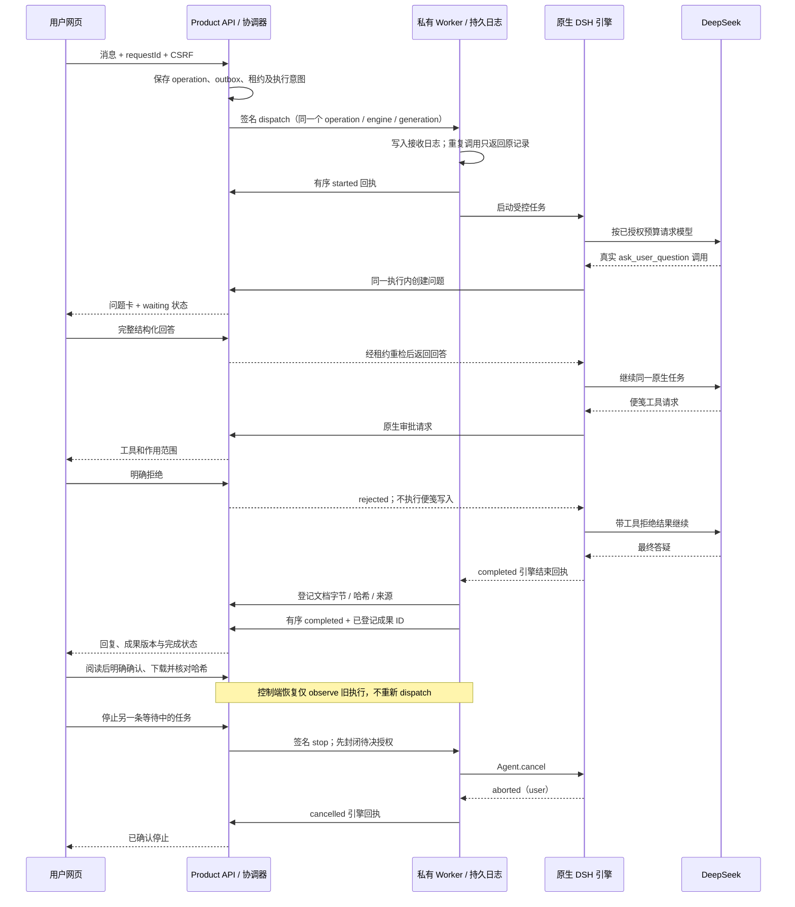

# 统一 Worker v1：协议、运行链与真实模型验证

实施日期：2026-11-14；适用插件 1.24.1 开发树、独立产品原型；产品控制库 schema 7。

## 已连接的操作链



协议实现位于 `packages/manager-contracts/worker.mjs`；产品侧为 `worker-executions.mjs`、`worker-transport.mjs`；Worker 侧为 `lib/runner.mjs`、`lib/server.mjs` 和既有原生审批/提问桥接。协议随 Worker 打包，脱离仓库仍可导入；契约生成文件必须同步。

## 标识、状态与一致性

每条执行绑定：`workerId / tenantId / projectId / operationId / leaseId / generation / engineId / payloadHash`。任务文本摘要由 Worker 重新计算，协议拒绝未知字段、路径形状的 ID 和不兼容版本；浏览器不能提交 Worker 地址、工作区根目录、模型凭据或原生引擎 ID。

控制端在外部派发之前保存 `worker_executions`。Worker 在创建引擎之前保存日志；相同身份的重复 dispatch 返回已有记录，身份或摘要变化直接拒绝。两个并发 dispatch 也串行处理，不能在首次日志写入前创建两次引擎。

| 执行状态 | 含义 |
| --- | --- |
| dispatching | 意图已保存，尚待 Worker 接收/开始回执 |
| running | 正在执行或恢复后的同一引擎继续处理 |
| waiting | 同一执行存在待回答问题或待决工具权限 |
| stopping | 停止意图已保存；不是引擎已经停止 |
| completed / cancelled / failed | 有相应引擎结束原因的终态 |
| uncertain | 结果待核对，禁止自动重发并占住该 Worker |

浏览器的运行请求状态与共享管家的业务阶段确认仍是不同概念：`completed` 不代表阶段已被用户确认，也不证明代码或测试正确。v1 协调器目前消费 `send_message` outbox；它没有自动把共享管家的所有阶段任务迁入队列，也没有自动启用完整陪学前端。

事件具有唯一 eventId、连续 sequence 和内容摘要。相同事件重放无副作用，摘要不同、序号跳跃、旧租约或旧代次拒绝；成功终态只能引用本次执行已经登记的成果。登记会读取实际字节、核对哈希并保存不可变版本，提交索引前再次检查租约及停止状态。

问题与审批使用稳定 requestKey 去重，并检查所属租户和项目。回答问题不等于批准工具；记录成功回执也不等于用户确认成果。控制端与 Worker 都不会自动批准 DSH 工具。

## 观察、租约与恢复

- 初始租约 60 秒；Worker 默认每 15 秒发心跳，在有效租约内延长至最多本次执行截止时间（协调器默认 5 分钟）。失效租约不能被心跳复活。
- 控制端重新启动或丢失 dispatch 回执后，只观察同一个 engineId。Worker 仍有该引擎且租约有效时，可接回原问题和日志；不会重新调用模型。
- Worker 自身重启后，未结束日志若没有对应活引擎，返回 uncertain，不会重新创建进程。已保存的终态日志可供原控制端核对。
- 租约已经失效、观察不到原引擎或缺少可信回执时保留待核对。运行结果不明不会通过删除记录、重发或批准权限来“修复”。
- 明确拒绝租约的回调或达到执行截止时间时，Worker 请求取消当前引擎；仅取消请求不是取消回执。强进程隔离仍需运行环境提供，协议租约本身不是操作系统沙箱。
- 控制端的业务状态与项目数据按单控制进程写入设计；本轮未实现分布式调度选主和多个控制节点共同写入。

## 停止的三种结果

1. 尚未派发：删除 outbox，返回 notDispatched=true；不会声称收到引擎停止回执。
2. 已经运行：持久化 stopping，撤掉待决授权，再调用 Worker stop。只有原生结束原因为 aborted 才确认 cancelled。
3. 请求超时、与成功结束冲突或没有对应引擎回执：进入 uncertain。不能仅凭 HTTP 200、发出 cancel 或撤销租约声称已经停止。

## 私有传输与接口

控制端到 Worker 使用每 Worker 专属 HMAC，audience 为 manager-worker；回调到产品 API 使用 product-api。令牌绑定完整路径、方法、请求体、身份、代次和短有效期；控制 nonce 持久化，拒绝重放。Worker RPC 只允许管理员配置的 HTTPS 地址或本机 HTTP，不接受浏览器提供的地址。Worker 默认只监听回环地址，跨机器需要独立 HTTPS 入口。

| 方向 | 接口 |
| --- | --- |
| 控制端 → Worker | POST `/worker/v1/handshake`、`dispatch`、`observe`、`stop` |
| Worker → API | POST `/internal/v1/executions/:operationId/events` |
| 原生互动 → API | POST `/internal/v1/interactions`，读取 answer，必要时 cancel |
| Worker → API | POST `/internal/v1/projects/:id/artifacts` |
| 用户 → API | GET `/api/v1/projects/:id/operations/:oid/execution` |
| 用户 → API | POST `/api/v1/projects/:id/operations/:oid/recover`（只观察原执行） |
| 用户 → API | 原有 messages、interactions/respond、actions/cancel_operation、artifacts/confirm/download |

所有用户写请求均复用登录、Origin 与 CSRF 保护；先查租户项目归属。私有回调继续核对 Worker、有效租约、操作和 generation。新增 schema 7 表保存执行、事件、互动去重键和执行成果关联；保留原项目、文档和历史互动，迁移可重复执行。

## 启用方式与运行适配器

默认仍关闭。控制端需 Node 24，使用现有 worker-admin.mjs 注册专属身份，然后显式配置：

```sh
PRODUCT_API_WORKER_PROTOCOL=1 \
PRODUCT_API_WORKER_ID=wrk_example \
PRODUCT_API_WORKER_URL=http://127.0.0.1:8094 \
PRODUCT_API_DB=./control-data/product.sqlite \
node server.mjs
```

同时开启模拟模式会拒绝启动。只有配置的 Worker 完成身份、协议版本和能力握手后才公布桥接能力，不因填写 URL 就宣称可用。

独立 Worker 入口：`node services/worker-bridge/worker.mjs --config /绝对路径/worker.json`。配置文件及专属密钥文件必须仅所有者可读，示意配置：

```json
{
  "workerId": "wrk_example",
  "tenantId": "ten_example",
  "productApiUrl": "http://127.0.0.1:8089",
  "host": "127.0.0.1",
  "port": 8094,
  "secretFile": "/受控目录/worker.secret",
  "directory": "/受控目录/worker-journal",
  "engineModule": "/绝对路径/管理员审核过的运行适配器.mjs"
}
```

engineModule 是可信后端代码，不能由用户网页或模型决定。它导出 createRuntime(config)，返回 execute({job,client,onControl}) 与可选 close()。执行端必须提供 cancel 控制句柄，并返回实际引擎的 status、reason.kind、text 与可选成果 relativePath/sha256/source；失败或停止不明应返回 uncertain。Worker 日志/密钥目录必须在业务 Agent 可修改范围之外。仅有该示意配置并不能生成一个通用代码执行器。

本轮提供了真实可复现的受限 DSH 适配与探针 `probes/run-unified-worker.mjs`：只暴露 ask_user_question 和固定便笺工具，不提供模型控制的路径、shell、网络或任意文件编辑。常规 server 没有自动加载此付费测试适配器，用户需显式批准预算。原模拟、只读验证实例继续保留，互不改造为生产 Worker。

## 验证结果

真实 DeepSeek / 原生 DSH / 双 HTTP 服务通过两条操作链，均为虚构项目：

| 案例 | 验证结果 | 模型请求 |
| --- | --- | --- |
| 完整链 | 派发、真实结构化提问、拒绝不完整回答、控制端重连不重执行、真实工具审批拒绝、便笺未写入、模型总结、成果登记、确认及下载哈希一致、重复 dispatch 不再调用模型 | 3 次，全部 HTTP 200 |
| 原生停止 | 真实模型提出问题后由产品 API 请求停止，原生 Agent 返回 aborted(user)，撤销待决卡，操作为 cancelled | 1 次，HTTP 200 |

共 4 次请求，模型 deepseek-flash；9,153 token（输入、缓存输入与输出均计入），没有未结算新请求。此前已用 14,671 和待核对预占 17,432 保留不变；合计已用 23,824、预占 17,432，共 41,256 / 200,000。原 200,000 总额下剩余 158,744，不代表本轮自动可以继续使用：本轮新授权最多 50,000 / 8 请求，验证结束后已暂停派发。

真实证据保存在忽略目录 `control-data/authorized-20261114-worker-v1/` 的授权、预算数据库、原生日志、Worker 日志与 unified-worker-report.json。旧授权目录只读核对，未修改旧预算、凭据或释放预占。后续验证必须同时结转两份账本，不能只读取旧账本的剩余值。

[DeepSeek 官方 Anthropic 兼容说明](https://api-docs.deepseek.com/guides/anthropic_api/)作为请求格式依据；真实证据由响应中的模型、用量及工具调用记录核对。没有把夹具工具调用替代为模型选择，也没有自动允许工具。

验证仍有明确范围：未测试“允许一次”后的真实工具写入、任意代码编辑、模型生成过程中停止、跨机断网与 Worker 进程被杀后的真实续接、陌生用户强隔离或生产计费。当前的恢复实测为控制端重建后接回仍在运行的原生任务；Worker 冷启动未知状态只做离线失败保护验证。

本机历史查看页为 `http://localhost:8093/`，不再派发新模型请求。原 8091 的旧预算冻结状态保持不变。

## 回归与维护

本轮新增 12 项离线测试：3 项协议契约、9 组双 HTTP 集成；覆盖签名拒绝与重放、序号/摘要冲突、租户与 CSRF、完整互动成果链、控制端恢复、Worker 冷重启不重执行、租约到期、真实回执要求及排队取消。独立打包测试新增检查 runner/server 和内置 Worker 契约，旧库迁移检查 schema 7 及旧记录保留。

```sh
node --test packages/manager-core/*.test.mjs packages/manager-contracts/test.mjs packages/manager-contracts/*.test.mjs services/product-api/tests/*.test.mjs services/worker-bridge/tests/*.test.mjs
node --test dsh-workbench/tests/*.test.mjs
node services/worker-bridge/scripts/sync-contracts.mjs --check
# 只跑夹具，无付费请求；真实模式必须另有明确授权，禁止重复运行旧授权目录
node services/product-api/probes/run-unified-worker.mjs --fixture
```

主使用手册、离线 HTML 与两张真实界面截图同批更新；未经后续授权不推送、部署或解除模型暂停。
